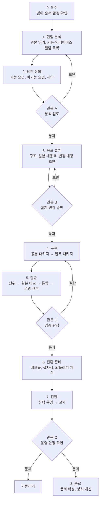

# 서비스 전환 절차

기존 서비스를 다른 언어로 옮길 때 따르는 절차다. NCC-VBR 전환에서 만들었고, 다음 전환 프로젝트에 그대로 쓴다.

## 1. 원칙

1. **원본 소스가 요건이다.** 개발 문서가 없는 서비스는 원본 소스를 읽어 요건을 되살린다. 추정한 내용은 추정이라고 적는다.
2. **동작은 그대로, 구조는 새로.** 입력·출력·파일 형식·통신 전문처럼 밖에서 보이는 동작은 원본을 따른다. 코드 구조는 새 언어의 표준 구조를 따른다.
3. **다르게 만든 것은 모두 적는다.** 원본의 결함을 고쳤거나 동작을 바꿨으면 변경 대장에 원본 동작, 전환본 동작, 이유를 적는다. 적지 않은 변경은 없어야 한다.
4. **판정에는 증거가 있어야 한다.** "통과"라고 쓰려면 실행한 명령과 출력이 있어야 한다. 실행하지 않은 것은 "미실행"이라고 쓴다.
5. **원본은 고치지 않는다.** 원본 폴더는 분석과 비교 시험의 기준으로 보존한다.
6. **작은 서비스부터.** 서로 독립된 서비스는 단순한 것부터 전환해 공통 부분과 절차를 먼저 다듬는다.

## 2. 전체 흐름

## 3. 단계별 내용

각 단계는 "하는 일, 산출물, 통과 기준"으로 정의한다. 산출물의 양식 번호는 `templates/`의 파일 번호다.

### 0단계. 착수

| 항목 | 내용 |
|---|---|
| 하는 일 | 전환 대상과 순서를 정한다. 원본 소스·빌드 스크립트·설정 파일의 위치를 확인한다. 개발·시험 환경에서 쓸 수 있는 도구를 확인한다. 원본을 호출하는 쪽과 원본이 호출하는 쪽을 파악한다 |
| 산출물 | 진행 현황판(`00-process/03-progress.md`)의 대상·순서·환경 절 |
| 통과 기준 | 대상 서비스마다 원본 파일 목록과 줄 수, 빌드 방법, 실행 방법이 적혀 있다 |

### 1단계. 현행(As-Is) 분석

| 항목 | 내용 |
|---|---|
| 하는 일 | 원본 소스를 처음부터 끝까지 읽는다. 기능, 처리 흐름, 입력·출력, 설정 항목, 파일, 통신, 외부 명령, 운영체제 의존, 오류 처리, 결함을 목록으로 만든다. 원본의 줄 번호를 근거로 단다 |
| 산출물 | T02 현행 분석서, T05 인터페이스 명세(현행), T04 변경·결함 대장의 결함 부분 |
| 통과 기준 | 원본의 모든 함수가 기능 목록의 어느 항목에 속하는지 적혀 있다. 읽지 않은 부분이 있으면 범위와 이유가 적혀 있다 |

분석에서 반드시 확인하는 항목은 T02 양식의 점검표에 있다.

### 2단계. 요건 정의

| 항목 | 내용 |
|---|---|
| 하는 일 | 현행 분석에서 기능 요건을 뽑는다. 전환 목적에서 비기능 요건(운영체제, 성능, 운영 방식)을 정한다. 유지할 것과 바꿀 것의 경계를 정한다 |
| 산출물 | T01 요건 정의서 |
| 통과 기준 | 요건마다 번호, 근거(원본 위치 또는 사용자 지시), 검증 방법이 있다 |

### 관문 A. 분석 검토

분석서와 요건 정의서를 사용자가 확인한다. 원본 작성자만 아는 사실(운영 환경, 호출 방식, 사용하지 않는 기능)을 이때 보충한다. 확인되지 않은 항목은 `04-open-decisions.md`에 남기고, 그 항목에 걸리지 않는 작업은 계속한다.

### 3단계. 목표(To-Be) 설계

| 항목 | 내용 |
|---|---|
| 하는 일 | 새 구조를 정한다. 원본 함수와 새 코드의 대응표를 만든다. 원본의 결함과 운영체제 의존을 어떻게 처리할지 항목마다 정한다(유지, 수정, 대체, 삭제) |
| 산출물 | T03 목표 설계서, T04 변경·결함 대장(처리 방침 포함), T05 인터페이스 명세(목표) |
| 통과 기준 | 원본 기능 목록의 모든 항목이 새 구조의 어디로 가는지 적혀 있다. 대응이 없는 항목은 "삭제(사유)"로 적혀 있다 |

### 관문 B. 설계·변경 승인

변경 대장에서 동작이 달라지는 항목을 사용자가 승인한다. 원본 결함을 그대로 둘지 고칠지는 사용자가 정한다. 승인 전에는 원본 동작에 가장 가깝고 자료 손실 위험이 작은 쪽으로 구현하고 "결정 대기"로 표시한다.

### 4단계. 구현

| 항목 | 내용 |
|---|---|
| 하는 일 | 공통 패키지(설정, 로그, 기동)를 먼저 만들고 업무 패키지를 만든다. 원본과 같은 순서로 한 기능씩 옮기고, 기능마다 단위 시험을 함께 쓴다 |
| 산출물 | 소스, 단위 시험, 빌드 스크립트 |
| 통과 기준 | 대상 운영체제 모두에서 빌드와 정적 검사가 오류 없이 끝난다 |

### 5단계. 검증

검증 수준과 실행 방법은 [02-verification-procedure.md](02-verification-procedure.md)에 있다.

| 항목 | 내용 |
|---|---|
| 하는 일 | 단위 시험, 원본 비교 시험, 통합 시험, 운영 규모 시험을 순서대로 실행한다. 출력을 `evidence/`에 저장한다 |
| 산출물 | T06 시험 계획과 결과, T09 추적표, 증거 파일 |
| 통과 기준 | 요건마다 연결된 시험이 있고 결과가 적혀 있다. 실행하지 못한 시험은 사유와 재개 조건이 적혀 있다 |

### 관문 C. 검증 판정

판정은 세 가지 중 하나다. 표현의 뜻은 검증 절차 문서 5장에 있다.

- 개발 검증 통과: 개발 환경에서 실행한 시험이 모두 통과했다.
- 운영 전환 가능: 실제 환경과 운영 규모 시험까지 통과했다.
- 보류: 실패가 있거나 필수 시험을 실행하지 못했다.

### 6단계. 전환 준비

| 항목 | 내용 |
|---|---|
| 하는 일 | 배포물을 만든다. 설치·교체·되돌리기 절차를 쓴다. 운영자가 알아야 할 달라진 점을 정리한다 |
| 산출물 | T07 전환 계획과 운영 안내 |
| 통과 기준 | 시험 환경에서 절차서대로 설치와 되돌리기를 한 번씩 실행했다 |

### 7단계. 전환

| 항목 | 내용 |
|---|---|
| 하는 일 | 병행 운영(원본과 전환본을 같은 입력으로 실행해 결과 비교) 후 교체한다 |
| 산출물 | 병행 운영 기록, 교체 기록 |
| 통과 기준 | 정한 기간의 병행 운영에서 결과가 일치한다. 차이가 있으면 변경 대장에 있는 항목으로 설명된다 |

### 관문 D. 운영 안정 확인

교체 후 정한 기간 동안 오류 로그와 처리 건수를 확인한다. 문제가 있으면 T07의 되돌리기 절차를 따른다.

### 8단계. 종료

문서를 확정하고, 이번에 양식에서 부족했던 점을 `templates/`에 반영한다.

## 4. 산출물 목록

| 번호 | 산출물 | 양식 | 만드는 단계 | 고치는 단계 |
|---|---|---|---|---|
| 1 | 진행 현황판 | 없음(`03-progress.md` 형식 사용) | 0 | 모든 단계 |
| 2 | 현행 분석서 | T02 | 1 | 관문 A |
| 3 | 인터페이스 명세 | T05 | 1 | 3 |
| 4 | 요건 정의서 | T01 | 2 | 관문 A |
| 5 | 목표 설계서 | T03 | 3 | 4 |
| 6 | 변경·결함 대장 | T04 | 1(결함) | 3, 4, 5 |
| 7 | 결정 대기 목록 | 없음(`04-open-decisions.md` 형식 사용) | 1 | 모든 관문 |
| 8 | 소스·단위 시험·빌드 스크립트 | 표준 구조(`common/02`) | 4 | 5 |
| 9 | 시험 계획과 결과 | T06 | 3(계획) | 5(결과) |
| 10 | 추적표 | T09 | 2 | 5 |
| 11 | 증거 파일 | 없음(실행 출력 그대로) | 5 | - |
| 12 | 전환 계획과 운영 안내 | T07 | 6 | 7 |
| 13 | 위험·사전 확인 사항 | T08 | 1 | 필요할 때 |
| 14 | 서비스별 전환 계획 | T10 | 규모가 큰 서비스의 1단계 뒤 | 필요할 때 |

규모가 작은 서비스는 T08과 T10을 생략하고 위험을 요건 정의서의 제약 절에 적는다. 이번 프로젝트에서 cifs와 remove가 그렇게 했다.

## 5. 식별자 규칙

문서 사이의 연결은 식별자로 한다. 형식은 `종류-서비스-번호`다.

| 종류 | 뜻 | 예 | 정의하는 문서 |
|---|---|---|---|
| REQ | 요건 | REQ-CIFS-03 | 요건 정의서 |
| F | 원본 기능 | F-CIFS-05 | 현행 분석서 |
| IF | 인터페이스 | IF-CIFS-02 | 인터페이스 명세 |
| D | 원본 결함·특이 동작 | D-CIFS-01 | 변경·결함 대장 |
| C | 원본 대비 변경 | C-CIFS-01 | 변경·결함 대장 |
| T | 시험 | T-CIFS-U03 (U 단위, P 원본 비교, I 통합, L 운영 규모) | 시험 계획과 결과 |
| Q | 결정 대기 | Q-03 | 결정 대기 목록 |
| R | 위험 | R-AGENT-02 | 위험 대장 |

## 6. 역할

| 역할 | 하는 일 |
|---|---|
| 사용자(업무·운영 책임자) | 범위와 순서 결정, 관문 승인, 동작 변경 승인, 실제 환경 시험과 전환 실행 |
| 전환 수행자(이번에는 Claude) | 분석, 문서 작성, 설계, 구현, 개발 환경 검증, 결정 대기 항목 보고 |
| 검토자 | 구현하지 않은 쪽이 변경 대장과 추적표를 원본과 대조한다. 한 사람이 구현과 최종 판정을 함께 하지 않는다 |

## 7. 새 프로젝트에서 시작하는 방법

1. `docs/templates/`와 `docs/00-process/`를 새 프로젝트에 복사한다.
2. `03-progress.md`의 대상·순서·환경 절을 채운다(0단계).
3. 서비스마다 폴더를 만들고 T02부터 순서대로 작성한다.
4. `common/02-tobe-standard-structure.md`의 폴더 구조와 `internal/boot`, `internal/config`, `internal/logx` 패키지를 그대로 가져가 시작한다.
