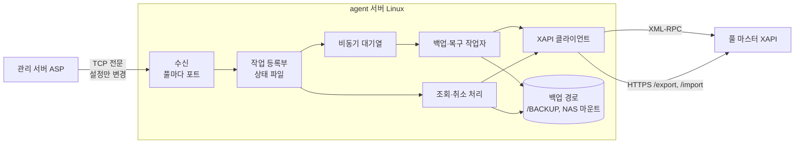

# agent 재구성 검토서 (agentless, 백업·복구 중심)

기준일: 2026-11-17 / 상태: **확정**(2026-11-17 사용자 답변 반영, 10장). 구현과 개발 검증을 마쳤다([06-test-report.md](06-test-report.md)).
관련: [02-risk-and-prerequisites.md](02-risk-and-prerequisites.md), [03-conversion-plan.md](03-conversion-plan.md), [05-interface-spec.md](05-interface-spec.md), [08-copied-code-register.md](08-copied-code-register.md)

이 문서는 원본 agent를 "그대로 옮기는" 전환에서 "필요한 기능만 다시 구성하는" 전환으로 방향을 바꾼 결정과 그 검토 결과다. 다른 서비스를 전환할 때도 범위를 줄이는 결정은 이 문서의 모양(결정 → 기능별 유지·삭제 → 원본 동작 대응 → 가져올 코드 → 남은 결정)으로 남긴다.

## 1. 사용자 결정 (2026-11-17)

| 번호 | 결정 | 이전 상태 |
|---|---|---|
| DEC-AG-01 | agent를 dom0가 아니라 별도 Linux 서버에서 원격으로 실행한다(agentless). cifs·remove와 같은 방식 | Q-A09 권장은 dom0 유지였다 |
| DEC-AG-02 | dom0 상태 감시 등 관리 기능은 삭제하고 백업·복구에 필요한 기능만 다시 구성한다 | 원본 전체 전환 |
| DEC-AG-03 | 관리 서버(ASP)의 설정은 바꿀 수 있다(접속 주소·포트) | 확인 필요였다 |
| DEC-AG-04 | 동기 명령(`S`)은 지원하지 않는다 | Q-A06 |
| DEC-AG-05 | 백업 경로는 지금과 같다(agent 서버에 같은 경로로 마운트) | 확인 필요였다 |
| DEC-AG-06 | 원격 실행으로 늘어나는 백업 시간은 agentless의 특징으로 설명한다. 성능은 판정 조건이 아니라 측정·보고 항목이다 | 확인 필요였다 |
| DEC-AG-07 | XAPI를 쓴다. ncc-xen 코드는 import로 참조하지 않고 **복사해서 고친다**. 무엇을 바꿨는지 문서에 정리한다 | Q-A01, Q-A10 |

DEC-AG-07의 기록 방법은 [08-copied-code-register.md](08-copied-code-register.md)와 양식 [T11](../templates/T11-copied-code-register.md)로 정했다.

## 2. 기능별 유지·삭제

원본 1.602의 기능 전체를 놓고 정했다. "결정 대기"는 9장의 질문에 걸린다.

| 기능 | 원본 위치 | 판정 | 근거·전환본의 동작 |
|---|---|---|---|
| TCP 수신, 전문 틀(길이 7 + `B` + 번호 17 + T + 3 + P) | 592~873 | **유지** | 관리 서버는 설정만 바뀐다(DEC-AG-03). 전문은 그대로 |
| 비동기 접수 응답 `OK` | 1124~1144 | **유지** | 현재 소스와 운영 로그대로 코드 `0` |
| `A` `BACKUP` | 3784~3981 | **유지(핵심)** | 4장 |
| `A` `PARTIAL` | 3811, 3983~4115 | **유지(핵심)** | 4장 |
| `A` `RESTORE` | 4118~4185 | **유지(핵심)** | 4장 |
| `Q` 결과 조회 | 관리 작업자 | **유지** | 비동기 결과를 받는 유일한 길이다 |
| `C` 취소(단건, 일괄) | 2862~3100 부근 | **유지** | 단건은 해당 작업의 XAPI task를 취소한다(원본의 `ps \| grep vm-export \| kill -9` 전체 종료 대신). 일괄은 원본처럼 대기 작업만 |
| `S` 동기 명령 | 3485~3600 부근, `dummy_call`, `dummy2.c` | **삭제** | DEC-AG-04. 요청이 오면 9장 Q-A11의 응답을 돌려준다 |
| `T` 작업자 수 조정 | 3129~3371 | **삭제** | 작업자 수는 설정 파일 값으로 정한다. 요청이 오면 Q-A11 응답 |
| `I` `INFO` | 1857 | **유지** | 백업 대상 VM 고르기에 필요한 풀·호스트·VM 목록 |
| `I` `SR-INFO` | 2120 | **유지** | 복구할 SR 고르기 |
| `I` `LUN-INFO` | 2261 | **유지** | 부분 백업할 디스크 고르기(`vdi_position` = userdevice) |
| `I` `DIR-INFO` | 2377 | **유지** | 복구할 백업 파일 고르기. 경로는 agent 서버 기준(DEC-AG-05) |
| `I` `TASK` | 1667 | 결정 대기(Q-A12). 권장 유지 | 작업 등록부를 그대로 보여 주는 것이라 구현 부담이 작다 |
| `I` `STATUS` | 1692 | 결정 대기(Q-A12). 권장 축소 | 관리 서버가 agent 생존 확인에 쓰면 모양은 유지하고 값만 바꾼다. `xen_server` = XAPI 접속 결과, `storage_cloud` = 백업 경로 확인, dom0 CPU·디스크·메모리 = `NO DEFINE`. 쓰지 않으면 삭제 |
| `I` `XS-INFO`, `VM-INFO` | 2468, 2565 | 결정 대기(Q-A12). 권장 삭제 | 호스트·VM 관리 정보다. 백업·복구 화면이 쓰면 유지 |
| `I` `RES-VM-INFO` | 2725 | 결정 대기(Q-A12). 권장 삭제 | "agent가 떠 있는 호스트"의 VM이라 원격 실행에서는 뜻이 없다. 유지하면 수신 포트를 호스트마다 둬야 한다(Q-A16) |
| `I` `EVENT-INFO`, 포털 이벤트 송신 | 2820, 4437~4664 | **삭제** | 이벤트는 상태 감시에서만 생긴다(920, 1006, 1029행). 감시가 없어지면 생길 이벤트가 없다 |
| 상태 감시(XenServer, CPU, 메모리, 디스크, 스토리지 마운트, CPU 상한) | 875~1045 | **삭제** | DEC-AG-02 |
| 스토리지 장애 때 내보내기·가져오기 일괄 취소 | 2862~2912 | **삭제** | 감시가 없어진다. 백업 경로에 쓰기가 실패하면 그 작업만 실패로 끝난다 |
| XVA 검증 | 3966~3975, 4763~5275 | 결정 대기(Q-A13) | 1.602(2026-01-08)에서 추가됐는데 운영 로그 결과 문장은 검증 전 문장이다(R-AG-21) |
| 공유 메모리 작업 상태와 재기동 복구 | 392~425, 564~586 | **대체** | 작업 상태 파일. 재기동 때 처리 중이던 작업을 원본처럼 취소(6)로 표시 |
| 시작 때 포트 점유 프로세스 종료, 이름으로 중복 실행 확인 | `bs_common.c` 101~139 | **대체** | 잠금 파일. 포트를 쓰고 있으면 오류로 끝낸다(Q-A05 권장대로) |
| 로그: `server.log`, `transaction` | `bs_common` | **유지** | 형식 유지. `ASYNC RESULT send error` 기록 포함 |
| 로그: 백업 단계 로그(`BACKUP_LOG`), 복구 로그(`IMPORT_LOG`) | 3869~3948, 4168~4178 | **유지** | 단계 기호(S, P, R, E, D, I)와 문장 유지 |
| 메시지 큐 7개, 송신 스레드 3개, `dummy2` | 전역 | **삭제** | 프로세스 안의 대기열로 대체 |

정리: 원본 요청 17종(`S`, `A` 3종, `Q`, `C`, `T`, `I` 10종) 가운데 **유지 9종**(`A` 3종, `Q`, `C`, `INFO`, `SR-INFO`, `LUN-INFO`, `DIR-INFO`), **결정 대기 5종**, **삭제 3종**(`S`, `T`, `EVENT-INFO`)이다.

## 3. 목표 구조



| 항목 | 원본 | 전환본 |
|---|---|---|
| 실행 위치 | 호스트마다 dom0 | agent 서버 한 대(여러 풀) |
| 수신 | 호스트마다 포트 하나 | 풀마다 포트 하나(설정으로 포트 ↔ 풀). 관리 서버의 같은 풀 호스트들은 같은 포트를 가리킨다. `RES-VM-INFO`를 유지하면 호스트마다(Q-A16) |
| XenServer 호출 | `xe` 명령(dom0 root) | XAPI(풀 마스터 주소, 계정). 마스터가 바뀌면 ncc-xen 방식으로 따라간다 |
| 자료 흐름 | dom0 → NAS | 풀 마스터 → HTTPS → agent 서버 → NAS |
| 외부 라이브러리 | - | 없음(표준 라이브러리만). ncc-xen의 zstd와 SSH는 가져오지 않는다 |
| 운영체제 | dom0(CentOS 계열) | Linux 우선. 운영체제 호출을 쓰지 않으므로 Windows 빌드도 된다(Q-A08 재검토, 시험은 Linux만) |

## 4. 백업·복구: 원본 단계와 전환본 대응

원본은 2026-11-17에 3784~4213행을 전체 읽고 적었다.

### 4.1 백업(`BACKUP`)과 부분 백업(`PARTIAL`)

| 순서 | 원본 동작 | 원본 행 | 실패 때 원본 | 전환본(XAPI) | 가져올 코드 |
|---|---|---|---|---|---|
| 1 | 본문을 공백으로 나눈다. `BACKUP vm-uuid 스냅샷이름 파일이름`, `PARTIAL vm-uuid 디스크15자리 스냅샷이름 파일이름` | 3806~3821 | `[ERROR]VBR COMMAND is not valid.` | 같다. 공백이 든 이름은 원본도 나뉘므로 같은 규칙 | - |
| 2 | vm-uuid 36자, 스냅샷 이름·파일 이름 1자 이상, 디스크 자리 15자 | 3823~3849 | `[ERROR]VM UUID is not valid.` 등 4종 | 같다. 파일 이름은 백업 루트 안인지 추가 확인(Q-A15) | ncc-xen `vm_backup_util.go` 경로 검사 |
| 3 | 스냅샷 생성. 이름은 받은 그대로 | 3864~3882 | `[ERROR]` + `xe` 출력, 단계 로그 S | `VM.snapshot(vm, 이름)`. VM이 꺼져 있어도 원본처럼 항상 스냅샷을 만든다 | ncc-xen `mixins/vm.go` `Snapshot`. ncc-xen은 켜진 VM만 스냅샷을 만들고 이름을 자기 형식으로 짓는다 → 수정 |
| 4 | 스냅샷을 템플릿이 아닌 VM으로 바꾼다(`is-a-template=false ha-always-run=false`) | 3892~3907 | `[ERROR]` + 출력, 스냅샷 정리, 단계 로그 P | `VM.set_is_a_template(false)`, `VM.set_ha_always_run(false)` | 새로 작성. ncc-xen은 복구 뒤에 고친다(복구 쪽은 4.2 참고) |
| 5 | 부분 백업이면 스냅샷 디스크 중 자리 값이 `0`인 userdevice의 VBD를 `other-config:owner=false`로 하고 VDI를 지운다 | 3910~3922, 3983~4115 | `[ERROR]Partial VM BACKUP (Remove VDI/VBD) failed.`, 스냅샷 정리, 단계 로그 R | 스냅샷의 VBD 목록 → userdevice → 자리 값 `0`이면 `VBD.remove_from_other_config(owner)`, `VDI.destroy` | 새로 작성(ncc-xen XVA 경로에 없음). 원본은 userdevice가 15 이상이면 배열 밖에 쓴다(D 후보) → 전환본은 범위 검사 |
| 6 | 같은 이름의 파일을 지운다(`rm -f 파일`) | 3926~3927 | 검사 없음 | `os.Remove`(없으면 무시). 셸을 쓰지 않는다 | - |
| 7 | 내보내기(`vm-export … compress=true`). 출력이 `Export succeeded`로 시작해야 성공 | 3934~3950 | `[ERROR]` + 출력, 스냅샷 정리, 단계 로그 E | HTTPS `/export?uuid=스냅샷&use_compression=true` → 파일. 권한 0666(원본 `chmod`) | ncc-xen `vm_backup_export.go`. `.partial` 뒤 이름 바꾸기, zstd, sha256, 진행률 보고, 게이트웨이 송신 → 4.3 |
| 8 | 스냅샷 삭제(`vm-uninstall force=true`, 디스크 포함). 출력이 `Error:`로 시작하면 실패 | 4187~4213 | `[ERROR]Remove Snapshot VM remove internal failed. Snapshot uuid=…` | 스냅샷의 VBD가 가리키는 VDI를 지운 뒤 `VM.destroy` | ncc-xen은 `VM.destroy`만 한다 → 디스크가 남을 수 있다(R-AG-22). 수정 |
| 9 | 결과 문장 `VM BACKUP Success : VM uuid=…, Snapshot VM uuid=…, backup filename=…` + 줄바꿈 | 3963 | - | 같은 문장(줄바꿈 포함) | - |
| 10 | XVA 검증. 성공하면 결과 문장을 `XVA file check Success : backup filename=…`로 **덮어쓴다** | 3966~3975 | `[ERROR]XVA file = … is not valid.` | Q-A13 결정에 따른다 | ncc-xen `vm_backup_verify.go` 또는 원본 `validate_xva` |

원본에서 실패 때 결과 코드를 `9`로 바꾸지 않는 경로가 있다. 1·2단계 실패는 `task_type`을 그대로 두고 `FALSE`만 돌려준다(3818~3848). 상위의 비동기 작업자가 `FALSE`면 `9`로 바꾸는지(3716~3724행 부근)는 A1에서 확인한다.

### 4.2 복구(`RESTORE`)

| 순서 | 원본 동작 | 원본 행 | 실패 때 원본 | 전환본(XAPI) | 가져올 코드 |
|---|---|---|---|---|---|
| 1 | `RESTORE 파일이름 preserve sr-uuid`. 파일 이름 1자 이상, sr-uuid 36자, preserve는 `true`/`false`로 시작 | 4132~4150 | `[ERROR]File Name is not valid.` 등 3종 | 같다. 파일 이름은 백업 루트 안(Q-A15) | - |
| 2 | 가져오기(`vm-import filename=… sr-uuid=… preserve=…`). 출력이 정확히 36자(VM uuid)여야 성공 | 4154~4179 | `[ERROR]` + 출력, 복구 로그 I | HTTPS `/import?sr_id=…&restore=preserve`로 파일을 올리고 task 결과에서 VM uuid를 얻는다 | ncc-xen `vm_backup_restore.go`. 파라미터 이름이 "실기검증 전"(R-AG-23), zstd 자동 판별 제거, 복구 뒤 `is_a_template` 고치기는 유지 |
| 3 | 결과 문장 = 새 VM uuid만 | 4177 | - | 같다 | - |

원본은 XVA 안에 VM이 여럿이면(가져오기 결과가 uuid 여러 개) 36자가 아니어서 실패로 처리한다. 전환본도 VM 하나만 성공으로 본다(같은 동작).

### 4.3 ncc-xen 내보내기·가져오기를 그대로 쓰면 생기는 문제

| 번호 | ncc-xen 동작 | 원본(vbr) 동작 | 그대로 쓰면 | 처리 |
|---|---|---|---|---|
| NX-01 | 켜진 VM만 임시 스냅샷, 꺼진 VM은 바로 내보내기 | 항상 받은 이름으로 스냅샷 | 결과 문장의 `Snapshot VM uuid`가 없다. 관리 서버가 쓰는 스냅샷 이름이 무시된다 | 원본 방식으로 고친다 |
| NX-02 | 임시 스냅샷을 `VM.destroy`로 정리 | `vm-uninstall force=true`(디스크까지) | 스냅샷 디스크가 SR에 남을 수 있다 | VDI 삭제를 더한다. 시험 풀에서 확인 |
| NX-03 | `.partial` 파일에 쓰고 끝나면 이름을 바꾼다 | 최종 이름으로 바로 쓴다 | 쓰는 동안 `DIR-INFO`에 보이는 이름이 다르다 | 유지(중간 파일이 복구 목록에 보이지 않는 편이 안전하다). 변경 대장에 적는다 |
| NX-04 | zstd 재압축 선택 기능, 가져올 때 zstd 자동 판별 | 없음(XVA gzip) | 외부 라이브러리(`klauspost/compress`)가 들어온다 | 뺀다 |
| NX-05 | 진행률·결과를 게이트웨이(Redis 기반)로 보낸다 | 결과는 전문, 진행 상태는 `Q`의 코드 3 | 관리 서버가 모른다 | 작업 등록부로 바꾼다 |
| NX-06 | 요청·설정 구조(`Request`, `BackupSettings`, `PoolSessionRegistry`)에 묶여 있다 | - | 그대로 컴파일되지 않는다 | 필요한 값만 받는 함수로 고친다 |
| NX-07 | 메시지가 i18n 키, 로그가 `stdlogger` | 원본 영어 문장, `server.log` 형식 | 결과 문장과 로그가 원본과 다르다 | 원본 문장으로 바꾸고 `logx`를 쓴다 |
| NX-08 | 복구 파라미터(`sr_id`, `restore`, `force`) 이름이 실기검증 전 | - | 복구가 실패하거나 preserve가 반영되지 않을 수 있다 | 시험 풀에서 확인(A7 전 우선 시험) |
| NX-09 | 백업 파일 경로를 허용 루트 안으로 제한 | 제한 없음(`rm -f` 대상도 제한 없음) | - | 가져온다(Q-A15) |

## 5. ncc-xen 코드 복사 기준 (DEC-AG-07)

1. **import로 참조하지 않는다.** ncc-vbr의 `go.mod`에 ncc-xen 모듈을 넣지 않는다. 필요한 파일을 `go/internal/xapi/` 등 ncc-vbr 안으로 복사한다.
2. **복사한 파일의 머리 주석**에 출처를 적는다.
   ```go
   // 출처: ncc-xen backend/pkg/xapi/client.go (커밋 043c6d5, 2026-11-17 복사)
   // 바뀐 부분: docs/agent/08-copied-code-register.md CP-03
   ```
3. **복사 대장**([08-copied-code-register.md](08-copied-code-register.md))에 파일마다 원본 경로·커밋·복사일·대상 경로와, 지운 것·고친 것·더한 것을 이유와 함께 적는다. 함수 단위로 적는다.
4. **복사한 그대로의 첫 판**을 먼저 넣고, 고친 것은 그다음에 넣는다. Git 등록(사용자가 따로 진행) 뒤에는 두 판의 차이가 대장 내용과 같아야 한다. Git 전에는 대장이 유일한 기록이다.
5. **외부 라이브러리를 들여오지 않는다.** 들여와야 하는 코드(zstd, SSH, Redis, gin)는 복사하지 않는다.
6. ncc-xen에서 나중에 결함이 고쳐져도 자동으로 따라오지 않는다. 대장의 원본 커밋을 기준으로 ncc-xen 변경 이력을 주기적으로 비교한다(전환 뒤 운영 절차, `07` 문서에 둔다).

복사 후보(검토 결과)

| 후보 | ncc-xen 경로 | 줄 수 | 쓰는 곳 | 바꿔야 하는 것 |
|---|---|---|---|---|
| XML-RPC | `backend/pkg/xapi/xmlrpc.go` | 537 | 모든 XAPI 호출 | 거의 없음(표준 라이브러리만) |
| XAPI 클라이언트 | `backend/pkg/xapi/client.go` | 460 | 로그인, 호출, 마스터 전환 | `stdlogger` → `logx` |
| VM 호출 | `backend/pkg/xapi/mixins/vm.go`의 일부 | 1,816 중 일부 | 스냅샷, 삭제, 조회, task | i18n 제거, 필요한 함수만 |
| task 호출 | `backend/pkg/xapi/mixins/task.go` | 84 | 진행 확인, 취소 | i18n 제거 |
| SR·호스트·풀 조회 | `mixins/sr.go`, `host.go`, `pool.go`의 일부 | 일부 | `INFO`, `SR-INFO`, `LUN-INFO` | i18n 제거, 필요한 함수만 |
| 내보내기 | `backend/internal/job/vm_backup_export.go` | 432 | 백업 7단계 | NX-01~07 |
| 가져오기 | `backend/internal/job/vm_backup_restore.go` | 435 | 복구 2단계 | NX-04~08 |
| XVA 검증 | `backend/internal/job/vm_backup_verify.go` | 248 | 백업 10단계(Q-A13) | zstd 제거, 판정 기준을 원본과 대조 |
| 경로 검사 | `backend/internal/job/vm_backup_util.go` | 122 | 파일 이름 검사 | 설정 구조 대신 백업 루트 목록 |

가져오지 않는 것: `gateway`, `redissource`, `analysis`, `hostssh`(동기 명령·dom0 감시가 없어져 SSH가 필요 없다), `stdcrypto`(Q-A14 결정 뒤 다시 본다), OVF 관련 파일.

## 6. 앞선 결정·위험에 미치는 영향

| 항목 | 영향 |
|---|---|
| Q-A01 XAPI | 확정(DEC-AG-07) |
| Q-A04 공유 메모리 | 공유 메모리를 읽을 다른 프로그램이 dom0에 있어도 원격 agent와는 상관이 없다. 상태 파일로 확정 권장 |
| Q-A05 포트 점유 프로세스 종료 | 원격 서버에서는 남의 프로세스를 죽일 이유가 없다. 잠금 파일로 확정 권장 |
| Q-A06 셸 제거 | `S` 삭제(DEC-AG-04)로 셸 실행 자체가 없어진다. 접속 허용 주소 제한은 남는다(9장 Q-A06 유지) |
| Q-A07 취소 범위 | XAPI task 단위로 해당 작업만 취소. 일괄 취소는 대기 작업만(원본과 같다) |
| Q-A08 운영체제 | Linux 우선, Windows 빌드 가능으로 바뀐다 |
| Q-A09 실행 위치 | 확정(DEC-AG-01) |
| Q-A10 재사용 | 확정(DEC-AG-07) |
| R-AG-03 셸 명령 | 해소(셸 실행 없음). 남는 것은 인증 없는 수신 포트 → 접속 허용 주소 |
| R-AG-05, 06, 07, 10, 14 | 해소(공유 메모리·프로세스 종료·dom0 명령·dom0 자원이 없어진다) |
| R-AG-11 장시간 작업 중 재기동 | 남는다. 원격에서는 재기동 때 남은 XAPI task와 스냅샷을 찾아 정리할 수 있다(원본은 못 했다). 1차는 원본처럼 취소 표시만 하고, 정리는 Q-A17로 |
| R-AG-16 fd 재사용 | 해소(전환본 구조) |
| R-AG-17 원본 비교 방식 | 범위가 줄어 비교 대상도 유지 9종으로 준다 |
| R-AG-20 XAPI 로그인 | 원격이므로 계정·암호가 반드시 필요하다(Q-A14) |

새 위험

| 번호 | 위험 | 대응 |
|---|---|---|
| R-AG-21 | 운영 중인 agent가 소스 1.602보다 이전 판으로 보인다. 1.602의 XVA 검증은 성공 결과 문장을 `XVA file check Success …`로 바꾸는데, 2026-11-17 운영 로그는 `VM BACKUP Success …`다. 관리 서버가 결과 문장으로 성공을 판단하면 1.602는 관리 서버와 맞지 않을 수 있다 | 운영 호스트에서 `vbr_agent -v`(원본 224행 출력)로 판을 확인한다. 관리 서버가 결과 문장을 읽는지 확인한다(Q-A13) |
| R-AG-22 | ncc-xen 방식의 스냅샷 정리(`VM.destroy`만)로는 디스크가 남을 수 있다 | 전환본은 VDI를 먼저 지운다. 시험 풀에서 백업 뒤 SR의 VDI 수가 늘지 않는지 확인한다 |
| R-AG-23 | ncc-xen 복구의 `/import` 파라미터가 실기검증 전이다 | 시험 풀에서 preserve `true`/`false` 각각 복구해 MAC·uuid 보존을 확인한다 |
| R-AG-24 | XAPI의 TLS 인증서. XenServer는 기본으로 자체 서명 인증서다 | ncc-xen처럼 검증 끄기를 설정으로 둔다. 기본값은 사용자 결정(Q-A14와 함께) |

## 7. 작업량 변화

| 구간 | 이전 계획 | 재구성 뒤 |
|---|---|---|
| A1 분석 | 원본 전체 5,275줄 | 유지 기능만: 수신·등록(592~873, 1047~1367), 조회·취소(`Q`, `C`, `INFO`, `SR-INFO`, `LUN-INFO`, `DIR-INFO`와 결정 대기 5종), 비동기 작업자(3600~3783), 송신(4216~4422), XVA 검증(Q-A13이 유지면). 약 2,600줄. 백업·복구 430줄은 이번에 읽었다 |
| A2 시험 기반 | 가짜 `xe` + 가짜 XAPI | 같다. 범위가 유지 9종으로 준다 |
| A3 뼈대 | 큐 3종, 작업자 3종 | 비동기 대기열 하나 + 조회·취소 처리 |
| A4 조회 | 8종 | 4종(+ 결정 대기) |
| A5 백업·복구 | `xe` 명령 순서 | XAPI 호출, ncc-xen 복사·수정 |
| A6 상태 감시 | 400줄 | **삭제** |
| A7 통합 | 실제 풀 | 같다. NX-02·NX-08·R-AG-22·23을 먼저 확인 |

## 8. 시험 풀에서 먼저 확인할 것

구현 전에 시험 풀(XenServer 9, 192.168.102.53)에서 확인하면 설계가 확정되는 항목이다. 모두 사용자 실행이다.

| 번호 | 확인 | 방법 |
|---|---|---|
| PT-01 | 스냅샷의 `VM.destroy`만으로 디스크가 지워지는가 | 시험 VM 스냅샷 → `xe vm-destroy uuid=스냅샷` → `xe vdi-list`로 스냅샷 디스크가 남는지 |
| PT-02 | `/import`의 `restore` 파라미터가 `xe vm-import preserve=`와 같은가 | 같은 XVA를 두 방법으로 복구해 MAC 비교 |
| PT-03 | agent 서버에서 풀 마스터 443 포트로 `/export`가 되는가, 속도 | 시험 VM 하나를 원격으로 내보내 시간 측정(DEC-AG-06의 설명 자료) |
| PT-04 | 운영 agent의 판 | 운영 호스트에서 `vbr_agent -v` |

## 9. 결정 대기

| 번호 | 질문 | 선택지 | 권장 |
|---|---|---|---|
| Q-A06 | 수신 포트의 접속 허용 주소를 제한하는가 | (가) 제한 없음(원본) (나) 설정의 허용 주소만 | (나). 인증 없는 포트가 풀 관리자 권한(XAPI 계정)을 갖게 되기 때문이다 |
| Q-A11 | 삭제한 요청(`S`, `T`, 삭제된 `I`)이 오면 | (가) 결과 코드 `9` + `[ERROR]Not supported.` (나) 접속 끊기 | (가). 관리 서버가 응답을 기다리다 멈추지 않는다 |
| Q-A12 | 관리 서버가 실제로 보내는 `I` 요청 | `TASK`, `STATUS`, `XS-INFO`, `VM-INFO`, `RES-VM-INFO` 각각 쓴다/안 쓴다 | 관리 서버 ASP 소스에서 요청 문자열을 찾아 주면 정해진다. 운영 `transaction` 로그에서 `I0001` 뒤 낱말을 세어도 된다 |
| Q-A13 | XVA 검증 | (가) 유지하고 결과 문장은 1.602처럼 덮어씀 (나) 유지하되 결과 문장은 `VM BACKUP Success …` 유지, 검증 결과는 로그에만 (다) 뺀다 | (나). 운영 판과 관리 서버가 아는 문장을 바꾸지 않으면서 검증은 얻는다. R-AG-21 확인 뒤 확정 |
| Q-A14 | 풀 계정·암호 보관 | (가) 설정 파일, 권한 600 (나) 암호화해서 설정 파일(ncc-xen `stdcrypto` 방식을 복사) | (나). 고객사 설치형이라 파일이 복사돼 나갈 수 있다 |
| Q-A15 | 백업·복구 파일 이름을 백업 루트 안으로 제한하는가 | (가) 제한(설정에 루트 목록) (나) 원본처럼 제한 없음 | (가). 원본은 받은 이름으로 `rm -f`를 실행한다 |
| Q-A16 | 수신 단위 | (가) 풀마다 포트 (나) 호스트마다 포트 | Q-A12에서 `RES-VM-INFO`가 빠지면 (가) |
| Q-A17 | 재기동 때 남은 XAPI task·스냅샷 정리 | (가) 원본처럼 취소 표시만 (나) 남은 스냅샷까지 정리 | 1차 (가). 정리는 스냅샷 이름 규칙이 관리 서버 것이라 잘못 지울 위험이 있다 |

## 10. 결정 결과 (2026-11-17)

사용자 답변: "vbr_agent 는 1.602로", "1. 운영 로그(백업 1건), 2. xva 검증은 따로 진행, 3. ncc-xen과 같은 방식, 4·5. 추천하는 방식으로 구현", 이어서 "조회 기능은 필요하면 나중에 추가하는 것으로 후순위".

| 번호 | 결정 | 적용 |
|---|---|---|
| DEC-AG-08 | 기준 원본은 1.602 | 04 문서의 원본 행 번호는 모두 1.602 |
| DEC-AG-09 | 조회(`I` 문의 10종) 후순위. 지금은 구현하지 않는다 | `TASK`, `STATUS` 도 포함해 결과 코드 9(C-AG-13). 2장의 "유지" 4종(INFO, SR-INFO, LUN-INFO, DIR-INFO)도 이 결정으로 보류. `Q`(결과 조회)는 비동기 결과를 받는 유일한 길이라 유지 |
| Q-A06 | 접속 허용 주소 제한(권장안) | 설정 `Allow Client`(C-AG-18) |
| Q-A11 | 삭제한 요청은 결과 코드 9 + `[ERROR]Not supported.`(권장안) | C-AG-11~14 |
| Q-A12 | 답: 운영 로그 1건(BACKUP 만 있음). DEC-AG-09 로 질문 자체가 후순위가 됐다 | - |
| Q-A13 | XVA 검증은 agent 밖에서 따로 | 성공 문장은 운영 로그와 같은 `VM BACKUP Success …`(C-AG-16). 확정 여부는 Q-A19 |
| Q-A14 | ncc-xen 과 같은 방식(stdcrypto 봉투) | CP-10, `vbr_secret`. 키링만 JSON |
| Q-A15 | 파일 이름을 백업 루트 안으로 제한(권장안) | 설정 `Backup Root`(C-AG-17) |
| Q-A16 | 풀마다 포트 하나(권장안. RES-VM-INFO 가 빠졌으므로) | 프로세스 하나 = 풀 하나 = 포트 하나. 여러 풀이면 작업 디렉터리를 나눠 여러 개 띄운다 |
| Q-A17 | 재기동 때 원본처럼 취소 표시만(권장안) | 처리 중 → 6, 대기 중 → 이어서 처리(C-AG-20). 종료할 때는 XAPI task 를 취소한다 |
| Q-A04, A05, A07, A08 | 6장의 권장대로 | 상태 파일, 포트 점유는 오류, 처리 중 작업은 원본처럼 취소하지 않음(C-AG-26), Linux 우선(Windows 빌드는 된다) |

새로 생긴 결정 대기: Q-A18(실패 판단 방식), Q-A19(성공 문장 확정) — [04-change-register.md](04-change-register.md) 5장.
