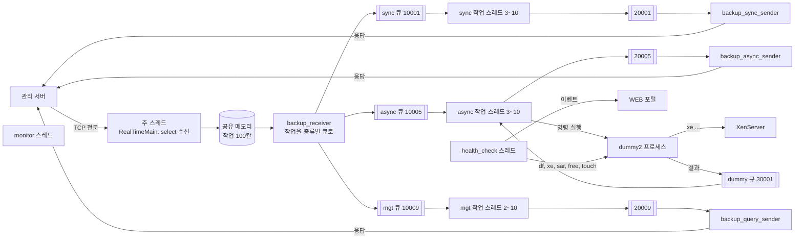

# agent 현행 사전 분석서

기준일: 2026-11-17 / 원본: `agent/vbr_agent.c` 1.602 (5,275줄), `agent/dummy2.c` (205줄), `agent/bs_common.c` (1,448줄), `agent/bs_common.h` (108줄) / 양식: T02(사전 분석판)

이 문서는 구현 전에 위험을 판단하려고 만든 사전 분석이다. 원본을 전부 읽은 것이 아니다. 읽은 범위는 아래 표와 같고, "명령만 추출"한 범위의 내용은 실행하는 명령과 문자열 비교를 뽑아 적은 것이라 처리 순서와 예외 처리가 빠져 있다. 전환 1단계에서 전체를 읽고 이 문서를 정식 현행 분석서로 바꾼다.

| 원본 범위 | 줄 | 읽은 수준 |
|---|---|---|
| 자료 구조, 전역 변수, `main`, `env_initialize` | 1~591 | 전체 |
| `RealTimeMain`, `MessageProcessing` | 592~873 | 전체 |
| `health_check_processing` | 875~1045 | 전체 |
| 수신·송신 스레드, `monitor` | 1047~1367 | 명령만 추출 |
| `mgt_processing`과 조회 명령 처리 | 1368~2860 | 명령만 추출 |
| 취소, 스레드 조정 | 2862~3484 | 명령만 추출 |
| `sync_processing`, `async_processing` | 3485~3783 | 명령만 추출 |
| `backup_vm` | 3784~3981 | 전체 |
| `partial_backup_remove`, `import_vm` | 3983~4215 | 명령만 추출 |
| 송신 스레드 2종 | 4216~4422 | 명령만 추출 |
| 신호, 이벤트, 포털, `dummy_call`, 접속 제한 시간 | 4423~4762 | 전체 |
| XVA 파일 검증 | 4763~5275 | 함수 목록만 |
| `dummy2.c` | 1~205 | 전체 |

## 1. 개요

- 하는 일: Citrix XenServer 호스트(dom0)에서 상주하며, 관리 서버가 TCP로 보내는 요청을 받아 VM 백업(스냅샷 후 내보내기), 부분 백업, 복구(가져오기), 취소, 각종 조회를 수행한다. 호스트와 백업 스토리지의 상태를 감시해 이벤트를 포털로 보낸다.
- 실행 형태: 상주 데몬. 실행하면 백그라운드로 분리되어 TCP 포트에서 요청을 기다린다.
- 언어·빌드: C, `cc -g -O vbr_agent.c bs_common.o -lpthread -D_REENTRANT -lm -lz` (`agent/c1.sh`). 빌드 뒤 `/tmp`로 복사한다.
- 소스 인코딩: `vbr_agent.c`는 UTF-8, `dummy2.c`와 `bs_common.c`·`bs_common.h`는 CP949.
- 변경 이력(소스 주석): 1.531 상태 조회에 버전 표시, 1.532 `ALIVE.chk`에 호스트 이름 추가, 1.602 XVA 파일 검증 추가(2026-01-08).

## 2. 구성

| 파일 | 줄 수 | 역할 |
|---|---|---|
| `vbr_agent.c` | 5,275 | 본체 |
| `dummy2.c` | 205 | 보조 프로그램 `dummy2`. 명령 하나를 제한 시간과 함께 실행하고 출력을 돌려준다 |
| `bs_common.c`, `bs_common.h` | 1,448 + 108 | 공통 라이브러리(agent 판) |
| `c1.sh` | 4 | 빌드 스크립트 |

`dummy2`를 만드는 빌드 스크립트는 받지 못했다. `c1.sh`에 이름을 넣어 `sh c1.sh dummy2`로 만드는 것으로 보인다.

## 3. 프로세스와 스레드

| 스레드 | 함수 | 하는 일 |
|---|---|---|
| 주 스레드 | `RealTimeMain`, `MessageProcessing` | 접속 수락, 전문 수신, 공유 메모리의 빈 칸에 작업 등록 |
| 수신 분배 | `backup_receiver` | 등록된 작업을 종류에 따라 sync·async·mgt 메시지 큐에 넣는다 |
| 작업 스레드 | `sync_processing`, `async_processing`, `mgt_processing` | 큐에서 작업을 꺼내 실행하고 결과를 송신 큐에 넣는다. 기본 3·3·2개, 최대 10개씩 |
| 응답 송신 | `backup_sync_sender`, `backup_async_sender`, `backup_query_sender` | 송신 큐의 결과를 요청한 접속으로 보낸다 |
| 상태 감시 | `health_check_processing` | 디스크, XenServer, CPU, 메모리, 백업 스토리지 확인. 쉬는 시간 없이 반복하고 `sar 3 1`이 3초를 쓴다 |
| 내부 감시 | `monitor` | 처리 현황 집계 |

## 4. 실행과 입력·출력

| 구분 | 내용 | 원본 위치 |
|---|---|---|
| 명령행 | `vbr_agent` (인자 없음), `-version` | 222 |
| 설정 | `./node_info.cfg`의 `[VBR Agent for Xenserver]`. 키는 `common/03-config-spec.md` 3장 | 231, 273, 951~980, 4538 |
| 읽는 파일 | `/etc/xensource-inventory`의 `INSTALLATION_UUID` | 533~547 |
| 쓰는 파일 | `./server.log`, `./transaction-YYYYMM.log`, `./client_connect.log`, `./backup.log`, `./sequence.log`, `<Mount Point>/ALIVE_<호스트명>.chk`, 백업 파일(XVA) | `bs_common.h`, 994 |
| 통신(수신) | TCP 수신 포트 `PORT-NO`. 관리 서버의 요청 전문 | 273, 592~794 |
| 통신(송신) | 같은 접속으로 응답 전문. 포털로 이벤트 전문 | 843, 4558 |
| 프로세스 간 통신 | System V 공유 메모리(키 1, 작업 100칸), 메시지 큐 7개(키 10001, 20001, 10005, 20005, 10009, 20009, 30001) | 187~196, 392 |
| 외부 명령 | 아래 6장 | |
| 필요한 실행 파일 | `./dummy2`, `xe`, `df`, `sar`, `free`, `touch`, `hostname`, `rm`, `ps`, `grep`, `awk`, `xargs`, `kill`, `fuser`, `pgrep` | |

## 5. 요청 전문

`MessageProcessing`과 구조체 `BACKUP_INFO`에서 읽은 형식이다. 응답과 작업 종류별 본문의 정확한 형식은 전체를 읽은 뒤 확정한다.

| 순서 | 필드 | 길이 | 내용 |
|---|---|---|---|
| 1 | 길이 | 7 | 뒤따르는 본문의 byte 수(10진수) |
| 2 | msg_type | 1 | `B` 고정. 다른 값이면 형식 오류 |
| 3 | msg_seq | 17 | `YYYYMMDDHHMMSS` + 1/1000초 3자리 |
| 4 | task_type | 1 | 요청: `S` 동기, `A` 비동기, `Q` 조회, `C` 취소, `T` 스레드 조정, `I` 문의. 응답: `0` 성공, `8` 대기열 가득, `9` 오류 |
| 5 | timeout | 3 | 동기 처리 제한 시간(초). `000`은 무한 |
| 6 | priority | 1 | `0` 즉시, `5` 일반, `9` 낮음 |
| 7 | msg_text | 가변(최대 약 300,000) | 명령 문자열 또는 결과 |

수신 방식: 7 byte를 읽어 길이를 얻고 그 길이만큼 한 번 읽는다. 덜 읽히면 소켓을 비차단으로 바꿔 1초 간격으로 5회까지 더 읽는다(669~776). 이 동안 다른 접속을 처리하지 못한다.

작업 등록: 공유 메모리 100칸 중 상태가 0이거나 3보다 큰 칸에 넣는다. 빈 칸이 없으면 task_type 자리에 `8`을 넣어 받은 전문을 그대로 돌려보낸다(814~855).

작업 상태 값: 0 미사용, 1 수신, 2 큐 대기, 3 처리 중, 5 완료, 6 취소(재기동으로 중단된 작업), 8 대기열 가득, 9 오류.

## 6. 기능 목록(사전)

| 번호 | 기능 | 요청 | 실행하는 명령(줄) |
|---|---|---|---|
| F-AG-01 | VM 백업 | `A`, `BACKUP <vm-uuid> <스냅샷이름> <파일>` | `xe vm-snapshot`(3864) → `xe template-param-set is-a-template=false ha-always-run=false`(3892) → `rm -f <파일>`(3926) → `xe vm-export … compress=true`(3934) → `chmod 0666` → 스냅샷 삭제 `xe vm-uninstall … force=true`(4198) → XVA 검증(3966) |
| F-AG-02 | 부분 백업 | `A`, `PARTIAL <vm-uuid> <디스크표시 15자> <스냅샷이름> <파일>` | 백업과 같고, 내보내기 전에 대상이 아닌 디스크를 스냅샷에서 뗀다. `xe vbd-list`, `xe vbd-param-get`, `xe vbd-param-set other-config:owner=false`, `xe vdi-destroy`(4020~4091) |
| F-AG-03 | VM 복구 | `A`, 가져오기 명령 | `xe vm-import filename=… sr-uuid=…`(4154). 실패하면 `xe vm-uninstall`(4201) |
| F-AG-04 | 작업 취소 | `C` | `ps -ef\|grep vm-export\|…\|xargs kill -9`, `vm-import`도 같음(2900~2912). 검색어로 찾아 죽이는 방식도 있다(3040) |
| F-AG-05 | 작업 현황 조회 | `Q`, `TASK` | 공유 메모리 조회(1667) |
| F-AG-06 | 에이전트 상태 조회 | `Q`, `STATUS` | 상태 감시 결과와 스레드별 상태를 JSON으로(1692~1856) |
| F-AG-07 | 풀·호스트·VM 조회 | `Q`, `INFO` | `xe pool-list`, `xe host-list`, `xe vm-list … is-a-template=false is-control-domain=false`(1890~2119) |
| F-AG-08 | 스토리지 조회 | `Q`, `SR-INFO` | `xe pool-list params=uuid,default-SR`, `xe sr-list`(2146~2260). 유형이 lvm, nfs, iscsi, hba인 것만 |
| F-AG-09 | VM 디스크 조회 | `Q`, `LUN-INFO` | `xe vbd-list vm-uuid=… type=Disk`, `xe vdi-list uuid=…`(2303~2376) |
| F-AG-10 | 디렉터리 조회 | `Q`, `DIR-INFO` | 디렉터리의 파일 이름, 유형, 크기, 수정 시각(2377~2467) |
| F-AG-11 | 호스트 상세 조회 | `Q`, `XS-INFO` | `xe host-list params=name-label,software-version,cpu_info,address,memory-total,memory-free,edition`(2489) |
| F-AG-12 | VM 상세 조회 | `Q`, `VM-INFO` | `xe vm-list params=name-label,power-state,memory-actual,VCPUs-max,install-time,networks,os-version`(2586) |
| F-AG-13 | 호스트의 VM 목록 | `Q`, `RES-VM-INFO` | `xe vm-list … resident-on=<host>` 또는 `power-state=halted`(2766~2770) |
| F-AG-14 | 이벤트 조회 | `Q`, `EVENT-INFO` | 보관 중인 이벤트 30건(2820~2860) |
| F-AG-15 | 스레드 수 조정 | `T` | 작업 스레드를 실행 중에 늘리거나 줄인다(3188~3360) |
| F-AG-16 | 문의 | `I` | 미분석 |
| F-AG-17 | 동기 작업 | `S` | 미분석(3485~3607) |
| F-AG-18 | 상태 감시 | 없음(주기 실행) | `df -Pk /\|tail -1`, `xe host-list`, `sar 3 1\|grep Average`, `free\|grep Mem`, `touch <Mount Point>/ALIVE_<호스트명>.chk`(895~994). 이벤트 `XEN000999`, `STG000999`. 스토리지 실패 시 비동기 작업 전체 취소(1008) |
| F-AG-19 | 이벤트 송신 | 없음 | 이벤트 30칸 보관, 미송신분 묶어 재송신. 접속 5초 제한(4437~4664) |
| F-AG-20 | 명령 실행 | 없음 | `./dummy2 <제한초> <큐 구분값> "<명령>"`을 `popen`으로 실행하고 결과를 메시지 큐 30001에서 받는다(4667~4713) |
| F-AG-21 | XVA 파일 검증 | 백업 끝 | 압축 여부 확인, tar 머리 512 byte 단위 검사, `ova.xml`·디스크·체크섬 파일 확인(4764~5275) |
| F-AG-22 | 재기동 복구 | 시작할 때 | 공유 메모리가 남아 있으면 이어 쓴다. 처리 중이던 작업(3)은 취소(6)로 바꾼다(392~586) |
| F-AG-23 | 호스트 식별 | 시작할 때 | `hostname` 실행, `/etc/xensource-inventory`의 UUID. 얻지 못하면 종료(453~553) |

`xe` 명령의 출력은 고정된 머리 문자열과 줄 단위로 비교해 읽는다. 예: `uuid ( RO)          : `, `    name-label ( RW): `(387~388, 1601~1645).

## 7. 보조 프로그램 `dummy2`

`dummy2 <제한초> <큐 구분값> "<명령>"`

1. 명령 뒤에 ` 2>&1`을 붙여 `popen`으로 실행한다(85~92).
2. 제한 시간을 `alarm`으로 건다. 0이면 제한이 없다(89~90).
3. 출력을 모두 모은다(97~105).
4. 제한 시간을 넘으면 자기 자식의 자식 프로세스를 찾아 `kill -9` 하고 결과를 `**TIMEOUT**`으로 한다(109~164).
5. 결과를 표준 출력에 쓰고, 메시지 큐 30001에 구분값을 종류로 해서 넣는다(168~180).

구분값은 호출한 스레드를 가리킨다(주 1000, sync 2000+, async 3000+, mgt 4000+, 상태 감시 5000, 초기화 8000). 여러 스레드가 큐 하나를 함께 쓰면서 자기 결과만 꺼내려는 장치다.

agent는 `dummy2`의 표준 출력 첫 줄을 읽고, 이어서 큐에서 전체 결과를 꺼내 덮어쓴다(4677~4695).

## 8. 운영체제·환경 의존

| 항목 | 쓰는 곳 | 비고 |
|---|---|---|
| XenServer dom0 | 전체 | `xe` 명령, `/etc/xensource-inventory` |
| System V 공유 메모리 | 작업 100칸 보관 | 재기동 뒤에도 남는다. 크기는 약 30MB(작업 한 칸 약 300KB) |
| System V 메시지 큐 7개 | 스레드 사이, `dummy2`와의 사이 | 키가 고정이다 |
| `select`, 소켓 | 수신 | |
| `popen`, `system` | 명령 실행 | 셸을 거친다 |
| `sar`, `free`, `df` 출력 형식 | 상태 감시 | 운영체제 버전에 따라 열 위치가 다를 수 있다 |
| `fuser -k`, `ps -ef \| grep` | 시작할 때 포트 점유 프로세스 종료, 중복 실행 판단, 취소 | |
| `dup2(2,1)` | 표준 오류를 표준 출력으로 | |

## 9. 사전 분석에서 찾은 결함과 위험 요소

[02-risk-and-prerequisites.md](02-risk-and-prerequisites.md)에 위험으로 정리했다. 결함 번호(D-AG-…)는 전체를 읽은 뒤 변경·결함 대장에 매긴다.

## 10. 확인하지 못한 것

| 항목 | 누구에게 확인할 것인가 |
|---|---|
| 관리 서버(요청을 보내는 쪽)가 어떤 프로그램이고 응답을 어떻게 읽는가 | 사용자(Q-A03) |
| 대상 XenServer 버전과 `xe` 출력 형식 | 사용자(Q-A02) |
| `S`(동기)와 `I`(문의) 작업의 내용 | 전체 읽기에서 확인 |
| 복구(가져오기) 요청의 본문 형식 | 전체 읽기에서 확인 |
| 설정 `CPU Limit`이 실제로 무엇을 제한하는가 | 전체 읽기에서 확인 |
| `dummy2`의 빌드 방법과 설치 위치 | 사용자 |
| 소스 주석에 남은 `./dummy`(dummy2의 이전 판)가 운영에 남아 있는가 | 사용자 |
