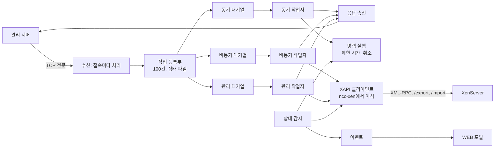

# agent 전환 계획

기준일: 2026-11-17 / 양식: T10 / 상태: 안. 사전 확인 사항(Q-A01~Q-A10)이 정해지면 확정한다.

**2026-11-17 3차: 구현과 개발 검증을 마쳤다.** 실제 진행은 구간 A1(유지 범위 읽기) → A3·A5(뼈대, 백업·복구) → A2(원본 비교 환경) 순으로 했고, A4(조회)는 후순위(DEC-AG-09), A6(상태 감시)은 삭제다. 결과는 [06-test-report.md](06-test-report.md), 남은 A7 은 [07-cutover-operations.md](07-cutover-operations.md).

**2026-11-17 2차 갱신: 범위가 바뀌었다.** agentless 원격 실행, 백업·복구 중심 재구성, 상태 감시 삭제가 정해졌다(사용자). 구간 A6(상태 감시)은 없어지고, A1·A3·A4의 범위는 [00-rescope-review.md](00-rescope-review.md) 2장·7장을 따른다. 이 문서의 표가 그 문서와 다르면 그 문서가 우선이다. 아래 구간 표는 결정 대기(Q-A11~A17)가 정해지면 다시 쓴다.

2026-11-17 1차 갱신: Q-A01이 XAPI로 정해졌다(사용자). Q-A02(XenServer 9 풀)와 Q-A03(전문 표본)의 답을 받았다. 이에 따라 A2의 시험 기반에 가짜 XAPI를, A4·A5의 구현 수단에 XAPI를 넣었다. 실행 위치(Q-A09)와 ncc-xen 코드 재사용 방식(Q-A10)은 결정 대기다. 아래 표에서 갱신한 칸에는 "(XAPI)"를 붙였다.

## 1. 전환 방식

구간별 전환이다. 원본을 한 번에 옮기지 않고 여섯 구간으로 나눠, 구간마다 원본과 비교한 뒤 다음으로 간다. 운영 교체는 모든 구간이 끝난 뒤 한 번에 한다(구간별로 운영에 넣지 않는다. 에이전트는 실행 파일 하나라 기능별로 나눠 교체할 수 없다).

이렇게 정한 이유

- 원본 5,275줄 가운데 약 3,400줄을 아직 줄 단위로 읽지 않았다. 읽으면서 요건이 더 나올 수 있다.
- 개발 PC에 XenServer가 없다. 가짜 `xe`로 원본과 비교하는 시험 기반을 먼저 만들어야 뒤 구간을 검증할 수 있다.
- 조회, 백업, 상태 감시는 뼈대(수신과 응답) 위에 따로 얹을 수 있다.

## 2. 구간

| 구간 | 내용 | 원본 범위 | 앞 구간 | 끝났다고 보는 기준 | 검증 수단 |
|---|---|---|---|---|---|
| A1 분석 | 원본 전체 읽기. 현행 분석서, 요건 정의서, 인터페이스 명세(요청·응답 전문 전부, [05 초안](05-interface-spec.md)을 확정), 결함 대장, (XAPI) `xe` 출력 ↔ XAPI 필드 대응표 | 전체 | A02, A03(답변 받음). 대응표는 `xe` 표본 필요 | 모든 함수가 기능 목록에 있다. 요청 종류마다 응답 형식이 적혀 있다. 05 문서 8장의 IF-AG-01~08이 닫혔다 | 문서 검토(관문 A) |
| A2 시험 기반 | 가짜 `xe`, (XAPI) 같은 시험 자료에서 응답을 만드는 가짜 XAPI 서버, 전문을 보내고 응답을 받는 시험 프로그램, 원본 agent와 `dummy2`를 컨테이너에서 실행하는 비교 환경 | - | A1 | 원본 agent가 컨테이너에서 떠서 `STATUS` 요청에 응답한다. 가짜 XAPI가 ncc-xen 클라이언트의 로그인·조회에 응답한다 | 원본만으로 실행 확인 |
| A3 뼈대 | 기동, TCP 수신, 전문 해석, 작업 등록과 대기열, 작업자, 응답 송신, 작업 현황(`TASK`)과 상태(`STATUS`) 조회, 로그, 재기동 복구 | 1~873, 1047~1367, 4216~4422와 조회 일부 | A2, Q-A04, A05 | 형식 오류, 대기열 가득, `TASK`, `STATUS`의 응답이 원본과 같다 | 단위 시험, 원본 비교 |
| A4 조회 | `INFO`, `SR-INFO`, `LUN-INFO`, `DIR-INFO`, `XS-INFO`, `VM-INFO`, `RES-VM-INFO`, `EVENT-INFO`. (XAPI) XAPI 클라이언트 이식(Q-A10) | 1857~2860 | A3, Q-A10 | 같은 시험 자료(원본에는 가짜 `xe`, 전환본에는 가짜 XAPI)에서 응답 JSON이 원본과 같다 | 원본 비교(명령별) |
| A5 백업·복구 | 명령 실행(제한 시간), 백업, 부분 백업, 복구, 취소, 스레드 조정, XVA 검증. (XAPI) 스냅샷·내보내기(`/export`)·가져오기(`/import`)·VDI 삭제를 XAPI로 | 2862~4215, 4667~4713, 4763~5275, `dummy2.c` | A3, Q-A06, A07, A10 | 원본이 가짜 `xe`에 보낸 작업 순서와, 전환본이 가짜 XAPI에 보낸 호출 순서가 같은 단계로 대응한다. 실패 지점별 정리 순서가 같다. XVA 판정이 같다 | 원본 비교, 단위 시험 |
| A6 상태 감시 | 상태 감시, 이벤트 보관·송신, 스토리지 장애 때의 작업 취소 | 875~1045, 4437~4664 | A3 | 장애를 흉내 낸 조건에서 이벤트 전문과 상태 값이 원본과 같다 | 원본 비교 |
| A7 통합·전환 | 실제 XenServer에서 조회, 백업, 부분 백업, 복구, 취소. 병행 운영, 교체 | - | A3~A6, Q-A02 | 서비스 `06` 문서의 통합 시험 통과 | 사용자 실행 |

A4, A5, A6은 A3이 끝나면 순서를 바꾸거나 나란히 진행할 수 있다.

## 3. 구간별 산출물

| 구간 | 문서 | 소스 | 시험 |
|---|---|---|---|
| A1 | `agent/01`(정식판), `agent/04` 결함 부분, `agent/05`, 요건 정의서 | 없음 | 없음 |
| A2 | `agent/06`의 시험 환경 절 | `go/test/agent/`(가짜 `xe`, 전문 시험 프로그램, Dockerfile) | 원본 실행 확인 |
| A3 | `agent/03` 목표 설계서(지금의 이 문서는 전환 계획으로 남긴다), `agent/04` 변경 부분 | `go/cmd/vbr_agent`, `go/internal/agent`, 전문 패키지, `logx` 추가분 | 단위, 원본 비교 |
| A4 | `agent/05` 조회 응답 | `go/internal/agent`의 조회 부분, `xe` 출력 읽기 규칙 표 | 원본 비교 |
| A5 | `agent/05` 백업·복구 요청과 응답 | 명령 실행 패키지, 백업·복구, XVA 검증 패키지 | 원본 비교, 단위 |
| A6 | - | 상태 감시, 이벤트 | 원본 비교 |
| A7 | `agent/06` 통합 시험 결과, `agent/07` 전환 계획과 운영 안내 | - | 통합 |

## 4. 목표 구조(안)

원본에서 없어지는 것

| 원본 | 전환본 | 이유 |
|---|---|---|
| 메시지 큐 6개(10001~20009) | 프로세스 안의 대기열 | 스레드 사이 전달에 운영체제 큐가 필요 없다 |
| 메시지 큐 30001과 `dummy2` | 명령 실행 패키지 | 제한 시간과 자식 프로세스 종료를 표준 라이브러리로 한다 |
| 공유 메모리(키 1) | 작업 등록부와 상태 파일 | Q-A04 |
| 송신 스레드 3개 | 응답 송신 하나 | 큐가 하나로 합쳐진다 |
| `fuser -k`, `ps \| grep` | 잠금 파일, 자기가 띄운 프로세스 직접 종료 | Q-A05, Q-A07 |
| `xe` 명령 34곳과 출력 읽기 | XAPI 호출(XML-RPC, HTTP `/export`·`/import`) | Q-A01 결정 |
| 내보내기 취소 = `vm-export` 프로세스 종료 | XAPI 작업(task) 취소 | Q-A01. XenServer 쪽 작업이 남는 원본 문제(R-AG-06)도 이 방법으로 풀 수 있을 것으로 본다. 실제 풀에서 확인한다 |

유지하는 것: 수신 포트, 전문 형식, 작업 종류와 상태 값, 작업자 수의 기본값·상한과 실행 중 조정, 응답 JSON의 키·순서·표기(값 대응표로 맞춘다), 로그 파일 5종의 이름과 형식(운영 로그의 `ASYNC RESULT send error` 포함), 설정 키, 이벤트 코드, 동기 명령(`S`)의 dom0 셸 실행(Q-A06 범위에서).

공통 패키지 재사용: `boot`(상주 데몬용으로 조금 넓힌다), `config`, `logx`, `daemon`, `portal`.

## 5. 시험 환경 계획

| 필요한 것 | 구하는 방법 | 없을 때의 대안 |
|---|---|---|
| 원본 agent 실행 환경 | 컨테이너에서 원본과 `dummy2`를 컴파일. `/etc/xensource-inventory`를 만들어 넣는다 | 없음(이것이 기준이다) |
| 가짜 `xe` | 인자를 기록하고 정해진 출력을 내는 셸 스크립트. 출력은 실제 표본(Q-A02) 또는 원본 소스의 머리 문자열에서 만든다 | 실제 표본이 없으면 소스에서 만든 출력만으로 진행하고, 실제 표본을 받으면 다시 비교 |
| `sar`, `free`, `df`, `fuser` | 컨테이너에 설치하거나 가짜 명령 | 가짜 명령 |
| 전문 시험 프로그램 | Go로 작성. 요청을 보내고 응답을 파일로 저장 | - |
| 실제 XenServer | 사용자 제공 | 통합 시험을 전환 직전으로 미룬다. 판정은 "개발 검증 통과"까지만 |

## 6. 관문

| 관문 | 시점 | 확인하는 것 | 누가 |
|---|---|---|---|
| 사전 결정 | A1 전 | Q-A01~Q-A08 | 사용자 |
| 관문 A | A1 뒤 | 현행 분석서, 전문 명세, 결함 대장 | 사용자 |
| 관문 B | A3 설계 뒤 | 목표 설계서, 동작이 달라지는 변경 | 사용자 |
| 구간 검증 | A3~A6 각각 | 그 구간의 원본 비교 시험 통과 | 전환 수행자 |
| 관문 C | A6 뒤 | 개발 검증 판정 | 전환 수행자 판정, 검토자 대조 |
| 관문 D | A7 | 실제 풀 통합 시험, 병행 운영 | 사용자 |

## 7. 전제와 미정 사항

| 항목 | 상태 | 관련 |
|---|---|---|
| XenServer 호출 방식 | 확정(사용자, 2026-11-17). XAPI | Q-A01 |
| 대상 버전과 시험용 풀 | 답변 받음. XenServer 9 풀. `xe` 표본은 수집 스크립트 실행 결과 대기 | Q-A02 |
| 전문 표본 | 받음(2015 엑셀, 운영 로그 1건). 요청 종류별 운영 로그는 추가 요청 | Q-A03 |
| 실행 위치 | 미정. 권장은 dom0 유지 + 로컬 XAPI | Q-A09 |
| ncc-xen XAPI 코드 재사용 | 미정. 권장은 복사 후 i18n·로거 제거 | Q-A10 |
| XAPI 로그인 방법 | 미확인. dom0 로컬 소켓 가능 여부를 표본으로 확인 | R-AG-20 |
| 작업 상태 보관 방식 | 미정. 권장은 파일 | Q-A04 |
| 포트 점유·중복 실행 처리 | 미정. 권장은 잠금 파일 | Q-A05 |
| 셸 제거와 접속 제한 | 셸 제거는 권장 확정, 접속 제한은 미정 | Q-A06 |
| 취소 범위 | A1 뒤 결정 | Q-A07 |
| 대상 운영체제 | 미정. 권장은 Linux 전용 | Q-A08 |
| cifs·remove의 공통 패키지 | 확정. 그대로 쓴다 | `common/02` |
