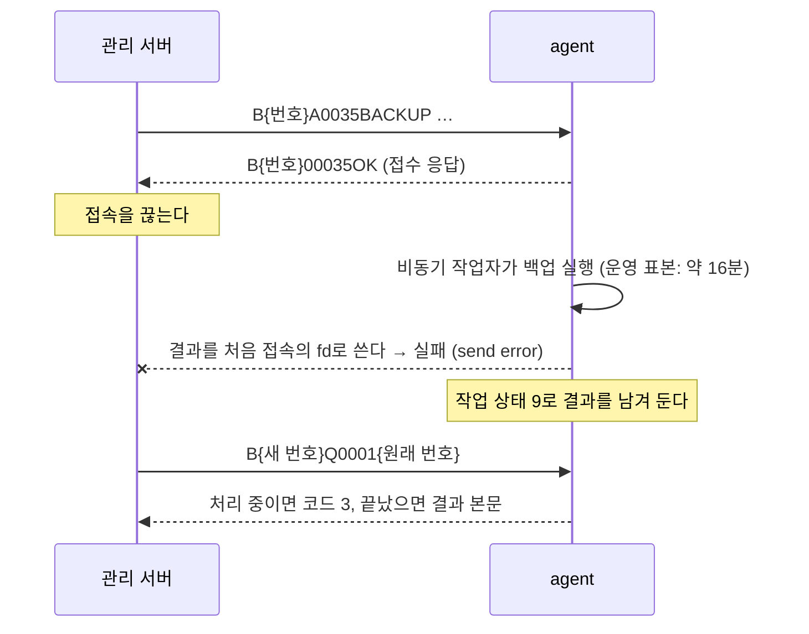

# agent 인터페이스 명세 (초안)

기준일: 2026-11-17 / 양식: T05 / 상태: **전환본 범위 확정**(BACKUP, PARTIAL, RESTORE, Q, C). 유지 범위의 원본을 전체 읽고 원본 비교 시험으로 확인했다. 확정 내용은 9장, 8장의 질문은 9장에서 닫았다. 조회(`I`)는 후순위라 6.6절은 원본 기록으로만 남긴다.

**범위 주의(2026-11-17 2차).** 이 명세는 원본 agent의 전문 전체를 적은 것이다. 전환본은 이 가운데 유지 9종만 구현한다. 요청별 유지·삭제는 [00-rescope-review.md](00-rescope-review.md) 2장을 본다. 7장의 `xe` 명령 표본은 원본 비교 시험(원본 쪽 가짜 `xe`)과 XAPI 값 대응표에만 쓴다.

## 1. 근거와 신뢰 수준

| 근거 | 내용 | 버전 | 위치 |
|---|---|---|---|
| 전문 표본 | 요청 종류별 송신·수신 전문과 참고 사항. 관리 서버(Windows ASP) 개발 때 만든 표로 보인다 | 2015-01-07, 응답의 `ver_info`가 `NCC-VBR v1.0(20150107)` | `evidence/agent/message-samples-2015.xls`, 같은 내용의 텍스트 `message-samples-2015.txt` |
| 운영 로그 | 2026-11-17 백업 1건의 `transaction` 로그 | 현재 운영본(소스 1.602로 추정) | `evidence/agent/transaction-log-sample-20261117.txt` |
| 원본 소스 | `vbr_agent.c` 1.602 | 1.602 | 이 문서에 적은 행 |

표에서 "확인" 칸의 뜻

- **소스·운영**: 현재 소스와 운영 로그가 같다.
- **소스**: 현재 소스에서 확인했다. 표본과 같거나 표본에 없다.
- **표본**: 2015년 표본에만 근거한다. 현재 소스와 대조하지 않았다.
- **차이**: 표본과 현재 소스가 다르다. 전환본은 현재 소스를 따른다. 관리 서버가 어느 쪽을 기대하는지는 운영 로그로 확인한다.

## 2. 연결

| 항목 | 값 | 확인 |
|---|---|---|
| 방향 | 관리 서버가 agent에 접속한다(agent가 수신) | 소스 273행 |
| 수신 포트 | 설정 `[VBR Agent for Xenserver] PORT-NO` | 소스 273행 |
| 접속 단위 | 요청마다 접속. 동기(`S`)·조회 계열은 같은 접속으로 결과를 받는다. 비동기(`A`)는 접수 응답(`OK`)만 받고 결과는 나중에 `Q`로 조회한다 | 표본, 운영 로그 |
| 인증 | 없음 | 소스 |
| 문자 집합 | ASCII. 한글이 들어가는 항목은 확인하지 못했다 | 미확인 |

## 3. 전문 틀

```
+---------+---+------------------+---+-----+---+----------------
| 길이 7  | B | 전문 번호 17     | T | 3   | P | 본문
+---------+---+------------------+---+-----+---+----------------
  0..6     7   8..24             25  26..28 29  30..
```

길이 7자리는 뒤에 오는 바이트 수다(자기 자신 제외). 아래 위치는 길이를 뺀 본문 기준이다(소스의 `buffer[18+7]`가 T 자리).

| 위치 | 길이 | 이름 | 요청에서 | 응답에서 | 확인 |
|---|---|---|---|---|---|
| 0 | 1 | 전문 형식 | `B` 고정 | `B` | 소스 35행, 표본 |
| 1 | 17 | 전문 번호 | `YYYYMMDDHHMMSS` + 밀리초 3자리. 관리 서버가 매긴다 | 요청과 같다 | 소스 36행, 운영 |
| 18 | 1 | T | 작업 구분(4장) | 결과 코드(5장) | 소스 37행, 1098·1131행 |
| 19 | 3 | 제한 시간 | 동기 명령의 제한 시간(초). `000`은 무한 대기 | 요청 값 그대로 | 소스 38행, 표본 |
| 22 | 1 | 우선순위 | `0` 즉시, `5` 일반, `9` 다른 작업 우선 | 요청 값 그대로 | 소스 39행, 826행 |
| 23 | 가변 | 본문 | 명령 문자열 | 결과 문자열 또는 JSON | 표본 |

운영 로그의 `B20261117001001001A0035BACKUP …`는 T=`A`, 제한 시간=`003`, 우선순위=`5`로 읽힌다. 비동기 작업에서 제한 시간 `003`이 무엇에 쓰이는지는 A1에서 확인한다.

## 4. 작업 구분 (요청의 T)

| T | 이름 | 처리 대기열(원본) | 접수 응답 | 확인 |
|---|---|---|---|---|
| `S` | 동기 명령 | 동기 큐 | 없음. 실행 결과를 같은 접속으로 보낸다 | 소스 1084행 |
| `A` | 비동기 작업(백업·부분 백업·복구) | 비동기 큐 | 즉시 `OK` | 소스 1086·1124~1144행 |
| `Q` | 작업 결과 조회 | 관리 큐 | 없음 | 소스 1088행 |
| `C` | 작업 취소 | 관리 큐 | 없음 | 소스 1089행 |
| `T` | 작업자 수 조정 | 관리 큐 | 없음 | 소스 1090행 |
| `I` | 문의(현황·정보 조회) | 관리 큐 | 없음 | 소스 1091행 |
| 그 밖 | 형식 오류 | - | 받은 전문의 T 자리를 `9`로 바꿔 돌려준다 | 소스 1094~1106행 |

## 5. 결과 코드 (응답의 T)

| 코드 | 뜻 | 나오는 곳 | 확인 |
|---|---|---|---|
| `0` | 정상 처리 | 대부분 | 소스·운영 |
| `9` | 오류(실행 오류, 형식 오류, 찾지 못함, 제한 시간 초과) | 동기 오류, 조회 대상 없음, 백업 실패 | 소스, 표본 |
| `3` | 처리 중 | `Q` 조회 때 아직 끝나지 않은 작업 | 표본 |
| `8` | 대기열 가득 | 비동기 접수 | 표본(참고 사항 "queue full시 '8' return"). 소스 위치 미확인 |
| `7` | 미확인 | 소스 3479행 | 소스. A1에서 뜻을 확인 |
| `A` | 비동기 접수(2015 표본) | 접수 응답 | **차이**. 현재 소스는 `0`(1131행)이다 |
| `C` | 일괄 취소 결과(2015 표본) | 일괄 취소 | **차이** 후보. 표본 비고에 "'C'로 return 하는 것을 '0'으로?"라는 메모가 있다. 현재 소스 확인 필요 |

## 6. 요청별 명세

본문 형식과 응답은 표본 기준이다. 원본 처리 위치는 소스의 분기 행이다.

### 6.1 동기 명령 (`S`)

| 항목 | 내용 |
|---|---|
| 요청 본문 | dom0에서 실행할 셸 명령. 예: `df -k /` |
| 응답 본문 | 명령의 표준 출력과 표준 오류. 제한 시간을 넘으면 `**TIMEOUT**` |
| 결과 코드 | `0` 실행 종료(명령 자체가 실패해도 `0`. 예: `sh: aaaaa: command not found`), `9` 제한 시간 초과·실행 오류 |
| 원본 | 동기 작업자 3485행 부근, `dummy_call` 4667행 부근 |
| 확인 | 표본. 소스 3566·3571행에서 `9`/`0` 설정 확인 |
| 보안 | 인증 없이 임의 명령을 실행한다(R-AG-03) |

### 6.2 비동기 작업 (`A`)

| 명령 | 요청 본문 | 결과 본문(성공) | 원본 |
|---|---|---|---|
| 백업 | `BACKUP vm-uuid snapshot-name file-name` | `VM BACKUP Success : VM uuid=…, Snapshot VM uuid=…, backup filename=…` | 3806행 |
| 부분 백업 | `PARTIAL vm-uuid vdi-seq snapshot-name file-name`. `vdi-seq`는 15자리, 디스크 위치(userdevice)마다 한 자리이며 `1`인 디스크만 백업 | 백업과 같은 문장 | 3811행, 3983행 이후 |
| 복구 | `RESTORE file-name reserve-option sr-uuid` | 새로 만든 VM uuid만 | 4118행 이후 |

실패 결과 예: `Error: No matching VMs found`(VM uuid 오류), `SR UUID is not valid.`(복구 인자 오류). 실패도 `Q` 조회 자체는 정상 응답이며 결과 코드로 판단해야 한다(표본 유의 사항).

#### 비동기 흐름



운영 로그의 해석(`evidence/agent/transaction-log-sample-20261117.txt`)

| 시각 | 로그 | 원본 | 뜻 |
|---|---|---|---|
| 00:10:01.726 | `1:Message Receive` | 829행 | 전문 수신, 작업 등록 |
| 00:10:01.836 | `2:Queue saving` | 1110행 | 비동기 큐에 넣음. 이어서 `OK` 접수 응답 |
| 00:10:01.836 | `3:ASYNC Queue receive` | 3683행 | 비동기 작업자가 꺼냄 |
| 00:25:55.708 | `5:ASYNC Queue result send finished` | 3751행 | 작업자가 결과를 송신 큐에 넣음 |
| 00:25:55.709 | `0:ASYNC RESULT send error` | 4256행 | 처음 접속에 쓰기 실패. 관리 서버가 이미 끊었으므로 **정상 흐름**이다. 작업 상태를 9로 두어 `Q` 조회로 결과를 가져가게 한다 |

전환본에 주는 뜻

- `send error`는 운영에서 매번 나오는 정상 기록이다. 로그 문구와 상태 값을 유지한다(K 항목 후보).
- 끊긴 접속의 fd 번호는 운영체제가 다음 접속에 다시 줄 수 있다. 원본은 결과를 **다른 관리 서버 접속에 쓸 수 있다**(R-AG-16). 전환본은 접속 객체를 직접 들고 있으므로 이 문제가 없다.

### 6.3 결과 조회 (`Q`)

| 항목 | 내용 |
|---|---|
| 요청 본문 | 조회할 전문 번호 17자리 |
| 응답 | 처리 중: 코드 `3`, 본문은 원래 요청 본문. 끝남: 원래 작업의 결과 코드와 결과 본문. 없음: 코드 `9`, 본문은 조회한 번호 |
| 원본 | 관리 작업자(1368행 이후), 결과 송신 4300행 부근 |
| 확인 | 표본. 동기 작업 결과도 조회된다(표본의 `df -k /` 결과 재조회) |

### 6.4 취소 (`C`)

| 경우 | 요청 본문 | 응답(표본) | 현재 소스 |
|---|---|---|---|
| 끝났거나 없는 작업 | 전문 번호 | 코드 `9`, `Request message not found.(Invalid or Already finished).` | 3005행 같은 문장 |
| 실행 중인 작업 | 전문 번호 | 코드 `9`, `Request message is processing.` | 3020행 같은 문장. 3059행에 `[NOTICE]Request message is processing or already finished.`가 따로 있다. 어느 경우에 나오는지 A1에서 확인 |
| 일괄 취소 | `00000000000000000`(0 17자리) | `Multi cancel summary : total [100], cancel [0], failed [100]` | 2965~2966행. 현재 소스는 문장 끝에 줄바꿈이 붙는다 |

일괄 취소는 실행 중인 작업을 뺀 대기 작업을 취소한다(표본 유의 사항).

### 6.5 작업자 수 조정 (`T`)

| 항목 | 내용 |
|---|---|
| 요청 본문 | `동기 비동기 관리` 세 숫자. 예: `2 2 2` |
| 응답 | `Thread Status : Sync=2 Async=2 Management=2` |
| 제약 | 각각 2 이상 10 이하. 실행 중인 작업이 끝난 뒤에 개수가 바뀐다 |
| 원본 | 3129~3371행 |
| 확인 | 표본, 소스 3371행 문장 같음 |

### 6.6 문의 (`I`)

본문의 첫 낱말로 나눈다(소스 1667~2853행, 앞부분 일치 비교).

| 본문 | 응답 본문 | 쓰는 `xe` 명령(7장) | 원본 |
|---|---|---|---|
| `TASK` | 작업 등록부 100칸. 한 줄에 `[칸]:상태-대기열순번-구분-[전문번호][본문]` | 없음 | 1667행 |
| `STATUS` | JSON `health_check_status`, `sync_thread_status`, `async_thread_status`, `mgmt_thread_status`, `agent_info` | 없음(상태 감시 결과) | 1692행 |
| `INFO` | JSON `pool_host_info[]`, `pool_vm_info[]` | X06, X07, X08 | 1857행 |
| `SR-INFO` | JSON `sr_info[]` | X09, X10 | 2120행 |
| `LUN-INFO vm-uuid` | JSON `lun_info[]` | X11, X12 | 2261행 |
| `DIR-INFO 디렉터리` | JSON `dir_info[]`(name, type, size, last_update). `.`과 `..`이 들어간다. 순서는 디렉터리 읽기 순서 | 없음 | 2377행 |
| `XS-INFO` | JSON `xs_info[]` | X13 | 2468행 |
| `VM-INFO vm-uuid` | JSON `vm_info[]` | X14 | 2565행 |
| `RES-VM-INFO` | 이 호스트에서 실행 중인 VM과 꺼진 VM. 표본은 바깥 중괄호 없이 `"res_vm_info":[…]`로 시작한다 | X15, X16 | 2725행 |
| `EVENT-INFO` | JSON `event_info[]`(event_type, host_name, host_uuid, event_time, event_code, event_msg) | 없음 | 2820행 |

JSON의 값은 숫자도 모두 문자열이다. 값이 없으면 `NO DEFINE`, 호스트가 없으면 `NONE`이다(표본). `SR-INFO`의 `"default":"N", "host_name"`처럼 쉼표 뒤에 공백이 들어간 곳이 있다. 원본은 문자열을 이어 붙여 JSON을 만들므로 공백과 순서를 전환본이 그대로 재현해야 한다(관리 서버가 문자열로 읽을 가능성).

## 7. 원본이 읽는 명령과 표본 수집

원본이 실행하고 출력을 읽는 조회 명령이다. 표본 수집 스크립트 `go/test/agent/collect-xe-samples.sh`가 이 명령을 그대로 실행한다(읽기 전용).

| 번호 | 명령 | 쓰는 곳 | 원본 |
|---|---|---|---|
| X01 | `xe host-list params=uuid,name-label hostname=<호스트이름>` | 기동 때 자기 호스트 uuid 찾기 | 469행 |
| X02 | `xe host-list` | 상태 감시(출력이 `uuid`로 시작하는지만 본다) | 910행 |
| X03 | `df -Pk /\|tail -1` | 상태 감시 디스크 | 895행 |
| X04 | `sar 3 1\|grep Average` | 상태 감시 CPU(8번째 값 = idle) | 933행 |
| X05 | `free\|grep Mem` | 상태 감시 메모리(2·3번째 값) | 943행 |
| X06 | `xe pool-list params=uuid,name-label` | INFO | 1890행 |
| X07 | `xe host-list params=uuid,name-label,address` | INFO | 1924행 |
| X08 | `xe vm-list params=uuid,name-label,resident-on,networks,os-version,power-state is-a-template=false is-control-domain=false` | INFO | 1976행 |
| X09 | `xe pool-list params=uuid,default-SR` | SR-INFO | 2146행 |
| X10 | `xe sr-list params=uuid,host,name-label,physical-utilisation,physical-size,type` | SR-INFO | 2179행 |
| X11 | `xe vbd-list vm-uuid=<VM> type=Disk params=uuid,userdevice,vdi-uuid` | LUN-INFO | 2303행 |
| X12 | `xe vdi-list uuid=<VDI> params=name-label,virtual-size` | LUN-INFO | 2333행 |
| X13 | `xe host-list params=name-label,software-version,cpu_info,address,memory-total,memory-free,edition uuid=<HOST>` | XS-INFO | 2489행 |
| X14 | `xe vm-list params=name-label,power-state,memory-actual,VCPUs-max,install-time,networks,os-version uuid=<VM>` | VM-INFO | 2586행 |
| X15 | `xe vm-list params=uuid,name-label is-a-template=false is-control-domain=false resident-on=<HOST>` | RES-VM-INFO | 2766행 |
| X16 | `xe vm-list params=uuid,name-label is-a-template=false is-control-domain=false power-state=halted` | RES-VM-INFO | 2770행 |
| X17~X19 | `xe vbd-list … params=uuid`, `xe vbd-param-get … param-name=userdevice`, `… param-name=vdi-uuid` | 부분 백업(스냅샷의 디스크 고르기) | 4020·4044·4056행 |

VM을 바꾸는 명령은 표본 수집에서 뺐다. 백업·복구 시험(구간 A7) 때 확인한다.

| 명령 | 쓰는 곳 | 원본 |
|---|---|---|
| `xe vm-snapshot uuid=… new-name-label="…"` | 백업 | 3864행 |
| `xe template-param-set is-a-template=false ha-always-run=false uuid=…` | 백업 | 3892행 |
| `xe vm-export vm=… filename="…" compress=true` | 백업 | 3934행 |
| `xe vbd-param-set uuid=… other-config:owner=false`, `xe vdi-destroy uuid=…` | 부분 백업(고르지 않은 디스크를 스냅샷에서 지움) | 4081·4091행 |
| `xe vm-import filename="…" sr-uuid=…` | 복구 | 4154행 |
| `xe vm-uninstall uuid=… force=true` | 백업 뒤 스냅샷 정리 | 4198·4201행 |

## 8. A1에서 확정할 것

| 번호 | 내용 | 근거 |
|---|---|---|
| IF-AG-01 | 결과 코드 `8`(대기열 가득)이 어디서 나오는가. 원본의 `msgsnd`는 기다리기 모드(1112행)라 가득 차면 수신 처리 전체가 멈춘다 | 표본 참고 사항, 소스 1112행 |
| IF-AG-02 | 결과 코드 `7`의 뜻 | 소스 3479행 |
| IF-AG-03 | 비동기 접수 응답이 `sx_Message`(1129행)에서 전문 번호를 복사한다. 같은 회차에 여러 전문을 등록하면 다른 전문 번호로 `OK`를 보낼 수 있는지 | 소스 1129행 |
| IF-AG-04 | 취소와 스토리지 장애 처리에서 `strcmp(msg_text, "RESTORE")`(2873·3028행)처럼 본문 전체를 비교한다. 본문이 `RESTORE /backup/…`이면 같지 않다. 미리 잘라 두는지, 실제로는 맞지 않는 결함인지 | 소스 2873·3028행 |
| IF-AG-05 | `[NOTICE]` 취소 문장(3059행)이 나오는 조건 | 소스 3059행 |
| IF-AG-06 | 비동기 요청의 제한 시간 자리(운영 `003`)의 용도 | 운영 로그 |
| IF-AG-07 | 복구 결과 본문. 표본 비고에 "백업과 동일하게 TEXT 삽입?"이라는 메모가 있다 | 표본 |
| IF-AG-08 | `RES-VM-INFO` 응답에 바깥 중괄호가 없는 것이 현재 소스에서도 같은가 | 표본 |

## 9. 확정 (2026-11-17, 원본 1.602 전체 읽기와 원본 비교 시험)

### 9.1 결과 조회(Q)는 transaction 로그로 답한다

원본 `query_task`(3376~3484행)는 메모리가 아니라 `transaction-YYYYMM.log`(조회할 전문 번호의 앞 6자리 달)를 처음부터 읽어, 그 번호의 **마지막 기록**을 찾는다.

| 응답 자리 | 값 |
|---|---|
| 머리 | 조회 요청 자신의 머리(`B` + 조회 번호 + T + 제한 시간 + 우선순위) |
| T(결과 코드) | 마지막 기록의 단계 기호. 완료 `0`, 처리 중 `3`, 대기 `2`, 접수 `1`, 결과 전달 직전 `5`, 취소 `C`, 재기동 `6`, 형식 오류 `9`. 기록이 없으면 `9`. 기록은 1·2·3 인데 등록부에 없으면 `7` |
| 본문 | 그 기록의 전문 본문(머리 23자를 뺀 것). 기록이 없으면 조회한 번호 그대로 |

그래서 백업이 실패해도 조회 코드는 `0`(마지막 기록이 "ASYNC RESULT send error")이고 본문이 `[ERROR]…`다. 2015 표본의 "query 결과는 정상이지만 처리 결과는 에러" 와 같다. 로그 한 건의 모양은 `\x00[YYYY-MM-DD HH:MM:SS:mmm]<번호17> <단계>:<문구>\n\x00<전문>\x00\n` 이다.

### 9.2 8장 질문의 답

| 번호 | 답 | 근거 |
|---|---|---|
| IF-AG-01 | 결과 코드 `8` 은 등록부 100칸이 모두 1~3 상태일 때 받은 전문의 T 자리를 8로 바꿔 되돌린다 | 834~855행. 전환본 같음(T-AG-U07) |
| IF-AG-02 | 결과 코드 `7` 은 9.1 의 "등록부에 없음" | 3464~3481행 |
| IF-AG-03 | 결함이다. 접수 응답 머리를 전역 `sx_Message` 에서 복사한다 | D-AG-02. 전환본은 그 요청의 머리 |
| IF-AG-04 | 결함(죽은 코드). `strcmp(본문, "RESTORE")` 는 맞을 수 없다 | D-AG-10. 해당 기능(장애 때 일괄 취소, 처리 중 취소)은 옮기지 않았다 |
| IF-AG-05 | `[NOTICE]…` 는 상태를 다시 읽었을 때 1·2 가 아니게 바뀐 경우(경합)다 | 3053~3061행. 전환본도 취소 직전 한 번의 잠금 안에서 다시 확인해 같은 문장을 낸다(K-AG-13) |
| IF-AG-06 | 비동기 요청의 제한 시간 자리는 쓰지 않는다(동기 명령만 씀). 응답에 그대로 돌려준다 | 3558행(동기만), 운영 로그 `00035` |
| IF-AG-07 | 복구 결과 본문은 새 VM uuid 만이다(1.602) | 4177행 |
| IF-AG-08 | 조회 후순위로 확인하지 않았다 | DEC-AG-09 |

### 9.3 표본과 다른 점의 최종 정리

| 항목 | 2015 표본 | 1.602·운영 로그 | 전환본 |
|---|---|---|---|
| 비동기 접수 응답 T | `A` | `0` | `0` |
| 일괄 취소 응답 T | `C` | `C`(코드를 바꾸지 않음) | `C`(K-AG-04) |
| 취소 문장 | 같다 | 같다 + `Request message Already finished.`(끝난 작업) | 1.602 와 같다 |
| 백업 성공 결과 | `VM BACKUP Success …` | 소스 1.602 는 `XVA file check Success …`, 운영 로그는 `VM BACKUP Success …` | `VM BACKUP Success …`(C-AG-16, Q-A19) |
