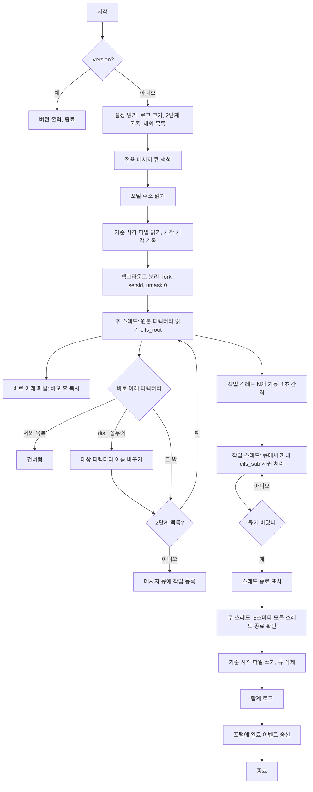

# cifs 현행 분석서

기준일: 2026-11-17 / 원본: `cifs/vbr_cifs.c` 2.0672 (1,250줄), `cifs/bs_common.c` (1,501줄), `cifs/bs_common.h` (116줄) / 읽은 범위: 전체 / 양식: T02

## 1. 개요

- 하는 일: NAS 디렉터리를 다른 디렉터리로 증분 백업한다.
- 실행 형태: 한 번 실행하고 끝나는 배치. 실행 직후 백그라운드로 분리된다.
- 언어·빌드: C, `cc -g -O -Wall -fcommon vbr_cifs.c bs_common.o -lpthread -D_REENTRANT -lm -lz` (`cifs/c1`)
- 소스 인코딩: UTF-8
- 변경 이력(소스 주석)

| 버전 | 내용 |
|---|---|
| 1.2 | 기준 시각보다 이른 파일 건너뛰기 |
| 2.01 | 이름에 공백이 있는 디렉터리 처리(구분자 `^&^`) |
| 2.04 | Windows 7에서 접근 시각이 바뀌지 않는 파일 때문에 세 시각 모두 비교 |
| 2.05 | 2단계 분할(`2ND SEARCH DIR`) |
| 2.062, 2.063 | 상세 로그 `BS_Tsyslog2` 추가 후 성능 때문에 호출 중지 |
| 2.065 | 백업 제외(`EXCLUSION DIR`). 2020-12-08 |
| 2.067 | 제외 디렉터리 20 → 200개. 2023-02-09 |
| 2.0671 | 작업마다 전용 메시지 큐 사용 |
| 2.0672 | 백업 오류 별도 로그 저장, 전체 오류 건수 누적(소스에서 찾지 못함. D-CIFS-13) |

`dis_` 디렉터리 처리는 변경 이력에 없지만 소스에 있다.

## 2. 구성

| 파일 | 줄 수 | 역할 |
|---|---|---|
| `vbr_cifs.c` | 1,250 | 백업 본체 |
| `bs_common.c` | 1,501 | 공통 라이브러리. 이 프로그램이 쓰는 것은 설정 읽기, 로그 2종, 데몬화, 시각 문자열 3종, 초기화 |
| `bs_common.h` | 116 | 상수, 전역 변수, 함수 선언 |
| `c1` | 9 | 빌드 스크립트 |

## 3. 실행과 입력·출력

| 구분 | 내용 | 원본 위치 |
|---|---|---|
| 명령행 | `vbr_cifs source-dir target-dir seq-no`. `-version` 또는 `-ver`이면 버전 출력 | 108, 128 |
| 설정 | `./node_info.cfg`의 `[VBR Manager]` 섹션. `MAX Log size`, `2ND SEARCH DIR`, `EXCLUSION DIR`, `MAX Thread cnt`, `WEB server(IP)`, `WEB server(PORT)` | 117, 138, 149, 380, 1168, 1176 |
| 읽는 파일 | `./history/<원본>-<대상>.vbr` 첫 줄의 첫 단어(기준 시각) | 187~208 |
| 쓰는 파일 | `./server.log`, `./transaction.log`, `./history/…vbr`, 대상 디렉터리의 파일과 `-vbr-시각.zip` | 293, 746 |
| 통신 | WEB 포털로 완료 이벤트 송신(TCP) 후 응답 한 번 수신 | 1090~1160 |
| 프로세스 간 통신 | System V 메시지 큐 하나(`IPC_PRIVATE`). 주 스레드가 작업을 넣고 작업 스레드가 꺼낸다 | 359, 660, 896 |
| 외부 명령 | 없음 | - |
| 종료 코드 | 정상 0, 버전 출력 0, 사용법 오류·시작 실패 255(`exit(-1)`), 큐 생성 실패 1. 백그라운드로 분리되므로 호출자는 항상 부모의 0을 받는다 | 111, 133, 362 |

상세 형식은 [05-interface-spec.md](05-interface-spec.md)에 있다.

## 4. 처리 흐름

단계별 설명

1. 인자가 `-version`이면 버전을 출력하고 끝낸다(108).
2. 로그 최대 크기, 2단계 목록, 제외 목록을 설정에서 읽는다(117~156).
3. 작업 분배용 메시지 큐를 전용으로 만든다(342~369).
4. 포털 주소를 읽는다. 없으면 이벤트를 보내지 않는다(1162~1186).
5. 원본·대상 경로의 `/`를 `_`로 바꿔 기준 시각 파일 이름을 만들고 읽는다(169~208).
6. 시작 시각을 기록하고 백그라운드로 분리된다(210~228).
7. 주 스레드가 원본 디렉터리를 읽는다. 파일은 바로 비교·복사하고 디렉터리는 작업으로 등록한다(532~677).
8. 작업 스레드를 설정한 수만큼 1초 간격으로 띄운다(371~428).
9. 작업 스레드는 큐가 빌 때까지 디렉터리를 하나씩 꺼내 끝까지 재귀 처리한다(872~1050).
10. 주 스레드는 5초마다 모든 스레드의 종료 표시를 확인한다. 모두 끝나면 기준 시각 파일을 쓰고 큐를 지우고 합계를 기록하고 이벤트를 보낸 뒤 끝낸다(263~338).

## 5. 기능 목록

| 번호 | 기능 | 설명 | 원본 함수(줄) |
|---|---|---|---|
| F-CIFS-01 | 기동 | 인자 검사, 설정 읽기, 기준 시각 읽기, 데몬화, 종료 감시 | `main`(94~340) |
| F-CIFS-02 | 큐 준비 | 전용 메시지 큐 생성 | `env_initialize`(342~369) |
| F-CIFS-03 | 작업자 기동 | 설정한 수만큼 스레드 생성과 분리, 상태 표 초기화 | `thread_initialize`(371~428) |
| F-CIFS-04 | 최상위 순회와 작업 등록 | 바로 아래 파일 처리, 제외·2단계·`dis_` 판단, 작업 등록 | `cifs_root`(532~677) |
| F-CIFS-05 | 작업 처리 | 큐에서 작업을 꺼내 원본·대상 경로를 나누고 하위 순회를 부름 | `cifs_processing`(872~938) |
| F-CIFS-06 | 하위 순회 | 한 디렉터리를 끝까지 재귀 처리 | `cifs_sub`(940~1050) |
| F-CIFS-07 | 변경 판단 | 대상 유무, 세 시각과 기준 시각, 크기, 수정 시각 비교 | `file_check`(679~741) |
| F-CIFS-08 | 이전 버전 보관 | 대상의 현재 내용을 gzip으로 압축해 `-vbr-시각.zip`으로 저장 | `file_check`(743~793) |
| F-CIFS-09 | 파일 복사 | 640,000 byte 버퍼로 읽고 써서 덮어쓰기 | `file_copy`(802~834) |
| F-CIFS-10 | 대상 디렉터리 준비 | 없으면 0755로 생성 | `dir_check`(836~865) |
| F-CIFS-11 | `dis_` 대상 이름 바꾸기 | 대상의 `X`를 `dis_X`로. 빈 `dis_X`는 먼저 삭제 | `prepare_dis_target_dir`(456~530), `directory_is_empty`(430~454) |
| F-CIFS-12 | 2단계 목록 설정 | 공백 구분 목록을 배열에 저장 | `setup_next_dir`(1188~1218) |
| F-CIFS-13 | 제외 목록 설정 | 공백 구분 목록을 배열에 저장 | `setup_exclusion_dir`(1220~1250) |
| F-CIFS-14 | 완료 이벤트 | 이벤트 등록과 포털 송신 | `event_register`(1052~1088), `send_portal`(1090~1160), `portal_initialize`(1162~1186) |
| F-CIFS-15 | 설정 읽기 | 섹션과 키로 값 찾기 | `BS_GetProfileString`, `seekApp`, `getNextKey`, `trim`, `isBlank` (`bs_common.c` 1010~1236) |
| F-CIFS-16 | 서버 로그 | `[날짜 시각]메시지` 추가, 크기 초과 시 `.old`로 교체 | `BS_Tsyslog`(`bs_common.c` 468~520) |
| F-CIFS-17 | 거래 로그 | NUL 문자 + `[날짜 시각:밀리초]메시지` 추가, 교체 | `TRAN_LOG3`(`bs_common.c` 841~894) |
| F-CIFS-18 | 데몬화 | fork, setsid, umask(0) | `BS_Daemonize`(`bs_common.c` 977~1008) |
| F-CIFS-19 | 시각 문자열 | `YYYY-MM-DD HH:MM:SS`, `YYYYMMDDHHMMSS` | `BS_date_time`, `BS_date_time_no_delimiter2`(`bs_common.c` 896~945) |

변경 판단 규칙(F-CIFS-07)을 순서대로 적으면 다음과 같다. 전환에서 가장 중요한 부분이다.

1. 원본 파일의 정보를 읽지 못하면 오류다.
2. 대상에 같은 이름이 없으면 복사한다. 결과는 "변경"이다.
3. 대상 정보를 읽다가 "없음" 이외의 오류가 나면 오류다.
4. 원본의 접근 시각, 수정 시각, 상태변경 시각이 모두 기준 시각 이하이면 건너뛴다.
5. 원본과 대상의 크기가 다르면 변경이다.
6. 원본 수정 시각이 대상 수정 시각보다 뒤이면 변경이다.
7. 변경이 아니면 건너뛴다.
8. 변경이면 이전 버전을 보관하고 복사한다. 결과는 "변경"이다.

복사는 내용만 옮긴다. 수정 시각과 권한은 옮기지 않는다. 그래서 복사한 뒤 대상의 수정 시각은 복사한 때가 된다.

## 6. 자료 구조와 전역 상태

| 이름 | 종류 | 용도 | 크기·한도 |
|---|---|---|---|
| `cifs_thread[51]` | 전역 배열 | 스레드별 상태(`W` 대기, `A` 실행, `F` 종료, `N` 미사용)와 건수. 0번은 주 스레드 | 51칸, 칸마다 경로 10,240 byte |
| `Msg` | 구조체 | 메시지 큐 한 건. `원본경로^&^대상경로` | 300,000 byte |
| `next_dir[200][512]` | 전역 배열 | 2단계 목록 | 200개, 경로 511자 |
| `exclusion_dir[200][512]` | 전역 배열 | 제외 목록 | 200개, 경로 511자 |
| `event_msg[2]` | 전역 배열 | 이벤트 보관 | 2칸(반복문은 30칸을 돈다. D-CIFS-09) |
| `backup_time` | 전역 | 기준 시각 | `long` |
| 경로 버퍼 | 지역 배열 | 원본·대상 경로 | 10,240 byte, `sprintf`로 길이 검사 없이 조립 |
| 복사 버퍼 | 지역 배열 | 파일 읽기·쓰기 | 640,000 byte. 스레드 스택에 잡힌다 |

## 7. 동시 처리

- 구성: 주 스레드 1개(최상위 순회 후 감시), 작업 스레드 최대 50개.
- 주고받는 수단: System V 메시지 큐(작업), 전역 배열 `cifs_thread`(상태와 건수).
- 잠금: 없다. 스레드마다 자기 칸만 쓰고 주 스레드는 읽기만 한다. 로그 파일은 여러 스레드가 잠금 없이 열고 쓰고 닫는다.
- 순서: 주 스레드가 작업을 모두 등록한 뒤에야 작업 스레드가 뜬다. 작업 스레드는 큐가 비면 끝난다.

## 8. 운영체제·환경 의존

| 항목 | 쓰는 곳 | 다른 운영체제에서의 대안 |
|---|---|---|
| System V 메시지 큐(`msgget`, `msgsnd`, `msgrcv`, `msgctl`) | 작업 분배 | 프로세스 안의 큐로 대체 |
| `fork`, `setsid`, `umask` | 데몬화 | 분리된 자식 프로세스로 다시 실행 |
| `pthread` | 작업 스레드 | 언어의 동시 실행 단위 |
| `lstat`의 `st_atime`, `st_ctime` | 변경 판단 | Windows에는 상태변경 시각이 없다. 생성 시각으로 대신 |
| `zlib`(`gzopen`, `gzwrite`) | 이전 버전 압축 | 표준 라이브러리의 gzip |
| `/` 경로 구분자 | 경로 조립, 기준 시각 파일 이름 | 운영체제의 구분자 사용 |
| 헤더 `sys/io.h`, `linux/sockios.h`, `net/if_arp.h` | `bs_common.h`가 포함. 이 프로그램은 쓰지 않음 | 필요 없음 |

## 9. 오류 처리

| 상황 | 원본 동작 | 원본 위치 |
|---|---|---|
| 인자 개수 오류 | 사용법 출력, 종료 255 | 128 |
| 원본 디렉터리 열기 실패(최상위) | 로그, 종료 255 | 249~253, 550 |
| 원본 디렉터리 열기 실패(하위) | 로그, 그 디렉터리만 건너뜀 | 953~958 |
| 항목 정보 읽기 실패 | 로그, 그 항목만 건너뜀 | 580, 987 |
| 파일 복사 실패 | 로그, 다음 파일로 | 590, 999 |
| 대상 하위 디렉터리 생성 실패 | 로그, 그 디렉터리의 남은 항목 처리를 그만둠 | 1017~1021 |
| 작업 등록 실패 | 로그, 최상위 순회 중단, 종료 255 | 660~665 |
| 이전 버전 압축 실패 | 만들던 파일 삭제, 복사는 계속 | 772~788 |
| 기준 시각 파일 쓰기 실패 | 로그 후 닫기 호출(D-CIFS-07) | 293~315 |
| 포털 접속 실패 | 로그, 계속 | 1111~1115 |

오류 건수는 세지 않는다. 오류가 있어도 끝은 "finished"이고 기준 시각은 갱신된다.

## 10. 결함과 특이 동작

찾은 항목은 [04-change-register.md](04-change-register.md) 1장에 번호와 함께 정리했다. 이 절에는 개수만 적는다.

- 결함: D-CIFS-01 ~ D-CIFS-16 (16건)
- 일부러 그런 것으로 보이는 특이 동작: K-CIFS-01 ~ K-CIFS-05 (5건)

## 11. 사용하지 않는 코드

| 대상 | 판단 근거 |
|---|---|
| `file_find`(867) | 항상 TRUE를 돌려주고 호출하는 곳이 없다 |
| `BS_Tsyslog2`와 `server2.log` | 호출이 모두 주석 처리되어 있다(2.063에서 중지) |
| `cifs_msg_key = 30001` | 전용 큐로 바뀐 뒤 쓰지 않는다 |
| `file_check`의 `new_file` | 항상 FALSE다 |
| `bs_common.c`의 통신·MAC·16진수 출력·문자열 자르기 함수 | 이 프로그램에서 호출하지 않는다 |
| 설정의 `PORT-NO`, `PROGRAM`, `Interval Time`, `Retry Count`, `Mount Point`, `CPU Limit`, `QUEUE ID`, `Full Scan Day` | 이 프로그램이 읽지 않는다. 다른 프로그램의 항목으로 보인다 |

## 12. 확인하지 못한 것

| 항목 | 왜 확인하지 못했는가 | 누구에게 확인할 것인가 |
|---|---|---|
| 누가 어떤 주기로 실행하는가 | 호출하는 프로그램의 소스가 없다 | 사용자(Q-08) |
| 포털이 응답으로 무엇을 보내는가 | 포털 소스가 없다. 원본은 응답을 로그에만 쓴다 | 사용자 |
| 2.0672의 오류 로그 | 변경 이력에만 있다 | 사용자(Q-04) |
| 운영 환경의 자료 규모(파일 수, 최상위 디렉터리 수) | 개발 환경 정보만 있다 | 사용자 |
| `Full Scan Day` 설정의 용도 | 이 프로그램(2.0672)이 읽지 않는다. 주기적으로 기준 시각 파일을 지워 전체 비교를 시키는 용도로 추정 | 사용자. **2026-11-18 확인**: 2.068에서 cifs가 읽는 요일 전체 비교 설정이다(C-CIFS-21). 폴더 이름 변경이나 복사로 이전 날짜를 가진 파일이 증분 백업에서 빠지는 문제를 메우려고 추가했다. 2.068 소스 전체는 없고, 추가된 코드 조각을 받았다(Q-12) |
