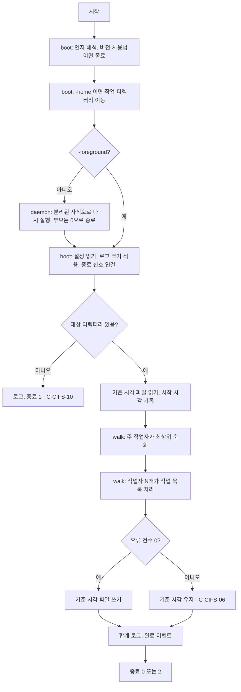

# cifs 목표 설계서

기준일: 2026-11-17 / 대상: Go 1.22 이상(개발은 1.26.0), 외부 라이브러리 없음 / 양식: T03

## 1. 설계 방침

- 유지하는 것: 명령행, 설정 키, 기준 시각 파일, 이전 버전 파일 이름, 변경 판단 규칙, 포털 전문, 로그 형식. [05-interface-spec.md](05-interface-spec.md)가 기준이다.
- 바꾸는 것: 작업 분배 수단(메시지 큐 → 프로세스 안의 큐), 데몬화 방식, 오류 검출과 집계.
- 따르는 표준: [common/02-tobe-standard-structure.md](../common/02-tobe-standard-structure.md)

## 2. 구조

```
go/
├─ cmd/vbr_cifs/main.go        시작점. 기동 절차를 부르고 백업을 실행한다
└─ internal/
   ├─ boot/      공통 기동 절차(인자, 작업 디렉터리, 백그라운드 분리, 로그, 설정, 종료 신호)
   ├─ config/    node_info.cfg 읽기
   ├─ logx/      server.log, transaction.log 쓰기와 교체
   ├─ daemon/    백그라운드 분리(운영체제별)
   ├─ fsx/       파일 시각, 경로 비교, 경로를 파일 이름으로 바꾸기(운영체제별)
   ├─ walk/      디렉터리 순회 엔진(최상위 순회, 작업 분배, 작업자). remove와 함께 쓴다
   ├─ portal/    포털 이벤트 전문 만들기와 송신
   └─ cifs/      백업 업무 규칙
      ├─ cifs.go     실행 한 번의 흐름, 기준 시각 파일, 합계, 완료 이벤트
      └─ copier.go   변경 판단, 이전 버전 보관, 복사, 대상 디렉터리 준비, dis_ 처리
```

| 패키지 | 책임 | 의존 |
|---|---|---|
| `cmd/vbr_cifs` | 인자를 업무 패키지에 넘기고 종료 코드를 정한다 | `boot`, `cifs` |
| `cifs` | 백업 규칙. 운영체제와 프로세스 구성에 대해 모른다 | `walk`, `fsx`, `portal`, `config` |
| `walk` | 순회와 병렬 처리. 파일에 무엇을 할지는 모른다 | `fsx` |
| `boot`, `config`, `logx`, `daemon`, `fsx`, `portal` | 공통 | 표준 라이브러리 |

업무 패키지는 서로 가져다 쓰지 않는다. `cifs`와 `remove`가 함께 쓰는 것은 공통 패키지에 둔다.

## 3. 처리 흐름



현행과 달라진 단계는 번호를 달았다. 번호의 내용은 [04-change-register.md](04-change-register.md)에 있다.

순회 엔진과 업무 규칙의 접점은 다음 세 가지 호출뿐이다(`walk.Visitor`).

| 호출 | 언제 | cifs에서 하는 일 |
|---|---|---|
| `File(path, rel)` | 일반 파일마다 | 변경 판단, 이전 버전 보관, 복사 |
| `EnterDir(path, rel)` | 작업자가 디렉터리에 들어가기 전 | 대상 디렉터리가 없으면 만든다 |
| `TopDir(name)` | 최상위 디렉터리를 작업으로 올리기 전 | `dis_` 대상 이름 바꾸기 |

## 4. 원본 대응표

| 원본 기능 | 원본 함수 | 전환본 위치 | 처리 | 비고 |
|---|---|---|---|---|
| F-CIFS-01 기동 | `main` | `boot.Start`, `cmd/vbr_cifs/main.go`, `cifs.Run` | 구조 변경 | 5초 주기 상태 감시는 작업자 종료 대기로 대체 |
| F-CIFS-02 큐 준비 | `env_initialize` | 없음 | 삭제 | 메시지 큐를 쓰지 않는다(C-CIFS-01) |
| F-CIFS-03 작업자 기동 | `thread_initialize` | `walk.engine.runWorkers`, `cifs.workerCount` | 구조 변경 | 1초 간격 기동 없음(C-CIFS-04) |
| F-CIFS-04 최상위 순회 | `cifs_root` | `walk.engine.scanRoot`, `dispatchDir`, `scanSecondLevel` | 구조 변경 | |
| F-CIFS-05 작업 처리 | `cifs_processing` | `walk.engine.work` | 구조 변경 | `^&^` 구분자 조립·분해 없음 |
| F-CIFS-06 하위 순회 | `cifs_sub` | `walk.engine.walkDir` | 구조 변경 | |
| F-CIFS-07 변경 판단 | `file_check` 앞부분 | `cifs.copier.File`, `cifs.changed`, `fsx.Times.NotAfter` | 그대로 | 규칙 8단계 그대로 |
| F-CIFS-08 이전 버전 보관 | `file_check` 뒷부분 | `cifs.copier.keepOldVersion`, `cifs.gzipFile` | 그대로 | 파일 열기 실패를 검사한다(C-CIFS-08) |
| F-CIFS-09 파일 복사 | `file_copy` | `cifs.copyFile`, `cifs.copyStream` | 그대로 | 쓰기·닫기 오류를 검사한다(C-CIFS-05) |
| F-CIFS-10 대상 디렉터리 준비 | `dir_check` | `cifs.copier.EnterDir` | 그대로 | |
| F-CIFS-11 `dis_` 처리 | `prepare_dis_target_dir`, `directory_is_empty` | `cifs.copier.TopDir`, `renameDisabled`, `clearEmptyTarget`, `isEmptyDir` | 그대로 | |
| F-CIFS-12 2단계 목록 | `setup_next_dir` | `cifs.dirList`, `config.Section.Fields` | 구조 변경 | 원본 결함을 고쳐 동작한다(C-CIFS-02) |
| F-CIFS-13 제외 목록 | `setup_exclusion_dir` | `cifs.dirList`, `walk.matchAny` | 구조 변경 | |
| F-CIFS-14 완료 이벤트 | `event_register`, `send_portal`, `portal_initialize` | `cifs.sendFinishEvent`, `cifs.portalClient`, `portal.Encode`, `portal.Client.Send` | 구조 변경 | 이벤트 보관 배열 없음(C-CIFS-09) |
| F-CIFS-15 설정 읽기 | `BS_GetProfileString` 외 | `config.Load`, `config.Section` | 구조 변경 | 파일을 한 번만 읽는다. 줄 길이 제한 없음(C-CIFS-03) |
| F-CIFS-16 서버 로그 | `BS_Tsyslog` | `logx.Logger.Printf` | 그대로 | 잠금 추가(C-CIFS-18) |
| F-CIFS-17 거래 로그 | `TRAN_LOG3` | `logx.Logger.Tran` | 그대로 | |
| F-CIFS-18 데몬화 | `BS_Daemonize` | `daemon.Detach` | 대체 | 자식으로 다시 실행(C-CIFS-14) |
| F-CIFS-19 시각 문자열 | `BS_date_time` 외 | 표준 시각 형식 | 대체 | |
| 사용하지 않는 코드 | `file_find`, `BS_Tsyslog2` 등 | 없음 | 삭제 | 현행 분석서 11장 |

## 5. 운영체제·환경 의존 처리

| 원본 의존 | 전환본 처리 | Linux | Windows |
|---|---|---|---|
| System V 메시지 큐 | `walk`의 작업 목록과 채널 | 같음 | 같음 |
| `fork`, `setsid`, `umask(0)` | `daemon.Detach` | 새 세션의 자식으로 다시 실행, umask 0 | 콘솔에서 분리된 자식으로 다시 실행 |
| 접근·수정·상태변경 시각 | `fsx.TimesOf` | `stat`의 세 시각 | 접근 시각, 수정 시각, 생성 시각(C-CIFS-12) |
| 경로 구분자 `/` | `filepath.Join` | `/` | `\` |
| 기준 시각 파일 이름 | `fsx.FlattenPath` | `/` → `_`, 첫 글자 버림(원본과 같음) | `\`와 `:`도 `_`로 |
| 제외·2단계 경로 비교 | `fsx.SamePath` | 문자열 비교(끝 구분자 무시) | 대소문자 무시 |
| zlib | `compress/gzip` | 같음 | 같음 |
| 종료 신호 | `signal.NotifyContext` | SIGINT, SIGTERM | Ctrl+C |

## 6. 동시 처리 설계

- 작업 단위: 원본 디렉터리 바로 아래(또는 2단계 분할 디렉터리 바로 아래)의 디렉터리 하나.
- 작업자 수: 설정 `MAX Thread cnt`. 없으면 50, 50보다 크면 50, 1보다 작으면 1.
- 순서: 주 작업자가 최상위를 다 읽은 뒤 작업자들이 시작한다(원본과 같다).
- 공유 자료: 작업 목록은 닫힌 채널로 넘긴다. 건수는 작업자마다 따로 세고 끝난 뒤 더한다. 로그는 잠금으로 보호한다. 복사 버퍼는 작업자끼리 재사용하는 묶음에서 빌려 쓴다.
- 중단: 종료 신호를 받으면 하던 파일까지만 처리하고 멈춘다. 기준 시각은 갱신하지 않고 종료 코드는 1이다.

## 7. 오류 처리와 종료 코드

| 상황 | 처리 | 종료 코드 |
|---|---|---|
| 버전 출력 | 출력 후 종료 | 0 |
| 인자 오류 | 사용법 출력, 로그 | 255 |
| 백그라운드 분리 실패, 작업 디렉터리 이동 실패 | 로그 | 1 |
| 대상 디렉터리 없음, 원본 디렉터리 열기 실패 | 로그 | 1(자식) |
| 일부 파일·디렉터리 오류 | 로그, 오류 건수 증가, 다음 항목 계속 | 2(자식) |
| 종료 신호 | 중단 | 1(자식) |
| 정상 | | 0 |

백그라운드로 분리되면 호출자는 부모의 0만 받는다. 자식의 종료 코드는 `-foreground`로 실행할 때만 호출자에게 보인다.

## 8. 설정·파일·전문

[05-interface-spec.md](05-interface-spec.md)에 있다. 설계에서 더한 것은 명령행 옵션 세 개다(C-CIFS-15).

| 옵션 | 뜻 |
|---|---|
| `-home dir` | 작업 디렉터리. 설정·로그·기준 시각 파일의 기준이 된다. 없으면 실행한 디렉터리 |
| `-config file` | 설정 파일 경로. 없으면 `./node_info.cfg` |
| `-foreground`, `-fg` | 백그라운드로 분리하지 않는다. 시험과 서비스 관리자(systemd 등) 아래에서 쓴다 |

## 9. Java로 다시 옮길 때의 대응

| 이 설계의 요소 | Java의 대응 |
|---|---|
| `walk.Visitor` 인터페이스 | 같은 메서드 세 개를 가진 인터페이스 |
| 작업 목록 채널과 작업자 | `ExecutorService`(고정 크기)와 작업 목록 |
| `context` 중단 | 인터럽트 또는 중단 표시 변수 |
| `fsx.TimesOf` | `Files.readAttributes`의 `BasicFileAttributes`. 상태변경 시각은 `unix:ctime` 속성 |
| `compress/gzip` | `java.util.zip.GZIPOutputStream` |
| `daemon.Detach` | 대응 없음. 실행 스크립트나 서비스 관리자가 백그라운드로 실행한다 |
| 실행 파일 하나 | JAR와 실행 스크립트. 실행 시간이 짧은 배치이므로 기동 시간을 확인한다 |

공통 사항은 [common/02-tobe-standard-structure.md](../common/02-tobe-standard-structure.md) 9장에 있다.

## 10. 설계에서 미룬 것

| 항목 | 이유 | 다시 볼 시점 |
|---|---|---|
| 임시 파일에 쓴 뒤 이름을 바꾸는 복사 | 복사 도중 실패하면 대상 파일이 잘린 채 남는다. 원본도 같다. 고치면 NAS에 임시 파일이 남을 수 있어 운영 확인이 필요하다 | 통합 시험 뒤 |
| 최상위 순회와 작업자를 동시에 시작 | 2단계 분할 디렉터리가 클 때 빨라진다. 로그 순서가 원본과 달라진다 | 운영 규모 시험 뒤 |
| 같은 원본·대상 쌍의 동시 실행 막기 | 원본에 없다. 호출 방식을 확인한 뒤 정한다 | Q-08 결정 뒤 |
| 오류만 따로 쓰는 로그 파일 | 형식이 정해지지 않았다 | Q-04 결정 뒤 |
