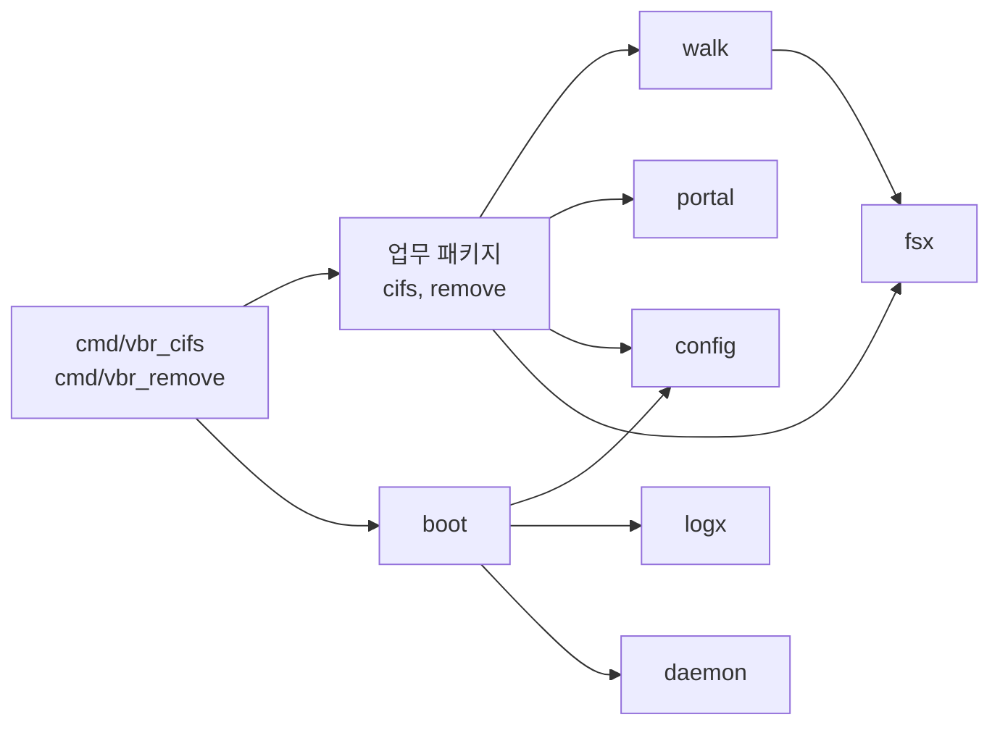

# Go 표준 구조

기준일: 2026-11-17 / 양식: T03의 공통 부분

C 서비스를 Go로 옮길 때 따르는 구조와 규칙이다. cifs와 remove 전환에서 만들었고 agent와 다음 프로젝트에 그대로 쓴다.

## 1. 폴더 구조

```
<프로젝트>/
├─ <원본 폴더들>/           원본 소스. 고치지 않는다
├─ docs/                    문서
└─ go/
   ├─ go.mod                모듈 하나. 서비스가 여럿이어도 나누지 않는다
   ├─ cmd/<실행파일명>/main.go   서비스마다 하나. 원본 실행 파일 이름을 그대로 쓴다
   ├─ internal/
   │  ├─ <업무 패키지>/     서비스마다 하나(cifs, remove, …)
   │  └─ <공통 패키지>/     두 서비스 이상이 쓰는 것
   ├─ test/                 Linux 시험 실행, 원본 비교 시험
   ├─ build.ps1, build.sh   빌드 스크립트
   └─ bin/<os>-<arch>/      빌드 산출물(Git에 넣지 않는다)
```

## 2. 패키지와 의존 방향



규칙

1. `cmd`는 인자를 업무 패키지에 넘기고 종료 코드를 정하는 일만 한다. 업무 규칙을 두지 않는다.
2. 업무 패키지끼리 가져다 쓰지 않는다. 함께 쓸 것은 공통 패키지로 옮긴다.
3. 공통 패키지는 업무 패키지를 가져다 쓰지 않는다.
4. 운영체제마다 다른 코드는 `daemon`과 `fsx`에만 둔다. 파일 이름 끝을 `_linux.go`, `_windows.go`, `_unix.go`로 나눈다. 업무 패키지에는 운영체제를 구분하는 코드를 두지 않는다.
5. 업무 패키지는 로그와 시계를 인자로 받는다(`Logger` 인터페이스, `Now` 함수). 시험에서 바꿔 끼울 수 있다.

## 3. 공통 패키지

| 패키지 | 하는 일 | 주요 이름 | 시험 |
|---|---|---|---|
| `boot` | 배치형 서비스의 기동 절차. 인자 해석, 인자 검사, 작업 디렉터리, 백그라운드 분리, 로그, 설정, 종료 신호 | `Spec`, `Start`, `App`, 종료 코드 상수 | 명령행 확인(`cli-windows.txt`) |
| `config` | `node_info.cfg` 읽기 | `Load`, `File.Section`, `Section.String`, `Int64`, `Fields` | 단위 3건 |
| `logx` | `server.log`, `transaction.log` 쓰기와 교체 | `New`, `Logger.Printf`, `Tran`, `SetMaxSize` | 단위 3건 |
| `daemon` | 백그라운드 분리 | `Detach`, `IsChild` | 원본 비교 시험과 명령행 확인에서 실제 실행 |
| `fsx` | 파일 시각, 경로 비교, 경로를 파일 이름으로 바꾸기 | `TimesOf`, `Times.NotAfter`, `SamePath`, `FlattenPath` | 업무 패키지 시험에서 간접 확인 |
| `walk` | 디렉터리 순회와 병렬 처리 | `Run`, `Options`, `Visitor`, `Counters`, `IsSnapshotName` | 업무 패키지 시험에서 간접 확인 |
| `portal` | 포털 이벤트 전문 만들기와 송신 | `Event`, `Encode`, `Client.Send` | 단위 2건 |
| `testkit` | 시험 도우미. 메모리 로그, 작업 디렉터리 이동, 파일 만들기 | `Log`, `Chdir`, `WriteFile` | - |

`walk`, `fsx`, `daemon`, `boot`에는 그 패키지만의 단위 시험이 없다. 업무 패키지 시험과 실행 시험으로 덮여 있지만, agent 전환 전에 `walk`와 `fsx`의 단위 시험을 더하는 것이 좋다.

## 4. 원본 공통 라이브러리 대응

| 원본(`bs_common`) | 전환본 | 상태 |
|---|---|---|
| F-COM-01 설정 읽기 | `config` | 완료 |
| F-COM-02 서버 로그 | `logx.Logger.Printf` | 완료 |
| F-COM-03 거래 로그(배치용) | `logx.Logger.Tran` | 완료 |
| F-COM-04 거래 로그(전문용) | `logx`에 추가 예정 | agent 전환 |
| F-COM-05 접속 로그, F-COM-06 백업·복구 로그 | `logx`에 추가 예정 | agent 전환 |
| F-COM-07 데몬화 | `daemon.Detach` | 완료 |
| F-COM-08~11 TCP 수신·접속·송수신 | 표준 라이브러리 `net`. 전문 틀은 새 패키지 | agent 전환 |
| F-COM-12 시각 문자열 | 표준 라이브러리 `time`의 형식 | 완료 |
| F-COM-13 초기화 | `logx.New`의 기본값 | 완료 |
| F-COM-14 삭제 명령 기록 | `remove.appendDeleteLog`(remove만 쓰므로 업무 패키지에 둠) | 완료 |
| F-COM-15~18 처리 시간 로그, MAC 조회, 16진수 출력, 문자열 처리 | 쓰는지 확인 후 결정 | agent 전환 |

## 5. 코딩 규칙

1. 형식은 `gofmt` 결과를 따른다. `go vet`에서 지적이 없어야 한다.
2. 외부 라이브러리를 쓰지 않는다. 표준 라이브러리로 안 되는 것이 생기면 먼저 문서에 이유를 적는다.
3. 함수는 한 가지 일만 한다. 원본의 긴 함수는 단계별로 나눈다.
4. 오류는 돌려준다. 로그만 남기고 삼키지 않는다. 계속 진행할 오류는 건수를 센다.
5. 전역 변수를 두지 않는다. 원본의 전역 상태는 구조체의 필드로 옮긴다.
6. 고정 크기 버퍼와 개수 한도는 원본의 상수를 이름 있는 상수로 옮기고 원본 이름을 주석에 적는다.
7. 원본 함수에 대응하는 함수에는 주석 첫 줄에 원본 함수 이름을 적는다(예: "원본 file_check 다").
8. 원본과 다르게 만든 곳에는 주석으로 무엇이 다른지 적는다. 변경 대장의 번호는 주석에 넣지 않는다(문서가 바뀌면 낡는다).
9. 주석과 문서는 한국어로 쓴다. 로그 문구는 원본 문구를 따른다.
10. 닫아야 하는 것(파일, 연결)은 `defer`로 닫고, 쓰기용 파일은 닫기 오류를 확인한다.
11. 다른 프로젝트의 코드는 import로 참조하지 않고 복사해서 고쳐 쓴다(2026-11-17 사용자 기준, agent의 ncc-xen 코드에서 처음 적용). 복사한 파일 머리에 출처(경로, 커밋, 복사일)와 복사 대장 항목 번호(CP-nn)를 적고, 바꾼 부분은 복사 대장(양식 [T11](../templates/T11-copied-code-register.md))에 함수 단위로 적는다. CP 번호는 바뀌지 않는 출처 번호라 8번의 예외로 주석에 넣는다. 복사 대상이 외부 라이브러리에 기대면 그 부분은 복사하지 않고 표준 라이브러리로 바꾸거나 뺀다(2번).

## 6. 운영 방식의 표준

| 항목 | 표준 | 원본과의 관계 |
|---|---|---|
| 실행 파일 | 서비스마다 하나. 외부 라이브러리 없음(`CGO_ENABLED=0`) | 원본은 zlib, pthread 필요 |
| 작업 디렉터리 | 실행한 디렉터리. `-home`으로 바꿀 수 있다 | 원본과 같음 |
| 설정 | `./node_info.cfg`. `-config`로 바꿀 수 있다 | 원본과 같음 |
| 로그 | `./server.log`, `./transaction.log`. 형식과 교체 규칙은 원본과 같음 | 원본과 같음 |
| 백그라운드 실행 | 기본. `-foreground`로 끌 수 있다 | 원본은 항상 백그라운드 |
| 종료 코드 | 0 정상, 1 시작 실패·중단, 2 일부 오류, 255 인자 오류 | 원본은 0과 255(일부 1) |
| 종료 신호 | SIGINT, SIGTERM을 받으면 하던 단위까지 처리하고 끝낸다 | 원본은 처리 없음 |
| 버전 | `-version`, `-ver` | 원본과 같음 |

서비스 관리자(systemd 등) 아래에서 실행할 때는 `-foreground`를 쓴다. 관리자가 프로세스를 직접 감시할 수 있다.

## 7. 빌드

| 명령 | 하는 일 |
|---|---|
| `.\build.ps1` 또는 `./build.sh` | 정적 검사 후 linux/amd64와 windows/amd64 실행 파일을 만든다 |
| `.\build.ps1 linux` | linux/amd64만 |
| `.\build.ps1 test` | 정적 검사와 단위 시험 |

옵션은 `CGO_ENABLED=0`, `-trimpath`, `-ldflags "-s -w"`다. 산출물은 `go/bin/<os>-<arch>/`에 생긴다.

Go 버전: `go.mod`는 1.22를 요구한다. 개발은 1.26.0으로 했다. 운영 서버의 커널이 오래된 경우 그 Go 버전이 지원하는 최소 커널을 확인해야 한다. 확인 방법은 운영 서버에서 `./vbr_cifs -version`을 실행해 보는 것이다.

## 8. 시험 방식의 표준

| 종류 | 위치 | 규칙 |
|---|---|---|
| 단위 시험 | 패키지 안의 `*_test.go` | 임시 디렉터리에서 실제 파일로 실행한다. 시계와 로그는 바꿔 끼운다. 시험 이름은 확인하는 동작을 문장으로 적는다 |
| Linux 실행 | `go/test/run-linux-tests.sh` | Windows에서 만든 Linux용 시험 실행 파일을 Linux 파일 시스템에 복사해 실행한다 |
| 원본 비교 | `go/test/parity/` | 원본을 고치지 않고 컴파일해 같은 입력으로 실행하고 결과를 비교한다 |

공통 패키지의 단위 시험

| 패키지 | 시험 | 확인하는 것 | Linux | Windows |
|---|---|---|---|---|
| `config` | `TestSectionAndKeyRules` | 섹션, 주석, 첫 값 우선, 빈 값, 대소문자, CR 제거, 없는 섹션 | 통과 | 통과 |
| `config` | `TestLongLineIsNotTruncated` | 200개 경로가 든 긴 줄을 모두 읽는다 | 통과 | 통과 |
| `config` | `TestRealDevelopmentFile` | 개발 환경 `node_info.cfg`에서 제외 28개, 2단계 2개, 로그 크기를 읽는다 | 건너뜀(파일을 상대 경로로 찾는다) | 통과 |
| `logx` | `TestServerLogFormat` | `[날짜 시각]메시지` 형식 | 통과 | 통과 |
| `logx` | `TestTransactionLogFormat` | NUL + `[날짜 시각:밀리초]메시지` + 줄바꿈 | 통과 | 통과 |
| `logx` | `TestRotateWhenOverMaxSize` | 최대 크기를 넘으면 `.old`로 바뀌고 교체 메시지가 남는다 | 통과 | 통과 |
| `portal` | `TestEncodeLayout` | 길이 7자리, 머리 23자리, JSON 본문이 명세와 같다 | 통과 | 통과 |
| `portal` | `TestSendAndReceive` | TCP로 보내고 응답을 받는다 | 통과 | 통과 |

## 9. Java로 다시 옮길 때

시험이 끝나면 Java 전환도 고려한다는 지시에 따라, 지금 구조가 Java로 어떻게 옮겨지는지 적는다.

### 그대로 옮겨지는 것

| Go | Java |
|---|---|
| `cmd/<이름>/main.go` | 서비스마다 `main` 메서드를 가진 클래스 하나 |
| 업무 패키지, 공통 패키지 | 같은 이름의 패키지. 의존 방향 규칙도 같다 |
| 인터페이스(`walk.Visitor`, `Logger`) | 인터페이스 |
| 구조체(`Job`, `Summary`, `Counters`) | 레코드 또는 클래스 |
| 작업 목록과 작업자 | `ExecutorService` 고정 크기 풀 |
| 단위 시험 | JUnit. 임시 디렉터리(`@TempDir`)에서 실제 파일로 |
| 원본 비교 시험 | 같은 스크립트. 실행 파일 경로만 바꾼다. 원본이 아니라 Go 판과 비교해도 된다 |
| 설정·로그·전문·파일 형식 | 인터페이스 명세가 언어와 무관하다 |

### 다르게 해야 하는 것

| 항목 | Go | Java에서 |
|---|---|---|
| 배포 | 실행 파일 하나 | JAR와 실행 스크립트. JVM 설치 또는 묶음이 필요하다 |
| 백그라운드 분리 | 자식으로 다시 실행 | 실행 스크립트(`nohup`) 또는 서비스 관리자에게 맡긴다. 원본의 "실행하면 바로 돌아온다"를 스크립트로 맞춘다 |
| 기동 시간 | 수 밀리초 | JVM 기동이 더해진다. 짧은 배치를 자주 실행하면 영향이 있다 |
| 파일 시각 | `syscall`의 `stat` | `Files.readAttributes`. 상태변경 시각은 `unix:ctime` 속성(Linux에서만) |
| 종료 신호 | `signal.NotifyContext` | 종료 훅(`Runtime.addShutdownHook`) |
| 메모리 | 작업자마다 640KB 버퍼 | 같음. 힙 크기 설정을 문서에 적는다 |
| 운영체제별 코드 | 파일 이름으로 나눔 | 실행 중 운영체제를 확인해 구현을 고른다 |

### 지금 지키는 것

- 업무 규칙을 운영체제와 동시 실행 방식에서 떼어 놓았다(`cifs.copier`, `remove.remover`는 스레드를 모른다).
- 규칙을 표로 시험한다(`TestIsExpiredVersion`). 같은 표를 Java 시험에 그대로 쓴다.
- 밖에서 보이는 형식은 문서(`05-interface-spec.md`)가 기준이다. 코드가 아니다.

Java 전환을 실제로 시작할 때는 이 프로젝트의 문서 묶음에서 T03(목표 설계)과 T06(시험 결과)만 새로 쓰면 된다. T01, T02, T04, T05는 그대로 쓴다.
