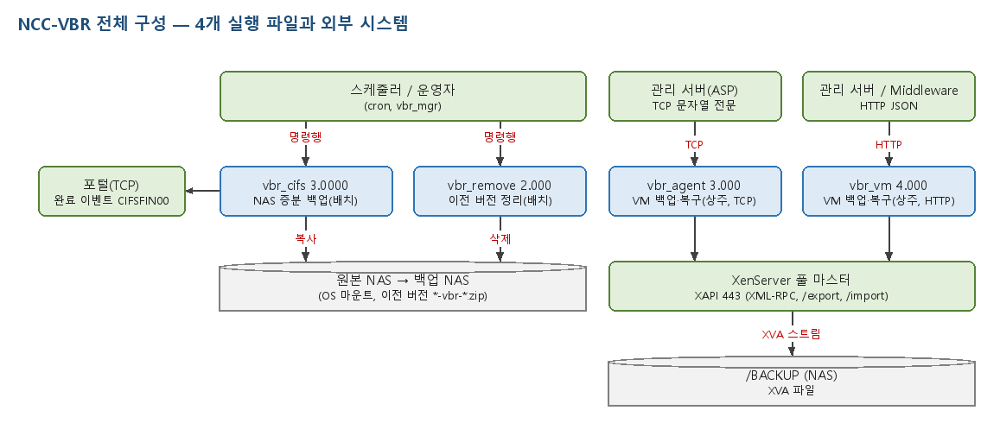
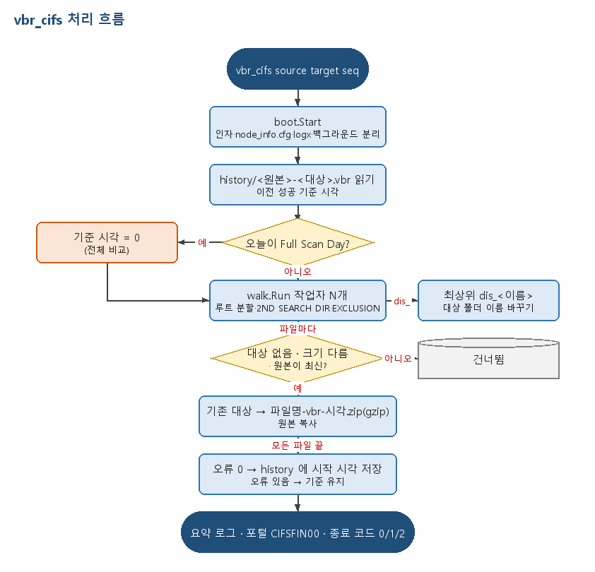

| 구분 | 내용 |
|---|---|
| 서비스 | vbr_cifs 3.0000 (원본 C vbr_cifs.c 2.0672 + 2.068 Full Scan Day) |
| 역할 | OS 에 마운트된 원본 디렉터리를 백업 NAS 로 증분 복사하고, 바뀌기 전 파일은 이전 버전(*-vbr-<시각>.zip, gzip)으로 남긴다 |
| 실행 형태 | 명령행 배치. 기본은 백그라운드로 분리, 스케줄러에서는 -foreground 권장 |
| 설정 · 로그 | node_info.cfg [VBR Manager] / logx(server.log, transaction.log) |
| 소스 | go/cmd/vbr_cifs, go/internal/cifs, 공통 boot · config · logx · walk · fsx · portal |
| 검증 상태 | 단위 시험 · 원본(C) 비교 시험 통과. 실제 NAS · 운영 규모 시험은 남음 |
| 함께 볼 문서 | docs/cifs/01~07(요건 · 분석 · 설계 · 변경 대장 · 인터페이스 · 시험 · 운영), 공통 소스 설명(05-common-source) |

# 1. 서비스 구성과 흐름

## 1.1 역할과 경계

vbr_cifs 는 파일 단위 백업 배치다. SMB(CIFS) 접속과 마운트는 OS · 설치 절차가 맡고, 서비스는 마운트된 경로를 일반 파일 API 로 읽고 쓴다. 한 번 실행에 원본 루트 하나를 대상 루트 하나로 복사하고, 끝나면 포털에 완료 이벤트(CIFSFIN00)를 TCP 로 보낸다. 원본 C 판(2.0672)의 동작을 유지했고, 의도적으로 바꾼 점은 docs/cifs/04-change-register.md 에 있다.



## 1.2 처리 흐름



| 단계 | 하는 일 | 소스 |
|---|---|---|
| 기동 | 인자 검사, node_info.cfg 읽기, 작업 디렉터리(-home) 이동, logx 시작, 기본은 백그라운드 분리 | boot.Start |
| 기준 시각 | history/<원본>-<대상>.vbr 의 첫 필드(Unix 초)를 이전 성공 기준으로 읽는다. 없으면 0(전체 비교) | cifs.readHistory |
| Full Scan Day | 오늘 요일이 설정과 같으면 이번 실행만 기준 시각을 0 으로 둔다(시각 필터 생략) | cifs.fullScanEnabled |
| 순회 | walk.Run 이 루트를 작업 단위로 나누고 작업자 N 개(MAX Thread cnt)가 재귀 순회. 2ND SEARCH DIR 은 한 단계 더 나눔, EXCLUSION DIR 은 건너뜀 | walk.Run |
| dis_ 처리 | 최상위 원본 dis_<이름> 을 만나면 원본 <이름> 이 없을 때 대상 <이름> 을 dis_<이름> 으로 먼저 이름 바꿈(다시 복사하지 않으려고) | copier.TopDir · renameDisabled |
| 파일 비교 | 대상이 없으면 복사. 있으면 기준 시각 이후 바뀐 것만 보고, 크기가 다르거나 원본 mtime 이 더 최신이면 복사 | copier.File · changed |
| 이전 버전 | 덮어쓰기 전 대상 파일을 같은 폴더의 파일명-vbr-YYYYMMDDHHMMSS.zip(gzip 형식)으로 남김 | copier.keepOldVersion |
| 마무리 | 오류 0 이면 history 에 이번 시작 시각 저장(오류가 있으면 기준 유지), 요약 로그, 포털 완료 이벤트, 종료 코드 | cifs.saveHistory · portal.Send |

## 1.3 실행 방식

스케줄러(cron 또는 관리 데몬 vbr_mgr)가 원본 · 대상 쌍마다 실행한다. 기본 동작은 원본과 같이 즉시 백그라운드로 분리하고 호출자에게 0 을 돌려준다. 호출자가 결과(종료 코드)를 받아야 하면 -foreground 로 실행한다. Linux 우선이며 Windows 빌드 · 단위 시험도 통과한다(Windows 는 ctime 대신 생성 시각을 쓴다).

# 2. 설정 · 키 · 로그 · 암호화

## 2.1 적용 범위

| 항목 | vbr_cifs 에서 |
|---|---|
| 설정 | node_info.cfg 의 [VBR Manager] 절(공통 config 패키지가 읽음). sysconfig.yaml 은 쓰지 않는다 |
| 키 · 암호화 | 쓰지 않는다. NAS 계정은 OS 마운트(fstab, credentials 파일)가 관리한다 |
| 로그 | logx: 작업 디렉터리의 server.log(동작), transaction.log(작업 기록). MAX Log size 를 넘으면 .old 로 바꾼다 |
| stdlogger | 쓰지 않는다(vbr_vm 전용) |
| 설정 반영 | 실행할 때마다 읽는다. 바꾸면 다음 실행부터 적용 |

## 2.2 node_info.cfg

```ini
[VBR Manager]
MAX Log size = 50000000
MAX Thread cnt = 2
Full Scan Day = 2
2ND SEARCH DIR = /mnt/src/big1 /mnt/src/big2
EXCLUSION DIR = /mnt/src/tmp
WEB server(IP) = 10.0.0.10
WEB server(PORT) = 8000
```

| 키 | 뜻 | 기본 · 범위 |
|---|---|---|
| MAX Log size | 로그 교체 크기(byte) | 50,000,000 |
| MAX Thread cnt | 작업자 수 | 50, 1~50 으로 보정 |
| Full Scan Day | 전체 비교 요일. 첫 글자 0~6(0=일 … 6=토) | 키가 없으면 일요일. 잘못된 값이면 전체 비교 안 함 |
| 2ND SEARCH DIR | 한 단계 더 나눠 처리할 전체 경로(공백 구분) | 최대 200개 |
| EXCLUSION DIR | 제외할 전체 경로(공백 구분) | 최대 200개 |
| WEB server(IP), WEB server(PORT) | 포털 완료 이벤트 목적지 | 없으면 보내지 않음 |

주의: 목록 값은 공백으로 나누므로 공백이 든 경로는 한 항목으로 적을 수 없다. 서비스가 읽는 키가 파일에 없으면 기본값으로 동작한다(원본과 같음).

## 2.3 로그 읽는 법

| 위치 | 내용 |
|---|---|
| server.log | BEGIN/END, Full search mode enable.[요일], 오류 경로와 원인, Total File / Total Dir / Change file / Create dir / Error 요약 |
| transaction.log | 작업 단위 기록(원본 형식) |
| history/*.vbr | 원본 · 대상 쌍마다 기준 시각 한 줄. 오류가 있던 실행은 갱신되지 않는다 |
| ===== RESULT ===== | 포털 응답 문자열(server.log) |

# 3. 기능별 호출 상세와 결과 분석

vbr_cifs 는 HTTP API 가 없다. 외부 계약은 ① 명령행 ② 종료 코드 ③ 대상 NAS 에 남는 파일(백업본, 이전 버전, history) ④ 포털 TCP 전문이다.

## 3.1 명령행

```sh
./vbr_cifs -foreground -home /opt/ncc-vbr/cifs -config /opt/ncc-vbr/cifs/node_info.cfg \
  /mnt/source /mnt/backup 20261120090000001
echo "exit=$?"
```

| 인자 · 옵션 | 뜻 |
|---|---|
| source-dir | 원본 루트(마운트된 경로) |
| target-dir | 백업 루트. 미리 있어야 한다(없으면 시작하지 않음 — 원본과 다른 결함 수정) |
| seq-no | 포털 완료 전문의 작업 번호(앞 17자 사용) |
| -config | 설정 파일. 기본 node_info.cfg |
| -home | 작업 디렉터리(로그 · history · 상대 경로 기준) |
| -foreground, -fg | 백그라운드로 분리하지 않음. 스케줄러 · 시험에서 사용 |
| -version, -ver | 버전 출력 후 종료 |

옵션은 위치 인자보다 앞에 둔다(Go flag 규칙).

## 3.2 파일 비교 규칙

| 상황 | 동작 |
|---|---|
| 대상 없음 | 복사 |
| 기준 시각 ≠ 0 이고 원본 atime · mtime · ctime 이 모두 기준보다 과거 | 건너뜀 |
| 크기 다름 또는 원본 mtime 이 대상보다 최신 | 이전 버전을 남기고 복사 |
| Full Scan Day | 기준 시각 0 → 시각 필터 없이 크기 · mtime 으로만 판단 |
| 같은 크기 · 원본 mtime 이 같거나 과거인 내용 변경 | 찾지 못한다(원본과 같은 한계) |
| 폴더 이름 변경 | 새 경로를 복사하고 옛 경로는 남는다(dis_ 규칙만 예외) |

## 3.3 포털 완료 이벤트

길이 7자리 + B + 시각 기반 전문번호 17자리 + 0 + 000 + 1 + JSON. 길이는 길이 자리를 뺀 본문 byte 수다. 연결 제한 5초, 읽기 · 쓰기 3초.

```json
{ "event_info": [ { "event_type": "N", "host_name": "VBR CIFS", "host_uuid": "NONE",
    "event_time": "2026-11-20 09:00:00", "event_code": "CIFSFIN00",
    "event_msg": "20261120090000001 BACKUP: /mnt/source => /mnt/backup Finished." } ] }
```

포털 전송 실패는 로그에만 남고 종료 코드 · 오류 수에 넣지 않는다. 백업 결과와 포털 전달은 따로 확인한다.

## 3.4 결과 분석

| 관측 | 해석 | 조치 |
|---|---|---|
| 종료 0 | 정상(오류 0). 단 -foreground 없이 실행하면 0 은 "분리 성공" 뜻이다 | 스케줄러는 -foreground |
| 종료 1 | 기동 실패, 대상 루트 없음, 취소 등 치명 오류 | server.log 첫 오류 |
| 종료 2 | 순회는 끝났으나 일부 파일 오류 | server.log 의 오류 경로, history 는 갱신 안 됨(다음 실행이 같은 범위를 다시 비교) |
| 종료 255 | 인자 오류 | 사용법 출력 확인 |
| Error = [n] | 이번 실행 오류 수(2.0672 이력에만 있던 집계를 구현) | 오류 경로별 원인 |
| history 가 안 바뀜 | 오류가 있었거나 기준 파일 쓰기 실패 | 로그 |

분석 순서: 종료 코드 → 요약 줄 Error → 첫 오류 경로 → history 갱신 여부 → 이전 버전 파일 복원 가능 여부(gzip -dc '파일-vbr-시각.zip') → 포털 전달.

## 3.5 내부 호출 API (다른 프로그램에서 부를 때)

| 함수 | 입력 → 출력 | 주의 |
|---|---|---|
| cifs.Run(ctx, Job) | Source, Target, Seq, Config, Log, Now(선택) → Summary, error | error 가 없어도 Summary.Errors, HistorySaved 를 본다 |
| walk.Run | 순회 옵션, Visitor, 진행 콜백 → 카운터, error | remove 와 같이 쓴다. 바꾸면 두 서비스 모두 회귀 시험 |
| portal.Encode / Send | Event → 전문 / 응답 문자열 | 형식 변경은 포털(ASP) 수신 쪽과 협의 |

# 4. 폴더와 소스 파일

| 파일 | 역할과 주요 함수 |
|---|---|
| go/cmd/vbr_cifs/main.go | 진입점. boot.Start → Job 구성 → cifs.Run → 종료 코드(0/1/2) |
| go/internal/cifs/cifs.go | Run(전체 조정), fullScanEnabled, historyPath · readHistory · saveHistory, 요약 · 포털 완료. Version="3.0000" |
| go/internal/cifs/copier.go | File(파일별 판단), changed, keepOldVersion(gzip 이전 버전), copyFile, EnterDir, TopDir, renameDisabled(dis_) |
| go/internal/cifs/cifs_test.go | 최초 · 증분 · 이전 버전 · Full Scan Day · dis_ · 오류 회귀 시험 |
| go/internal/walk/walk.go | 루트 분할, 작업자 풀, 재귀 순회(1,024개씩 읽음), 제외 · 2단계 분할, 카운터 |
| go/internal/fsx/fsx.go, times_*.go | 경로 비교, history 파일명 변환, OS 별 atime/mtime/ctime(Windows 는 생성 시각) |
| go/internal/portal/portal.go | 완료 전문 만들기와 TCP 송수신 |
| go/internal/boot/boot.go | 공통 기동: 플래그, -home, 설정, 신호, 백그라운드 분리, 종료 코드 상수 |
| go/internal/config/config.go | node_info.cfg 절 · 키 해석(문자열 · 정수 · 목록) |
| go/internal/logx/logx.go | server.log · transaction.log 쓰기와 .old 교체 |
| go/test/parity/run.sh, make-cifs-2068.sh | 원본 C 와 비교 시험(Docker), 2.068 재구성판 만들기 |
| cifs/ (저장소 최상위) | 원본 C 소스. 고치지 않는다(동작 대조용) |

# 5. 소스 이전 시 분석에 도움이 되는 설명

## 5.1 읽는 순서

1. cmd/vbr_cifs/main.go → internal/boot/boot.go(기동 · 종료 코드 공통 규칙)
2. internal/cifs/cifs.go 의 Run(전체 흐름) → copier.go(파일 단위 판단)
3. internal/walk/walk.go(병렬 순회) — 성능 · 순서 문제는 여기
4. internal/cifs/cifs_test.go(동작 명세 대신 읽기 좋다)
5. docs/cifs/04-change-register.md(원본과 다르게 한 점과 이유), 05(인터페이스)

## 5.2 원본과 다르게 한 주요 점 (결정 대기 포함)

| 항목 | 원본 | 전환본 | 상태 |
|---|---|---|---|
| 2ND SEARCH DIR | 설정을 읽은 직후 지워 동작하지 않음 | 원래 의도대로 동작 | Q-01 결정 대기 |
| 오류가 있던 실행의 기준 시각 | 항상 갱신(실패 파일이 다음에 비교 안 될 수 있음) | 오류가 있으면 갱신 안 함 | Q-02 결정 대기 |
| 대상 루트 없음 | 그대로 진행해 전부 오류 | 시작하지 않음 | Q-03 결정 대기 |
| 오류 집계 | 이력 주석에만 있음 | 요약에 Error = [n] | Q-04 |

결정 대기 목록은 docs/00-process/04-open-decisions.md 1장.

## 5.3 알아 둘 함정

- 이전 버전 파일 확장자는 .zip 이지만 내용은 gzip 이다(원본과 같음). remove 가 이 이름 규칙으로 지운다.
- 같은 초에 같은 파일의 이전 버전이 두 번 생기면 이름이 겹친다(원본과 같은 한계).
- 이전 버전 만들기가 실패해도 본체 복사는 시도한다.
- 시간대: history 는 Unix 초, 이전 버전 이름 · 로그는 로컬 시각.
- 순회 순서는 작업자 수에 따라 달라진다. 비교 시험은 결과 파일 집합으로 비교한다.
- 공통 패키지(boot, config, logx, walk, fsx)는 remove · agent 도 쓴다. 고치면 세 서비스 모두 시험한다.

## 5.4 시험

```sh
cd go
go test -p 1 ./internal/cifs ./internal/portal ./internal/walk
```

원본 비교: go/test/parity/run.sh(Docker, alpine + gcc 로 원본 컴파일). 운영 인수 때는 마운트 권한, 큰 디렉터리, 시간대, 정상 · 오류 종료, 이전 버전 복원, history 위치를 확인한다.
