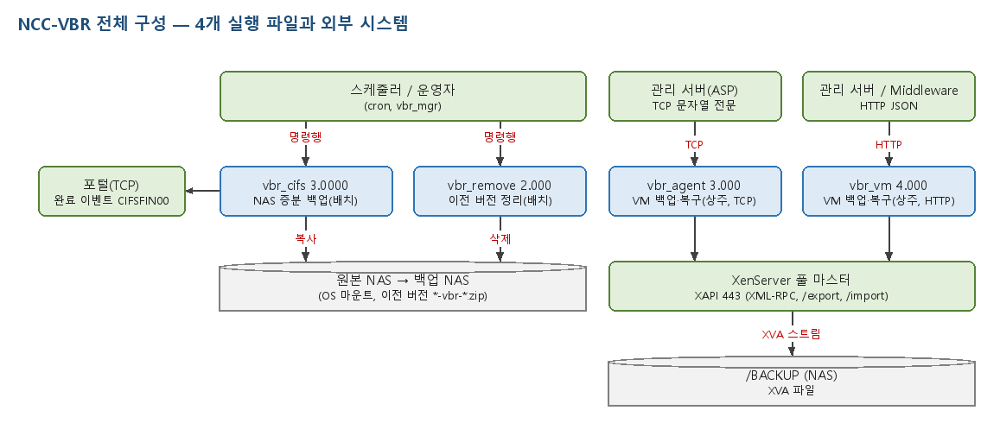
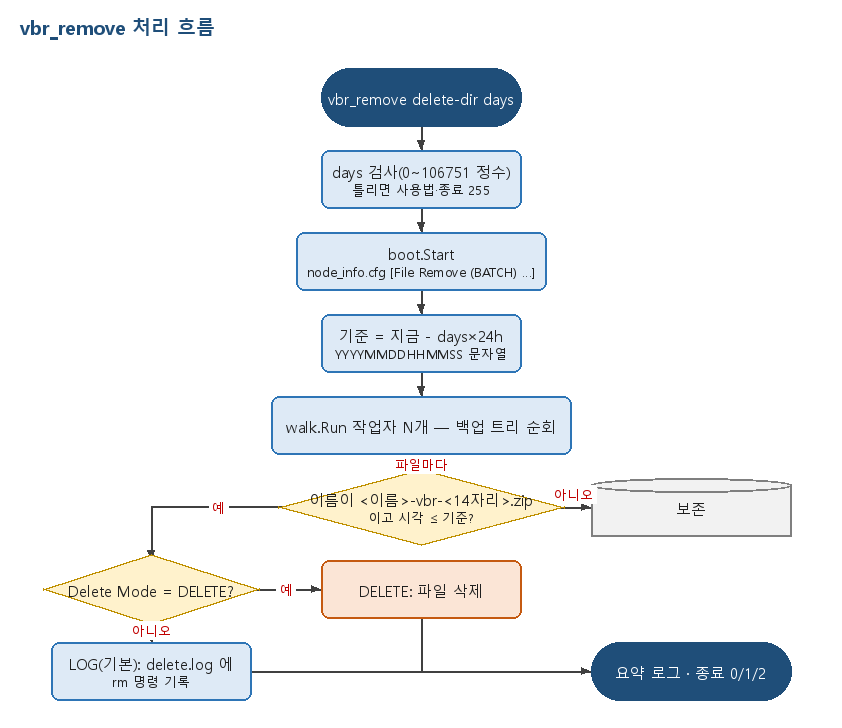

| 구분 | 내용 |
|---|---|
| 서비스 | vbr_remove 2.000 (원본 C vbr_remove.c 1.000) |
| 역할 | vbr_cifs 가 남긴 이전 버전 파일(<이름>-vbr-<14자리 시각>.zip) 중 보존 기간이 지난 것을 지운다. 기본은 지우지 않고 delete.log 에 명령만 적는다 |
| 실행 형태 | 명령행 배치. 기본은 백그라운드 분리, 스케줄러에서는 -foreground 권장 |
| 설정 · 로그 | node_info.cfg [File Remove (BATCH) for NCC-VBR] / logx(server.log), delete.log |
| 소스 | go/cmd/vbr_remove, go/internal/remove, 공통 boot · config · logx · walk · fsx |
| 검증 상태 | 단위 시험 · 원본(C) 비교 시험 통과. 실제 NAS 시험은 남음 |
| 함께 볼 문서 | docs/remove/01~07, CIFS 인계서(이전 버전 이름 규칙), 공통 소스 설명 |

# 1. 서비스 구성과 흐름

## 1.1 역할과 경계

vbr_remove 는 백업 NAS 를 순회하며 파일 이름만 보고 지울 대상을 고른다. 파일의 실제 mtime 이나 내용은 보지 않는다. 디렉터리는 지우지 않는다. 원본 NAS 에서 사라진 파일을 추적하는 기능은 없다(이름 속 시각 기준의 기간 정리다). VM 백업 파일(.xva)은 이름 규칙에 맞지 않아 대상이 아니다.



## 1.2 처리 흐름



| 단계 | 하는 일 | 소스 |
|---|---|---|
| 인자 검사 | days 가 0~106,751 정수인지(더 크면 날짜 계산이 넘침). 틀리면 사용법 출력 · 종료 255. 백그라운드 분리 전에 검사 | remove.ParseDays, boot.Spec.Check |
| 기동 | node_info.cfg, -home, logx, 백그라운드 분리 | boot.Start |
| 기준 시각 | 지금 - days×24시간 을 로컬 YYYYMMDDHHMMSS 문자열로 | remove.Run |
| 모드 | Delete Mode 가 정확히 DELETE 면 실제 삭제, 그 밖(없음 포함)은 LOG | remove.deleteMode |
| 순회 | walk.Run(cifs 와 같은 병렬 순회, 2ND SEARCH DIR · EXCLUSION DIR) | walk.Run |
| 판정 | 이름이 <이름>-vbr-<숫자 14자리>.zip 이고 그 시각 ≤ 기준이면 대상 | remove.IsExpiredVersion |
| 처리 | LOG: delete.log 에 셸 인용한 rm 명령 한 줄 / DELETE: os.Remove | remover.File, appendDeleteLog, shellQuote |
| 마무리 | 요약 로그와 종료 코드 | remove.Run, main |

# 2. 설정 · 키 · 로그 · 암호화

## 2.1 적용 범위

| 항목 | vbr_remove 에서 |
|---|---|
| 설정 | node_info.cfg 의 [File Remove (BATCH) for NCC-VBR] 절 |
| 키 · 암호화 | 쓰지 않는다(NAS 인증은 OS 마운트) |
| 로그 | logx: server.log. 삭제 후보 목록 delete.log(실행 시작 때 기존 파일을 지우려고 시도) |
| stdlogger | 쓰지 않는다 |
| 설정 반영 | 실행할 때마다 읽는다 |

## 2.2 node_info.cfg

```ini
[File Remove (BATCH) for NCC-VBR]
MAX Log size = 50000000
MAX Thread cnt = 2
Delete Mode = LOG
2ND SEARCH DIR = /mnt/backup/big
EXCLUSION DIR = /mnt/backup/keep
```

| 키 | 뜻 | 기본 · 범위 |
|---|---|---|
| Delete Mode | DELETE 면 실제 삭제. 그 밖은 LOG(후보만 기록) | LOG |
| MAX Thread cnt | 작업자 수 | 50, 1~50 |
| MAX Log size | 로그 교체 크기(byte) | 50,000,000 |
| 2ND SEARCH DIR | 한 단계 더 나눠 처리할 경로(공백 구분) | 최대 10개 |
| EXCLUSION DIR | 제외 경로(공백 구분) | 최대 10개 |

# 3. 기능별 호출 상세와 결과 분석

## 3.1 명령행

```sh
./vbr_remove -foreground -home /opt/ncc-vbr/remove -config /opt/ncc-vbr/remove/node_info.cfg /mnt/backup 30
echo "exit=$?"
```

| 인자 · 옵션 | 뜻 |
|---|---|
| delete-dir | 순회할 백업 루트 |
| days | 보존 일수. 0~106,751 정수(0 도 허용 — 이전 버전 거의 전부가 대상) |
| -config, -home, -foreground(-fg), -version(-ver) | cifs 와 같은 공통 옵션(boot) |

모드는 명령행이 아니라 설정(Delete Mode)으로 정한다.

## 3.2 대상 판정 예

기준이 20261021090000 일 때:

| 파일 이름 | 판정 |
|---|---|
| report.doc-vbr-20261021085959.zip | 대상 |
| report.doc-vbr-20261021090000.zip | 대상(같으면 포함) |
| report.doc-vbr-20261021090001.zip | 보존 |
| report.zip, vm.xva | 규칙에 맞지 않아 보존 |
| -vbr-20261021090000.zip | 앞 이름이 없어 보존 |

시각은 숫자 14자리인지만 본다(달력상 유효한 날짜인지는 보지 않음, 원본과 같음).

## 3.3 delete.log

LOG 모드에서 대상마다 POSIX 셸 형식으로 인용한 삭제 명령을 한 줄씩 적는다. 기록 순서는 작업자 순서에 따라 달라진다. 이 파일은 검토용이며, Windows PowerShell 에 그대로 붙여 실행하지 않는다. 실제 삭제는 DELETE 모드로 한다.

## 3.4 결과 분석

| 관측 | 해석 |
|---|---|
| 종료 0 | 정상(-foreground 없이 실행했다면 분리 성공 뜻) |
| 종료 1 | 기동 실패, 루트 오류, 취소 |
| 종료 2 | 순회는 끝났으나 일부 오류 |
| 종료 255 | 인자 · 보존 일수 오류 |
| 요약의 Delete / Deleted | 모드, LOG 면 후보 수 · DELETE 면 지운 수 |
| 요약의 Cutoff | 이번 판정 기준 문자열 |
| Skipped | 일반 파일이 아닌 항목 수(보존된 파일 수가 아님) |

분석 순서: 모드 → 기준 시각 → 종료 코드 → 오류 수 → 후보 · 삭제 수 → 실제 파일 존재 확인. 운영에서는 먼저 LOG 로 후보를 확인한 뒤 DELETE 로 바꾼다. 지운 파일은 바이너리를 되돌려도 복구되지 않는다.

## 3.5 내부 호출 API

| 함수 | 입력 → 출력 | 뜻 |
|---|---|---|
| ParseDays(text) | 문자열 → 정수, error | 명령행 입력과 범위 검사 |
| Run(ctx, Job) | Dir, Days, Config, Log, Now(선택) → Summary, error | 기준 계산 · 순회 · 집계 |
| IsExpiredVersion(path, cutoff) | 경로, 기준 문자열 → bool | 이름 규칙과 기간 판정 |
| walk.Run | Visitor → 카운터 | cifs 와 공유 |

# 4. 폴더와 소스 파일

| 파일 | 역할과 주요 함수 |
|---|---|
| go/cmd/vbr_remove/main.go | 진입점. 보존 일수 검사(boot.Spec.Check), Job 구성, 종료 코드 |
| go/internal/remove/remove.go | ParseDays, Run, deleteMode, IsExpiredVersion, appendDeleteLog, shellQuote. Version="2.000" |
| go/internal/remove/remove_test.go | 이름 · 기준 시각 · LOG · DELETE · 기간 넘침 회귀 시험 |
| go/internal/walk/walk.go | 병렬 순회(cifs 와 공유) |
| go/internal/boot, config, logx, fsx | 공통(공통 소스 설명 참고) |
| go/test/parity/run.sh | 원본 C 와 비교 시험(remove 9개 항목) |
| remove/ (저장소 최상위) | 원본 C 소스(고치지 않음) |

# 5. 소스 이전 시 분석에 도움이 되는 설명

## 5.1 읽는 순서

cmd/vbr_remove/main.go → internal/remove/remove.go(200여 줄로 짧다) → remove_test.go → walk.go → docs/remove/04-change-register.md.

## 5.2 원본과 다르게 한 점 (결정 대기 포함)

| 항목 | 원본 | 전환본 | 상태 |
|---|---|---|---|
| 보존 일수가 숫자가 아니거나 음수 | 기준이 0 또는 미래가 되어 모든 이전 버전이 대상 | 실행하지 않고 사용법 출력(0 은 허용, 106,751 초과도 거부) | Q-06 |
| 2ND SEARCH DIR | 동작하지 않음 | 의도대로 동작 | Q-07 |

## 5.3 알아 둘 함정

- 판정은 이름 속 시각만 본다. 파일을 복사해 mtime 이 바뀌어도 판정은 같다.
- 이름 규칙은 cifs 의 keepOldVersion 과 짝이다. 한쪽 이름 형식을 바꾸면 반드시 다른 쪽도 바꾼다.
- 같은 백업 루트에 VM 백업 등 다른 업무 파일을 두면, 이름 규칙에 우연히 맞는 파일이 지워질 수 있다. 루트를 업무별로 나눈다.
- delete.log 의 이전 파일 삭제 실패는 무시된다. 실행마다 -home 을 정해 두면 추적이 쉽다.

## 5.4 시험

```sh
cd go
go test -p 1 ./internal/remove ./internal/walk
```

실제 삭제(DELETE) 회귀는 합성 이전 버전 파일을 만든 격리 디렉터리에서만 한다.
