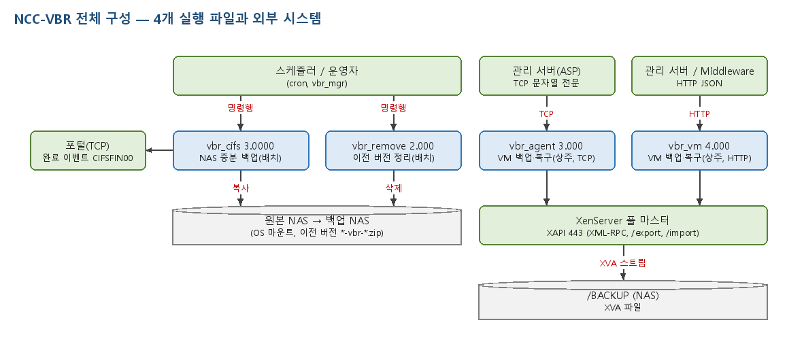
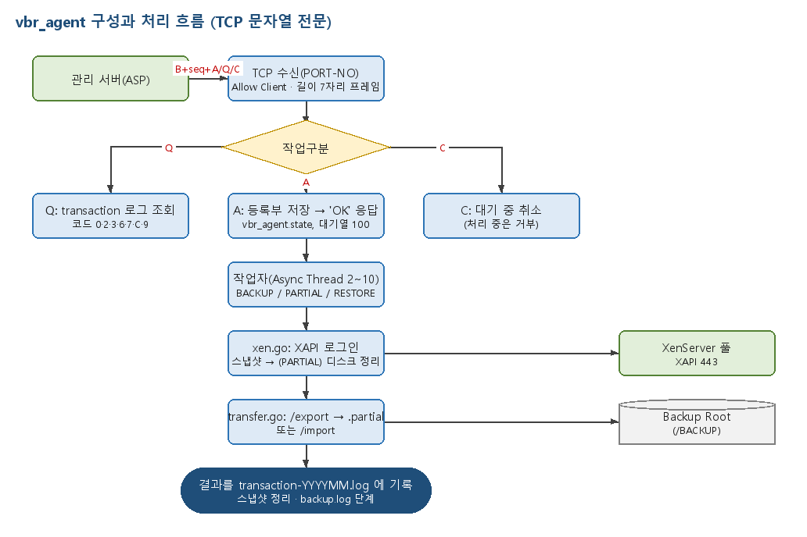

| 구분 | 내용 |
|---|---|
| 서비스 | vbr_agent 3.000 (원본 C vbr_agent.c 1.602, dom0 에서 돌던 agent 를 agentless 로 재구성) |
| 역할 | 관리 서버(ASP)가 보내는 고정 길이 문자열 전문(TCP)을 받아 XenServer VM 을 XVA 로 백업 · 부분 백업 · 복구하고, 결과 조회 · 취소에 답한다 |
| 실행 형태 | 상주 데몬(TCP 수신). 별도 Linux 서버에서 XenServer 풀 마스터에 XAPI(443)로 원격 접속 |
| 설정 · 로그 | node_info.cfg [VBR Agent for Xenserver] / logx(server.log), backup.log(단계), transaction-YYYYMM.log(작업 기록), vbr_agent.state(등록부) |
| 암호화 | XAPI 암호를 ENC[…] 로 설정에 둔다(키링 key.yaml, vbr_secret) |
| 소스 | go/cmd/vbr_agent, go/internal/agent, 공통 boot · config · logx · xapi · secret |
| 검증 상태 | 단위 · 원본 비교 시험 통과, 실제 XenServer 9 풀 실기 R1~R9 통과(2026-11-19). 관리 서버 연동 · Linux 서버 시험은 남음 |
| 위치 | 2단계 vbr_vm(JSON API)이 같은 기능을 새 규약으로 제공한다. 관리 서버가 새 API 로 바뀌기 전까지 vbr_agent 를 쓴다(두 서비스는 같은 서버에서 다른 포트로 함께 돌 수 있음) |

# 1. 서비스 구성과 흐름

## 1.1 역할과 재구성 범위

원본은 dom0 에서 xe 명령으로 일하던 agent 였다. 1단계에서 별도 서버의 Go 데몬으로 옮기고 XAPI 를 직접 부르게 바꿨다(agentless). 기능은 백업 · 부분 백업 · 복구 · 결과 조회(Q) · 취소(C)만 남겼고, dom0 상태 감시 · 현황 조회(I) · 상태(S) 전문 등은 뺐다. 결정과 근거는 docs/agent/00-rescope-review.md.



## 1.2 처리 흐름



| 단계 | 하는 일 | 소스 |
|---|---|---|
| 수신 | PORT-NO 에서 TCP 접속을 받고 Allow Client(IP 목록)를 확인. 길이 7자리 + 본문 프레임을 읽는다 | agent.go, frame.go |
| 분기 | 작업구분: A(작업 등록) / Q(결과 조회) / C(취소). 형식 오류는 9, 대기열 가득은 8 로 받은 전문을 되돌려 줌 | agent.go |
| 등록(A) | 등록부(vbr_agent.state)와 대기열(100칸)에 넣고 'OK'(코드 0) 응답. transaction 로그에 1(수신) · 2(대기 저장) | registry.go, tranlog.go |
| 작업자 | Async Thread 개(2~10)가 대기열에서 꺼내 BACKUP / PARTIAL / RESTORE 실행 | worker.go |
| XAPI | 로그인 → 임시 스냅샷 → (PARTIAL) 고르지 않은 디스크 VBD · VDI 삭제 | xen.go, internal/xapi |
| 전송 | /export 스트림을 <파일>.partial 에 받고 task 성공 확인 후 이름 바꿈. 복구는 /import 업로드 | transfer.go |
| 마무리 | 임시 스냅샷 · VDI 삭제, 결과(성공 문장 또는 [ERROR]…)를 transaction 로그에 0 으로 기록, backup.log 에 단계 | xen.go, steplog.go |
| 조회(Q) | transaction 로그에서 그 전문번호의 마지막 기록을 찾아 코드와 문장으로 응답 | agent.go query, tranlog.go |
| 재기동 | 등록부를 읽어 처리 중이던 작업은 6(Task cancel) 으로 기록, 대기 중이던 작업은 다시 대기열에 | registry.go Restore |

# 2. 설정 · 키 · 로그 · 암호화

## 2.1 node_info.cfg

```ini
[VBR Agent for Xenserver]
PORT-NO = 10003
XAPI Address = 192.168.102.53
XAPI User = root
XAPI Password = ENC[v1:aes-256-gcm:k1:...]
XAPI Keyring = /opt/ncc-vbr/agent/key.yaml
XAPI Verify SSL = N
Backup Root = /BACKUP
Allow Client = 10.0.0.20 10.0.0.21
Async Thread = 3
```

| 키 | 뜻 | 기본 · 비고 |
|---|---|---|
| PORT-NO | TCP 수신 포트 | 필수 |
| XAPI Address | 풀 마스터 주소. 마스터가 바뀌면 HOST_IS_SLAVE 응답을 따라간다 | 필수 |
| XAPI User / XAPI Password | XAPI 계정, 암호(ENC 값) | root / 필수 |
| XAPI Keyring | 키링 파일 | 키링 경로 |
| XAPI Verify SSL | Y · YES · TRUE 면 인증서 검증 | 검증 안 함 |
| Backup Root | 백업 파일을 둘 수 있는 루트. 밖의 경로는 거부 | 필수 |
| Allow Client | 접속 허용 IP(공백 구분). 비면 모두 허용하고 경고 | - |
| Async Thread | 동시 작업 수 | 3 (2~10) |

agent 하나가 풀 하나를 맡는다(접속 정보가 설정에 있음). 여러 풀이면 agent 를 포트를 달리해 여러 개 띄운다. vbr_vm 은 요청마다 풀을 받는다.

## 2.2 키링과 암호화

| 항목 | 내용 |
|---|---|
| 키링 파일 | key.yaml. **이름은 yaml 이지만 내용은 JSON**이다(version, active_key_id, keys{id: algorithm, material}). vbr_secret keygen 으로 만든다. Linux 권한 600 |
| 암호 형식 | ENC[v1:aes-256-gcm:<키 ID>:<payload>]. AES-256-GCM, 용도 문자열이 인증 데이터로 묶인다 |
| 용도 | XAPI 암호는 ncc-vbr/xapi-password(vbr_secret encrypt 의 기본값). vbr_vm 요청 암호와 같은 용도라 같은 값을 쓸 수 있다 |
| 만들기 | vbr_secret keygen key.yaml → 암호를 표준 입력으로 vbr_secret encrypt key.yaml → 나온 ENC 를 XAPI Password 에 |

```sh
./vbr_secret keygen /opt/ncc-vbr/agent/key.yaml          # 이미 있으면 덮어쓰지 않고 실패
read -rs PW; printf '%s\n' "$PW" | ./vbr_secret encrypt /opt/ncc-vbr/agent/key.yaml; unset PW
```

Windows PowerShell 파이프는 첫 줄 앞에 BOM 을 붙일 수 있는데, vbr_secret 이 떼어 낸다(1단계 실기 R1 에서 고침).

## 2.3 로그와 상태 파일

| 파일 | 내용 |
|---|---|
| server.log | 기동 · 수신 · 오류 등 동작 로그(logx). MAX Log size 를 넘으면 .old |
| backup.log | 백업 · 복구 단계별 진행(원본 BACKUP_LOG / IMPORT_LOG) |
| transaction-YYYYMM.log | 전문 단위 작업 기록. 파일 이름의 YYYYMM 은 전문번호 앞 6자리. Q 조회의 근거 |
| vbr_agent.state | 등록부(대기 · 처리 중 작업). 재기동 복구에 쓴다 |

stdlogger 와 sysconfig.yaml 은 쓰지 않는다(vbr_vm 전용).

# 3. 기능별 호출(전문) 상세와 결과 분석

## 3.1 프레임

```
[길이 7자리][B][전문번호 17자리][작업구분 1][시간 3][우선순위 1][본문 …]
  0000123    B  20261120090000001    A       000       5        BACKUP <vm> <스냅샷 이름> <파일>
```

| 자리 | 길이 | 뜻 |
|---|---|---|
| 길이 | 7 | 길이 자리를 뺀 나머지 byte 수(ASCII 숫자) |
| B | 1 | 고정 |
| 전문번호 | 17 | 호출자가 만든다(보통 yyyyMMddHHmmssfff). 조회 · 취소의 키 |
| 작업구분 | 1 | 요청: A / Q / C. 응답: 결과 코드(아래) |
| 시간 | 3 | timeout(원본 호환 자리) |
| 우선순위 | 1 | 0~9(원본 호환. 실행 순서에는 쓰지 않음) |

## 3.2 요청 종류

| 작업구분 · 본문 | 뜻 | 즉시 응답 |
|---|---|---|
| A · BACKUP <VM uuid> <스냅샷 이름> <백업 파일 전체 경로> | 전체 백업(항상 임시 스냅샷, 항상 gzip 압축) | 0 'OK'(접수). 결과는 Q 로 |
| A · PARTIAL <VM uuid> <15자리> <스냅샷 이름> <파일> | 부분 백업. 15자리 i 번째가 1 이면 userdevice i 를 담는다 | 0 'OK' |
| A · RESTORE <파일> <true\|false> <SR uuid> | 복구. true 면 MAC · uuid 보존 | 0 'OK' |
| Q · <원래 전문번호 17자리> | 결과 조회(새 전문번호로 보냄) | 아래 결과 코드 |
| C · <원래 전문번호> | 대기 중 작업 하나 취소(처리 중이면 거부) | 0 'Request message is cancel.[번호]' 또는 9 |
| C · 00000000000000000 | 대기 중 작업 모두 취소 | C 'Multi cancel summary : total […], cancel […], failed […]' |

## 3.3 결과 코드(Q 응답과 transaction 로그)

| 코드 | 뜻 |
|---|---|
| 0 | 끝남. **성공도 실패도 0** 이다. 본문이 VM BACKUP Success : … 이면 성공, [ERROR]… 이면 실패(원본 동작 유지, K-AG-01) |
| 1 · 2 | 수신 · 대기 중 |
| 3 | 처리 중 |
| 6 | 재기동으로 중단(Task cancel) |
| 7 | 로그로는 대기 · 처리 중인데 등록부에 없음(이미 취소됨) |
| C | 취소됨 |
| 8 | (즉시 응답) 대기열 가득 |
| 9 | 없음 · 형식 오류 · 거부 |

성공 문장 예: VM BACKUP Success : VM uuid=…, Snapshot VM uuid=…, backup filename=/BACKUP/…xva
실패 문장 예: [ERROR]XAPI Error: UUID_INVALID | VM | 0000… (원본은 [ERROR] + xe 출력이었다. 머리 [ERROR] 는 같음)

## 3.4 호출 예 (PowerShell 시험 도구)

go/test/agent/vbr-send.ps1 의 Send-Vbr 가 길이를 붙여 보내고 응답 한 프레임을 읽는다. Wait-Vbr 는 Q 를 되풀이한다.

```powershell
. .\go\test\agent\vbr-send.ps1
$seq  = Get-Date -Format 'yyyyMMddHHmmssfff'
$body = "B" + $seq + "A0005" + "BACKUP <VM uuid> vbrtest /BACKUP/test.xva"
Send-Vbr -Body $body -HostName <agent 주소> -Port 10003          # → 0 OK
$q = Get-Date -Format 'yyyyMMddHHmmssfff'
Send-Vbr -Body ("B" + $q + "Q0001" + $seq) -HostName <agent 주소> -Port 10003   # → 3 처리 중 / 0 결과
```

새 호출자를 만들 때: 길이는 문자 수가 아니라 byte 수, TCP 는 나뉘어 도착할 수 있으므로 길이만큼 다 읽을 때까지 읽는다.

## 3.5 결과 분석

| 증상 | 확인 | 원인 · 조치 |
|---|---|---|
| A 에 9 | transaction 로그 9 Format Error · TASK Format Error | 본문 형식(공백 구분 인자 수, 15자리) |
| A 에 8 | Queue full | 대기열 100칸 가득. 나중에 다시 |
| Q 가 계속 3 | backup.log 단계 | 큰 VM 은 수 분~수십 분(2.6 GB gzip 약 4분 30초) |
| Q 0 + [ERROR]XAPI Error: SESSION_AUTHENTICATION_FAILED | 계정 · 암호 | ENC 값을 같은 키링으로 다시 만든다 |
| Q 0 + DUPLICATE_MAC_SEED | RESTORE true | 원본 VM 이 같은 풀에 있으면 MAC 보존 복구가 거부된다(실기 R4). false 로 복구 |
| Q 6 | 재기동 | 처리 중 중단. 임시 스냅샷이 남을 수 있다 → dom0 xe snapshot-list snapshot-of=<vm> |
| C 에 9 Request message is processing. | 처리 중 취소 | vbr_agent 는 처리 중 취소를 지원하지 않는다(vbr_vm 은 지원) |

# 4. 폴더와 소스 파일

| 파일 | 역할 |
|---|---|
| go/cmd/vbr_agent/main.go | 진입점. 설정 · 키링 · XAPI 클라이언트 준비, TCP 수신 시작 |
| go/internal/agent/agent.go | 수신 루프, 전문 분기(A/Q/C), query, cancel, 응답. Version="3.000" |
| go/internal/agent/frame.go | 길이 프레임, 23자리 머리 해석, 응답 만들기(Reply, Echo), 코드 상수 |
| go/internal/agent/config.go | [VBR Agent for Xenserver] 읽기, Backup Root 경로 검사, Allow Client |
| go/internal/agent/registry.go | 등록부 · 대기열, vbr_agent.state 저장 · 재기동 복구 |
| go/internal/agent/worker.go | 작업자, BACKUP / PARTIAL / RESTORE 인자 해석과 실행 |
| go/internal/agent/xen.go | 스냅샷 · 부분 디스크 정리 · 스냅샷 삭제 등 XAPI 조작 |
| go/internal/agent/transfer.go | /export · /import 스트림 전송(.partial, task 확인, 취소) |
| go/internal/agent/tranlog.go | transaction-YYYYMM.log 쓰기 · Q 조회 |
| go/internal/agent/steplog.go | backup.log 단계 기록 |
| go/internal/xapi/ | XML-RPC 클라이언트, 세션 · 마스터 따라가기, VM · VBD · VDI · SR · task 호출(vbr_vm 과 공유) |
| go/internal/secret/ | 키링 · ENC 복호화(vbr_vm, vbr_secret 과 공유) |
| go/test/agent-parity/ | 원본 C 와 비교 시험(가짜 xe/XAPI, driver) |
| go/test/agent/vbr-send.ps1, collect-xe-samples.sh | 수동 송신 도구, xe 표본 수집 |
| agent/ (저장소 최상위) | 원본 C 소스(고치지 않음) |

# 5. 소스 이전 시 분석에 도움이 되는 설명

## 5.1 읽는 순서

1. docs/agent/00-rescope-review.md(왜 이렇게 줄였는지) → 05-interface-spec.md 9장(전문 명세)
2. cmd/vbr_agent/main.go → agent.go(수신 · 분기) → frame.go
3. registry.go · worker.go(대기열과 작업자) → xen.go · transfer.go(XAPI)
4. tranlog.go(Q 의 근거)
5. ncc-xen 에서 복사한 코드: docs/agent/08-copied-code-register.md(xapi, secret)

## 5.2 원본 동작을 그대로 둔 특이점

| 특이점 | 이유 |
|---|---|
| 실패도 Q 코드 0, 본문 [ERROR] 로 구분 | 관리 서버(ASP)가 이렇게 판단한다(Q-A18 확인 대기) |
| 일괄 취소 응답 코드 C | 원본 · 2015 표본과 같음 |
| 성공 문장은 운영 로그의 VM BACKUP Success : … | 소스 1.602 의 XVA file check … 문장은 쓰지 않음(Q-A19 확인 대기) |
| 우선순위 자리 | 받기만 하고 실행 순서에 쓰지 않음 |

## 5.3 알아 둘 함정

- 같은 VM 을 동시에 백업해도 XenServer 는 막지 않는다(실기 E-03). 파일 이름만 겹치지 않게 한다.
- 강제 종료 · 장애 때 임시 스냅샷과 .partial 이 남을 수 있다. 자동 정리는 범위 밖(Q-A17).
- 전문 길이는 byte 기준이다. 한글 등 멀티바이트를 본문에 넣으면 길이가 문자 수와 달라진다.
- xapi · secret 은 vbr_vm 과 공유한다. 고치면 두 서비스 모두 시험한다(2단계에서 vbr_vm 결함 수정은 xapi 를 건드리지 않고 했다).

## 5.4 vbr_vm 으로 옮길 때 대응

| vbr_agent | vbr_vm |
|---|---|
| A BACKUP | POST /api/v1/jobs action=export (+ compression: gzip, snapshot_mode: always 면 기존과 같음) |
| A PARTIAL 15자리 | export + options.disks[번호…] |
| A RESTORE | action=restore, restore_original_uuid, sr_uuid |
| Q | GET /api/v1/jobs/{taskId}: 0 → succeeded/failed 로 나뉨, 2 → queued, 3 → running, 6 → interrupted, C → canceled, 9 → 404 |
| C | POST /api/v1/jobs/{taskId}/cancel(처리 중도 취소됨) |
| node_info.cfg | sysconfig.yaml(즉시 반영), 접속 정보는 요청마다 |

## 5.5 시험

```sh
cd go
go test -p 1 ./internal/agent ./internal/xapi ./internal/secret ./cmd/vbr_secret
```

원본 비교: go/test/agent-parity/run.sh. 실기 절차: docs/00-process/06-windows-test-guide.md 4장(R0~R9).
