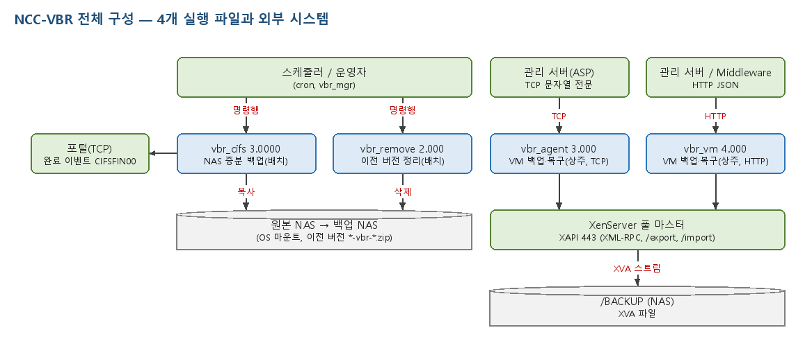
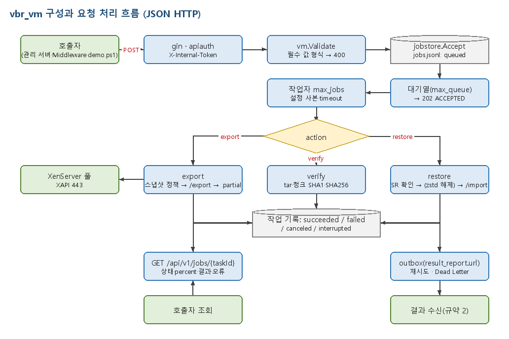
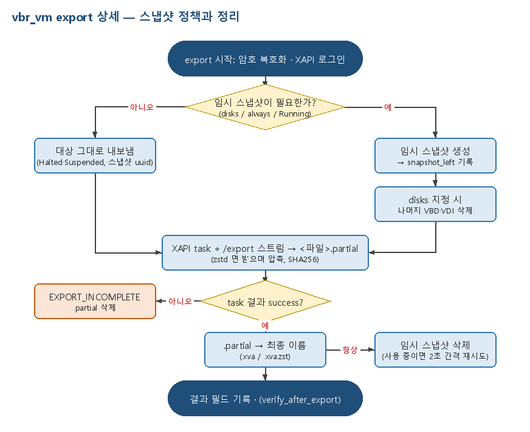
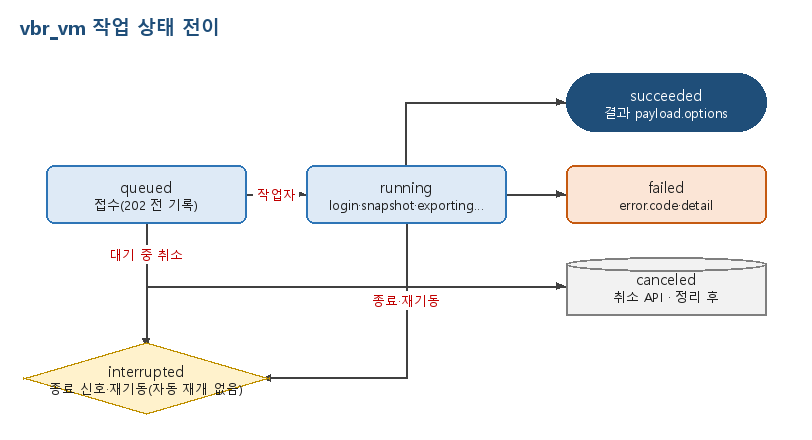

| 구분 | 내용 |
|---|---|
| 서비스 | vbr_vm 4.000 — NCC-VBR VM Backup Service (systemd ncc-vbr-vm.service) |
| 역할 | 호출자(관리 서버, 나중에 Middleware)의 JSON 요청을 받아 XenServer VM 을 XVA 로 백업(export, 디스크 선택 포함), XVA 를 검증(verify), VM 으로 복구(restore)한다. 작업 조회 · 취소, 결과 보고(설정 시) |
| 규약 | NCC-Xen Job Type 표준 명세서 v3.36 의 규약 1 · 2 와 VM_BACKUP. 상세 명세는 docs/vm/NCC-VBR_VM_JobType_표준명세서_v1.00.docx |
| 실행 형태 | 상주 HTTP 서비스(기본 8090). 별도 서버에서 XAPI(443)로 원격 실행. 풀 접속 정보는 요청마다 받는다 |
| 설정 · 로그 | sysconfig.yaml(viper, 저장 즉시 반영), key.yaml(키링), stdlogger, 작업 기록 jobs.jsonl · outbox |
| 소스 | go/cmd/vbr_vm, go/internal/{vm, vm/api, xva, jobstore, vmconfig, apiauth, redact, i18n, stdlogger}, 공용 xapi · secret |
| 검증 상태 | 단위 시험 Windows 77/4/0 · Linux 76/1/0, 데모 자동 16/16, govulncheck 0. 실제 XenServer 9 풀 실기 I01~I03 · I05~I10 통과(2026-11-19). 남은 실기 I04 · L01 등 |

# 1. 서비스 구성과 흐름

## 1.1 역할과 1단계(vbr_agent)와의 관계

vbr_agent 의 백업 · 복구 기능을 같은 동작(XAPI 호출 순서)으로 유지하면서, 인터페이스를 고정 길이 전문에서 JSON HTTP 로 바꾸고 작업 기록 · 처리 중 취소 · 즉시 반영 설정 · 토큰 인증을 더한 서비스다. vbr_agent 코드와는 별개이며 공용 패키지(xapi, secret)만 같이 쓴다. 두 서비스는 같은 서버에서 다른 포트로 함께 돌 수 있다.



## 1.2 요청 처리 흐름



| 단계 | 하는 일 | 소스 |
|---|---|---|
| 수신 · 인증 | gin 라우터. /api/v1/* 는 X-Internal-Token 검사(상수 시간 비교). /health 는 인증 없음 | vm/api/api.go, apiauth |
| 검사 | 필수 값 · 형식만 검사(400 + code + field). VM · SR · 파일이 실제로 있는지는 보지 않는다 | vm/request.go Validate |
| 접수 | 같은 taskId 중복 확인과 접수 기록(jobs.jsonl, queued)을 한 잠금 안에서 → 202 ACCEPTED | vm/service.go, jobstore/store.go |
| 대기 · 실행 | 대기열(max_queue) → 작업자 max_jobs 개. 작업은 시작할 때 설정 사본을 받아 끝까지 쓴다. timeout_hours | vm/service.go, vm/run.go |
| 업무 | export / verify / restore(아래 그림 3) | vm/export.go, verify.go, restore.go, xva/* |
| 기록 | 상태가 바뀔 때마다 jobs.jsonl 한 줄. 진행률은 progress_interval_sec 마다 · 1% 넘게 바뀔 때만 | vm/run.go progress |
| 결과 | GET /api/v1/jobs/{taskId} 로 조회. result_report.url 이 있으면 outbox 로 결과 보고(재시도 · Dead Letter) | jobstore/outbox.go |



## 1.3 작업 상태



| 상태 | 뜻 |
|---|---|
| queued | 접수(202 를 주기 전에 기록) |
| running | 처리 중. step: login, snapshot, exporting, cleanup, verifying, decompressing, uploading, importing, postprocess, canceling |
| succeeded / failed | 끝남. failed 는 error.code · error.detail(XAPI 원문) |
| canceled | 취소 API. 처리 중이면 XAPI task 취소 → task 가 끝나기를 기다림(최대 60초) → 정리 |
| interrupted | 종료 신호 또는 재기동 때 끝나지 않은 기록. 자동 재개 없음. 남은 임시 스냅샷은 snapshot_left |

## 1.4 기동 · 종료

기동 순서(cmd/vbr_vm/main.go): 설정 파일 찾기(-config → 실행 파일 옆 → 현재 디렉터리) → stdlogger 시작 → 설정 · 키링 읽기 → 작업 기록 열기(끝나지 않은 기록을 interrupted 로) → 작업자 · outbox 시작 → HTTP 수신. 종료(SIGINT · SIGTERM): 새 접수 503 → 처리 중 작업을 취소 경로로 정리(최대 30초) → interrupted 기록 → 종료. 항상 앞에서 실행한다(systemd 가 감시, 백그라운드 분리 없음).

# 2. 설정 · 키 · stdlogger · 암호화

## 2.1 파일 배치

| 파일 | 운영(Linux) 예 | 개발 PC 예 | 커밋 |
|---|---|---|---|
| 실행 파일 | /opt/ncc-vbr/vm/vbr_vm, vbr_secret | go/bin/windows-amd64/vbr_vm.exe | 안 함(빌드 산출물) |
| sysconfig.yaml | /opt/ncc-vbr/vm/sysconfig.yaml | 저장소 최상위 sysconfig.yaml | 안 함(.gitignore). 양식 sysconfig.example.yaml |
| key.yaml | /opt/ncc-vbr/vm/key.yaml(권한 600) | 저장소 최상위 key.yaml | 안 함(.gitignore) |
| 작업 기록 | /var/lib/ncc-vbr/vm/tasks | C:/temp/vbrvm/tasks | - |
| 로그 | /var/log/ncc-vbr/vbr_vm.log | C:/temp/vbrvm/vbr_vm.log | - |

상대 경로는 실행할 때의 작업 디렉터리(systemd WorkingDirectory) 기준이다. 헷갈리지 않게 설정 안의 경로는 절대 경로로 적는다.

## 2.2 sysconfig.yaml

```yaml
server:
  port: 8090                     # 재기동 필요
api_auth:
  enabled: true                  # /api/v1/* 토큰 검사(즉시 반영)
  VBR_VM_API_TOKEN: "ENC[v1:aes-256-gcm:k1:...]"   # 받는 토큰. 환경 변수 VBR_VM_API_TOKEN 이 우선
  GATEWAY_INTERNAL_TOKEN: ""     # 결과 보고에 싣는 토큰
crypto:
  enabled: true                  # false 면 평문 암호 · 토큰 허용(시험용, 경고 로그)
  keyring_file: /opt/ncc-vbr/vm/key.yaml
locale: ko                       # ko / en / ja
logging:                         # level 을 적으면 아래 키를 모두 적어야 기동한다
  level: info
  format: custom
  output: both
  file_name: /var/log/ncc-vbr/vbr_vm.log
  max_size_mb: 50
  max_backups: 5
  max_age_days: 28
  compress: true
  local_time: true
  time_format: "2006-01-02 15:04:05.000"
  time_zone: "Asia/Seoul"
  log_pattern: "[{time}][{level}] {msg} {attrs}"
  service_name: vbr_vm
backup:
  base_path: /BACKUP             # 상대 경로의 기준
  sandbox_mode: false            # true 면 base_path · 허용 목록 밖 경로 거부
  allowed_absolute_paths: []
  timeout_hours: 4
  verify_after_export: false
concurrency:
  max_jobs: 3                    # 동시 처리 수(즉시 반영)
  max_queue: 100
xapi:
  verify_ssl: false
  progress_interval_sec: 5
task_store:
  dir: /var/lib/ncc-vbr/vm/tasks # 재기동 필요
  retention_days: 30
result_report:
  url: ""                        # 비면 결과 보고 안 함(조회 API 로만)
```

반영 시점: 파일을 저장하면 viper + fsnotify 가 감지해 즉시 반영한다. server.port · server.listen · task_store.dir 는 재기동해야 반영되고 경고 로그가 남는다. backup.* · xapi.* 는 새 작업부터. 잘못 고친 파일(YAML 오류, 범위 밖 값)은 이전 설정을 그대로 쓰고 오류 로그를 남긴다. 키별 상세는 표준 명세서 8장.

## 2.3 key.yaml(키링)

| 항목 | 내용 |
|---|---|
| 형식 | **이름은 .yaml 이지만 내용은 JSON 이다**(secret/load.go 가 encoding/json 으로 읽고 모르는 필드는 거부). NCC-Xen 원본의 YAML 형식에서 바꿨다(YAML 라이브러리를 들이지 않으려고) |
| 구조 | {"version":1, "active_key_id":"k1", "keys":{"k1":{"algorithm":"aes-256-gcm","material":"<32바이트 base64>"}}} |
| 만들기 | vbr_secret keygen <경로>. 파일이 이미 있으면 덮어쓰지 않고 실패한다 |
| 권한 | Linux 는 600 이어야 읽는다(심볼릭 링크 · 큰 파일 거부). Windows 는 검사 안 함 |
| 키 교체 | 새 키를 keys 에 더하고 active_key_id 를 바꾼다. 옛 ENC 값이 남아 있는 동안 옛 키를 지우지 않는다. 저장하면 다음 복호화부터 쓴다 |

## 2.4 암호화(ENC)와 vbr_secret

ENC 형식은 ENC[v1:aes-256-gcm:<키 ID>:<payload>] 이다. payload 에 nonce 와 인증 태그가 들어 있고, 용도(purpose) 문자열이 인증 데이터로 묶인다. 그래서 토큰용으로 만든 ENC 를 XAPI 암호 자리에 넣으면 복호화가 실패한다.

| 쓰는 곳 | vbr_secret encrypt 의 용도 인자 |
|---|---|
| 요청의 credentials.password(XAPI 암호) | 생략(기본 ncc-vbr/xapi-password). vbr_agent 의 XAPI Password 와 같은 값을 쓸 수 있다 |
| api_auth.VBR_VM_API_TOKEN | sysconfig.api_auth.VBR_VM_API_TOKEN |
| api_auth.GATEWAY_INTERNAL_TOKEN | sysconfig.api_auth.GATEWAY_INTERNAL_TOKEN |

```sh
cd /opt/ncc-vbr/vm
./vbr_secret keygen key.yaml
# 토큰: 무작위로 만들어 ENC 로 바꾸고, 평문은 호출자(관리 서버)에게 전달한 뒤 지운다
head -c 32 /dev/urandom | od -An -tx1 | tr -d ' \n' > /tmp/tok
./vbr_secret encrypt key.yaml sysconfig.api_auth.VBR_VM_API_TOKEN < /tmp/tok   # → sysconfig.yaml 에
shred -u /tmp/tok
# XAPI 암호(호출자가 요청에 넣는 값)
read -rs PW; printf '%s\n' "$PW" | ./vbr_secret encrypt key.yaml; unset PW
```

호출자가 X-Internal-Token 헤더에 보내는 값은 토큰 평문이고, 서비스 설정에 두는 값은 그 ENC 다. 요청의 password 는 ENC 값이다(crypto.enabled=true 에서 평문이면 400 PLAINTEXT_PASSWORD_REJECTED). 복호화한 암호는 XAPI 로그인에만 쓰고 기록하지 않는다. 로그 · 작업 기록 · 조회 응답 · 결과 보고의 password, token 등은 항상 *** 로 가린다(redact).

## 2.5 stdlogger

NCC-Xen 의 stdlogger(Go slog 기반)를 그대로 복사해 쓴다(CP-VM-11). vbr_vm 만 쓰고, 1단계 3개 서비스는 logx 를 쓴다.

| 항목 | 내용 |
|---|---|
| 초기화 | main.go 가 logger.InitFromFile(sysconfig.yaml). logging 절을 통째로 빼면 기본값(text, ./logs/app.log) |
| 설정 | level(trace · debug · info · warn · error), format(text · json · custom), output(stdout · file · both), 파일 교체(lumberjack: max_size_mb, max_backups, max_age_days, compress), time_format(Go 레이아웃), time_zone(IANA, 실행 파일에 시간대 자료 포함), log_pattern({time} {level} {msg} {attrs} {service} {source}) |
| 즉시 반영 | stdlogger 가 logging 절을 따로 감시한다. level 을 debug 로 저장하면 바로 자세한 로그 |
| 필수 키 | level 을 적으면 나머지 키도 모두 있어야 기동한다(원본 규칙 유지, DEC-VM-30) |

업무 코드에서 쓰는 법:

```go
import logger "ncc-vbr/internal/stdlogger"

log := logger.With("component", "vm", "taskId", taskID, "action", "export")
log.Info("VM 내보내기 시작", "exportUUID", uuid, "compression", "gzip")
log.Warn("임시 스냅샷 삭제 실패", "snapshotUUID", snap, "error", err)
```

작업 로그에는 taskId, action, targetUUID 속성이 붙는다. 문제를 볼 때는 taskId 로 로그 · 조회 응답 · jobs.jsonl · outbox 를 잇는다. 로그 문구는 i18n 카탈로그(ko/en/ja, 키 44개)에서 온다.

# 3. 기능별 API 상세, 호출과 결과 분석

## 3.1 끝점

| 메서드 · 경로 | 하는 일 | 응답 |
|---|---|---|
| POST /api/v1/jobs | 작업 접수(export / verify / restore) | 202 ACCEPTED, 같은 taskId 면 202 + duplicate 문장, 400 · 401 · 500 · 503 |
| GET /api/v1/jobs/{taskId} | 작업 하나 조회 | 200 작업 상태, 404 TASK_NOT_FOUND |
| GET /api/v1/jobs | 목록(status 쉼표 목록, action, since, limit 1~1000) | 200 {items, count}, 최신순, request 제외 |
| POST /api/v1/jobs/{taskId}/cancel | 취소 | 200(대기 중 → canceled) / 202(처리 중 → canceling) / 404 / 409 |
| POST /api/v1/jobs/cancel-queued | 대기 중 모두 취소 | 200 {canceled, count} |
| GET /health | 상태(인증 없음) | 200 {status, service, version, startedAt, running, queued, authEnabled, cryptoEnabled} |
| POST <result_report.url> | (송신) 결과 보고 | NCC-Xen 규약 2 형식 |

공통: JSON UTF-8, 시각 RFC 3339 UTC, 바깥 필드 camelCase · options 는 snake_case, 모르는 필드 무시, 본문 1 MiB, 읽기 15초 · 쓰기 30초 · 유휴 60초.

## 3.2 요청 공통

| 필드 | export | verify | restore | 설명 |
|---|---|---|---|---|
| taskId | 필수 | 필수 | 필수 | 호출자가 만든다(UUID v4 권장, 1~64자). 같은 값이면 다시 실행하지 않는다 |
| jobType / action | VM_BACKUP / export | VM_BACKUP / verify | VM_BACKUP / restore | |
| payload.targetType | VM | FILE | FILE | |
| payload.targetUUID | 필수 | - | - | VM 또는 스냅샷 uuid |
| payload.masterIp | 필수 | - | 필수 | 풀 마스터 |
| payload.credentials | 필수 | - | 필수 | {username(기본 root), password(ENC)} |
| payload.options | 필수 | 필수 | 필수 | 아래 |

## 3.3 export · verify · restore options

| action | 필드 | 기본 | 설명 |
|---|---|---|---|
| export | file_name | 필수 | .xva(zstd 면 .xva.zst) 자동. 경로 구분자 · 특수문자 · .. 불가 |
| export | export_path | backup.base_path | 상대 경로는 base_path 아래 |
| export | compression | none | none / gzip(XAPI 압축, XenCenter 호환) / zstd(서비스가 압축, vbr_vm 으로만 복구) |
| export | disks | 전부 | userdevice 번호 배열. 주면 항상 임시 스냅샷 |
| export | snapshot_mode | auto | auto: Running 만 스냅샷, Halted · Suspended 는 그대로 / always: 항상 스냅샷(기존 vbr_agent) |
| export | snapshot_name, keep_snapshot, overwrite, verify_after_export | 자동, false, false, 설정 | |
| verify | file_path | 필수 | 압축 형식 자동 판별, tar · 청크 SHA1 · 전체 SHA256 |
| restore | file_path, sr_uuid | 필수 | |
| restore | restore_original_uuid | false | true 면 MAC · uuid 보존(원본이 같은 풀에 있으면 DUPLICATE_MAC_SEED) |
| restore | force, name_label, home_server_uuid | false, -, - | 후처리 실패는 작업 성공 유지 + *_error 필드 |

기존 vbr_agent 와 같은 백업을 원하면 compression: "gzip", snapshot_mode: "always" 를 함께 보낸다. auto 로 Halted VM 을 내보내는 동안 VM 을 켜면 내보내기가 끝날 때까지 시작이 기다린다(실기 I10).

## 3.4 호출 예 — curl

```sh
TOKEN='<토큰 평문>'                 # 서비스 설정의 ENC 원문
PW='ENC[v1:aes-256-gcm:k1:...]'     # vbr_secret encrypt 로 만든 XAPI 암호
TID=$(cat /proc/sys/kernel/random/uuid)

curl -s -X POST http://vbrvm:8090/api/v1/jobs -H "X-Internal-Token: $TOKEN" \
  -H 'Content-Type: application/json' -d @- <<EOF
{ "taskId": "$TID", "jobType": "VM_BACKUP", "action": "export",
  "payload": { "targetType": "VM", "targetUUID": "42097417-b9ee-2f97-8eeb-3612efbcb25d",
    "masterIp": "192.168.102.53", "credentials": { "username": "root", "password": "$PW" },
    "options": { "file_name": "copy_20gb2", "compression": "gzip", "snapshot_mode": "always" } } }
EOF
# → {"taskId":"…","status":"ACCEPTED","sentAt":"…","message":""}

curl -s http://vbrvm:8090/api/v1/jobs/$TID -H "X-Internal-Token: $TOKEN"
curl -s "http://vbrvm:8090/api/v1/jobs?status=running,queued" -H "X-Internal-Token: $TOKEN"
curl -s -X POST http://vbrvm:8090/api/v1/jobs/$TID/cancel -H "X-Internal-Token: $TOKEN"
curl -s http://vbrvm:8090/health
```

## 3.5 호출 예 — PowerShell

```powershell
$H = @{ 'X-Internal-Token' = (Read-Host '토큰 평문' -MaskInput) }
$tid = [guid]::NewGuid().ToString()
$job = @{ taskId = $tid; jobType = 'VM_BACKUP'; action = 'verify'
          payload = @{ targetType = 'FILE'; options = @{ file_path = 'test1.xva' } } }
Invoke-RestMethod -Method Post -Uri http://127.0.0.1:8090/api/v1/jobs -Headers $H `
  -ContentType 'application/json; charset=utf-8' -Body ($job | ConvertTo-Json -Depth 6)
Invoke-RestMethod -Uri "http://127.0.0.1:8090/api/v1/jobs/$tid" -Headers $H | ConvertTo-Json -Depth 6
```

시험용으로는 go/test/vm/demo.ps1 이 메뉴로 위 호출을 만들어 준다(자동 모드 -Auto: 가짜 XAPI 로 16개 시나리오, 실기 모드: 실제 풀. 절차는 docs/00-process/06-windows-test-guide.md 6장).

## 3.6 결과 분석

조회 응답(처리 중 → 끝남):

```json
{ "taskId": "…", "jobType": "VM_BACKUP", "action": "export",
  "status": "succeeded", "result": "success", "percent": 100, "step": "done",
  "acceptedAt": "2026-11-19T06:52:47Z", "startedAt": "…", "finishedAt": "…",
  "payload": { "targetType": "VM", "targetUUID": "42097417-…", "message": "VM 백업 완료: …",
    "options": { "file_path": "/BACKUP/copy_20gb2.xva", "file_size_bytes": 5983571968,
                 "checksum_sha256": "…", "compression": "none", "exported_uuid": "42097417-…",
                 "power_state": "halted", "snapshot_used": false, "duration_seconds": 108 } } }
```

| 보는 순서 | 확인 | 해석 |
|---|---|---|
| ① 접수 응답 | 202 / 400 code·field / 401 / 503 QUEUE_FULL · SERVICE_STOPPING / 500 STORE_ERROR | 400 은 고쳐서 다시, 503 은 나중에, 202 + duplicate 는 이미 있는 작업 |
| ② status | succeeded / failed / canceled / interrupted | result(success/failure)는 status 를 바꾼 값 |
| ③ error.code | 아래 표 | 메시지(locale)가 아니라 code 로 분기, detail 로 원인 |
| ④ options | export: file_path · size · sha256 · snapshot_used / restore: vm_uuid · *_error / verify: verified · failure_reasons | **verify 는 succeeded 이면서 verified=false 일 수 있다**(파일 손상은 작업 실패가 아님). 두 값을 모두 본다 |
| ⑤ 정리 | snapshot_cleanup_failed · snapshot_cleanup_error · snapshot_left | 남은 임시 스냅샷 uuid → dom0 xe snapshot-uninstall |
| ⑥ 결과 보고 | task_store.dir/outbox_pending · delivered · deadletter.jsonl | 보고 실패는 작업 결과에 영향 없음 |

| error.code | 뜻 | 조치 |
|---|---|---|
| CREDENTIAL_DECRYPT_FAILED | 키링으로 암호를 못 풂 | 호출자와 같은 key.yaml · 용도 |
| XAPI_CONNECT_FAILED / XAPI_AUTH_FAILED | 마스터 접속 · 인증 실패 | 주소, 계정 · 암호 |
| XAPI_ERROR | XAPI 원문(UUID_INVALID, DUPLICATE_MAC_SEED 등) | detail 그대로 |
| DISK_NOT_FOUND / INVALID_FIELD / VM_STATE_UNSUPPORTED | disks 번호 없음 / 스냅샷에 disks / Paused 등 | 요청 수정 |
| PATH_NOT_ALLOWED / FILE_EXISTS / FILE_IO_ERROR | sandbox 밖 / 같은 이름(overwrite) / 파일 오류 | 경로 · 권한 |
| EXPORT_INCOMPLETE / TIMEOUT | 스트림은 끝났는데 task 실패 / 시간 초과 | XenServer 로그, timeout_hours |
| CANCELED / INTERRUPTED | 취소 / 종료 · 재기동 | detail 의 단계와 남은 스냅샷 |

진행률 주의: percent 는 XAPI task progress 를 쓰는데(NCC-Xen 같은 계산) XAPI 가 낮게 보고해 25% 근처까지만 오르다 끝에서 99% 로 건너뛴다. 끝났는지는 status 로 판단한다(Q-VM-03 결정 대기).

# 4. 폴더와 소스 파일

| 파일 | 역할 |
|---|---|
| go/cmd/vbr_vm/main.go | 기동 · 종료 조립(설정, stdlogger, 작업 기록 복구, 작업자, outbox, HTTP, 신호). time/tzdata 포함 |
| go/internal/vm/api/api.go | gin 라우트, 본문 크기, 오류 코드 → HTTP 상태 |
| go/internal/vm/request.go | 요청 구조체, Validate(필수 값 · 형식), Redacted(로그용 가림) |
| go/internal/vm/service.go | 접수 · 중복 · 대기열 · 작업자 수 조정 · 취소 · 종료 |
| go/internal/vm/run.go | 실행, 진행률(progress.set / note), 최종 상태 기록, 조회 응답(View) · 결과 보고 본문 |
| go/internal/vm/export.go | 로그인 · 스냅샷 정책(decideSnapshot) · 디스크 정리(keepOnlyDisks) · 정리(cleanupSnapshot, 재시도) |
| go/internal/vm/restore.go | SR 확인 · zstd 해제 · import · 템플릿 후처리 · 이름 · Home Server |
| go/internal/vm/verify.go | verify 실행과 결과 |
| go/internal/vm/errors.go | 오류 코드 |
| go/internal/vm/vmtest/fakexapi.go | 단위 시험용 가짜 XAPI(전원 상태, 디스크, 느린 export, task 취소, VDI_IN_USE 재현) |
| go/internal/xva/ | export(.partial · 동시 zstd · SHA256 · task 확인 · 취소 뒤 대기), import, verify, zstd 해제, 경로 규칙 |
| go/internal/jobstore/ | store.go(jobs.jsonl, 중복, 재기동 interrupted, 압축 · 보관), outbox.go(결과 보고 재시도 · Dead Letter) |
| go/internal/vmconfig/config.go | sysconfig.yaml 구조체 · 기본값 · 검사 · viper 감시 · 반영 시점 구분 · 토큰 복호화 |
| go/internal/apiauth, redact, i18n, stdlogger | 토큰 미들웨어, 비밀 값 가림, 문구 ko/en/ja, 로그(모두 NCC-Xen 에서 복사) |
| go/internal/xapi, secret | XAPI 클라이언트, 키링 · ENC(vbr_agent 와 공유) |
| go/cmd/vbr_secret/main.go | keygen, encrypt <키링> [용도] |
| go/test/vm/ | demo.ps1 · demo_modules(자동 · 실기 시험), fakexapi(데모용 가짜 XAPI) |
| tools/spec/ | 표준 명세서 원문 · Word 생성기 |

# 5. 소스 이전 시 분석에 도움이 되는 설명

## 5.1 읽는 순서

1. 표준 명세서(docx) 1~3장 또는 docs/vm/05-interface-spec.md — 외부 계약
2. cmd/vbr_vm/main.go — 무엇이 어떤 순서로 뜨는지
3. vm/api/api.go → vm/request.go → vm/service.go → vm/run.go — 요청 하나의 일생
4. vm/export.go + xva/export.go — 가장 복잡한 업무(스냅샷 정책 · 정리 · 취소)
5. jobstore/store.go — 상태 기록 · 재기동
6. vmconfig/config.go — 설정 즉시 반영
7. vm/api/api_test.go — 시나리오별 동작(가짜 XAPI)
8. docs/vm/04-change-register.md(결정 DEC-VM-01~33, 결함 D-VM-01~03), 08(복사 코드 대장)

## 5.2 설계 결정 중 놓치기 쉬운 것

| 결정 | 내용 |
|---|---|
| 검사하지 않음 | 필수 값만 검사하고 나머지는 실행해 XAPI 오류를 그대로 돌려준다(사용자 지시) |
| 같은 taskId | 끝난 작업도 다시 실행하지 않는다. 보관 기간이 지나 기록에서 지워지면 새 작업으로 받는다 |
| 재기동 | 자동 재개 없음(interrupted). 호출자가 다시 보낼지 정한다 |
| 접수 기록 실패 | 기록 없이 202 를 주지 않는다(500 STORE_ERROR) |
| 결과 보고 | 설정했을 때만. 실패해도 작업 결과는 그대로 |
| 기본값 | 스냅샷 auto, 압축 none(사용자 결정). 기존 동작은 요청 옵션으로 |
| 공용 패키지 | xapi · secret 은 vbr_agent 와 공유한다. 2단계 결함 수정은 이 둘을 고치지 않고 vm · xva 쪽에서 했다 |

## 5.3 실기에서 찾아 고친 결함 (같은 실수를 피하려고)

| 번호 | 증상 | 교훈 |
|---|---|---|
| D-VM-01 | Windows 에서 time_zone Asia/Seoul 로 기동 실패 | 실행 파일에 time/tzdata 를 넣었다 |
| D-VM-02 | 처리 중 취소 뒤 임시 스냅샷이 남음(VDI_IN_USE) | XAPI task.cancel 직후에는 디스크가 아직 사용 중이다. task 가 끝나기를 기다리고 삭제를 재시도 |
| D-VM-03 | 강제 종료 뒤 남은 스냅샷 uuid 를 알 수 없음 | 스냅샷을 만들자마자 작업 기록에 적는다(snapshot_left) |

## 5.4 다른 언어(Java)로 옮길 때

| 이 설계의 요소 | Java 대응 |
|---|---|
| gin 처리기 | Spring MVC 컨트롤러 |
| 작업자 풀 + context 취소 + 정리용 새 context | ExecutorService + Future.cancel + finally 정리 블록 |
| JSON Lines 작업 기록 · outbox | 같은 파일 형식(언어 무관) |
| viper 즉시 반영 | Spring Cloud Config 또는 WatchService |
| stdlogger | SLF4J + Logback(MDC 에 taskId) |
| ENC(AES-256-GCM, 용도를 AAD 로) | javax.crypto AES/GCM/NoPadding, updateAAD(purpose) — 형식을 맞추면 같은 키링 · ENC 를 그대로 쓸 수 있다 |
| 외부 계약 | 표준 명세서 그대로 |

## 5.5 시험

```sh
cd go
go test -p 1 ./internal/vm/... ./internal/xva ./internal/jobstore ./internal/vmconfig ./internal/i18n ./internal/redact ./cmd/vbr_secret
govulncheck ./...
pwsh ./test/vm/demo.ps1 -Auto        # 가짜 XAPI + 실제 vbr_vm 실행, PASS 16
```

실기 남은 항목: I04(MAC 보존 복구), I05(gzip · zstd 검증), I06(gzip · always 동시), L01(운영 크기 시간), Linux 서버 기동, send_progress. 결과 기록은 docs/vm/06-test-plan-report.md.
