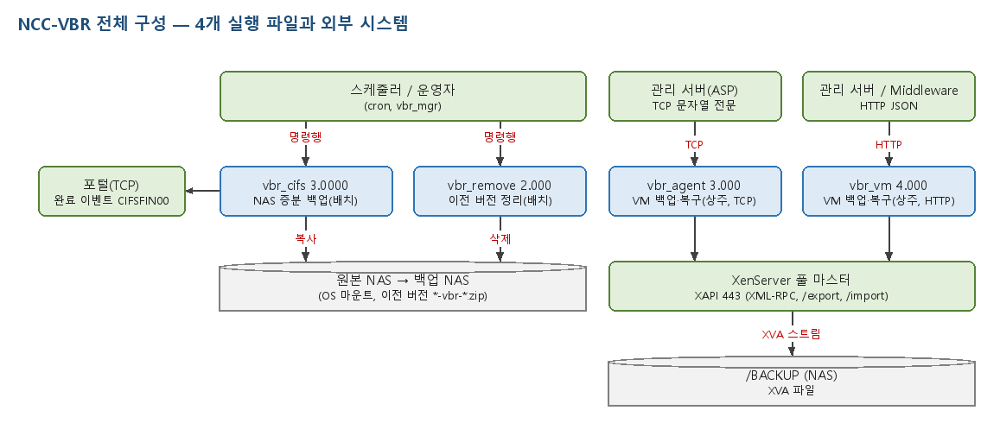
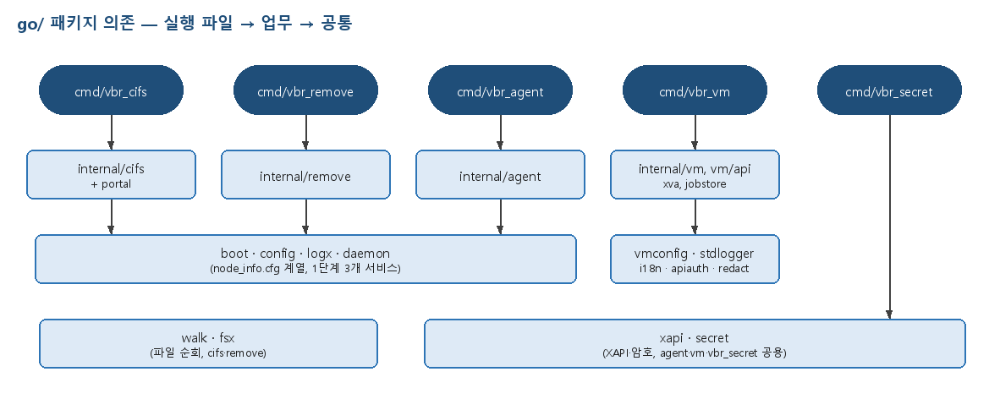

| 구분 | 내용 |
|---|---|
| 저장소 | ncc-vbr-go(GitHub SungKyou/NCC-VBR, main). 기준 커밋 9deb702(2026-11-19) |
| 구성 | Go 모듈 하나(go/, module ncc-vbr)에 실행 파일 5개: vbr_cifs, vbr_remove, vbr_agent, vbr_vm, vbr_secret(도구) |
| Go | go.mod: go 1.26.0, toolchain go1.27.4(보안 권고를 고친 판, 처음 빌드 때 자동 내려받기) |
| 외부 라이브러리 | vbr_vm 계열에서만: gin v1.12.0, viper v1.21.0, fsnotify, lumberjack v2.2.1, klauspost/compress v1.20.3. 1단계 3개 서비스는 표준 라이브러리만 |
| 서비스별 인계서 | 01 CIFS, 02 Remove, 03 Agent, 04 VM(vbr_vm). 이 문서는 서비스에 걸친 공통 내용 |
| 원본 | 저장소 최상위 cifs/, remove/, agent/ 의 C 소스(고치지 않음, 동작 대조용) |

# 1. 전체 구성과 흐름

## 1.1 서비스 4개



| 서비스 | 역할 | 호출 | 상주 | 외부 시스템 |
|---|---|---|---|---|
| vbr_cifs | NAS 디렉터리 증분 백업, 이전 버전 보관 | 스케줄러가 명령행 실행 | 아니오(배치) | 원본 · 백업 NAS(마운트), 포털(TCP) |
| vbr_remove | 보존 기간이 지난 이전 버전 삭제 | 스케줄러가 명령행 실행 | 아니오(배치) | 백업 NAS |
| vbr_agent | VM 백업 · 복구(1단계, 기존 전문) | 관리 서버(ASP)가 TCP 문자열 전문 | 예 | XenServer XAPI, /BACKUP |
| vbr_vm | VM 백업 · 검증 · 복구(2단계, JSON API) | 관리 서버 · Middleware 가 HTTP | 예 | XenServer XAPI, /BACKUP, 결과 보고 주소 |
| vbr_secret | 키링 만들기, 암호 · 토큰 ENC 만들기 | 운영자 | 아니오(도구) | - |

세 서비스(cifs, remove, agent)는 원본 C 를 옮긴 1단계, vbr_vm 은 agent 기능을 NCC-Xen 규약으로 새로 만든 2단계다. 실행 파일과 버전은 따로 두고 따로 운영한다.

## 1.2 패키지 의존



규칙: 실행 파일(cmd) → 업무 패키지 → 공통 패키지 방향으로만 import 한다. 공통 패키지는 업무 패키지를 import 하지 않는다. 외부 라이브러리는 vbr_vm 계열 패키지(vm/api, vmconfig, stdlogger, i18n, xva)에서만 import 하므로 1단계 실행 파일의 의존은 늘지 않는다(docs/common/02-tobe-standard-structure.md 5장).

# 2. 설정 · 키 · 로그 · 암호화

## 2.1 서비스별 적용 범위

| 항목 | vbr_cifs | vbr_remove | vbr_agent | vbr_vm |
|---|---|---|---|---|
| 설정 파일 | node_info.cfg [VBR Manager] | node_info.cfg [File Remove (BATCH) for NCC-VBR] | node_info.cfg [VBR Agent for Xenserver] | sysconfig.yaml |
| 설정 패키지 | config | config | config + agent/config.go | vmconfig(viper) |
| 설정 반영 | 실행마다 | 실행마다 | 기동 때 | 저장 즉시(일부 재기동) |
| 로그 | logx | logx | logx + backup.log + transaction-YYYYMM.log | stdlogger |
| 키 · 암호화 | 없음 | 없음 | secret(XAPI 암호) | secret(XAPI 암호, API 토큰) |
| 상태 저장 | history/*.vbr | delete.log | vbr_agent.state, transaction 로그 | jobs.jsonl, outbox_*.jsonl |
| 공통 기동 | boot | boot | boot | 자체(main.go) |

## 2.2 node_info.cfg (1단계 3개 서비스)

INI 형식 파일 하나에 서비스별 절이 있다. 서비스는 자기 절만 읽고, 읽는 키가 없으면 기본값으로 동작한다(원본과 같음). 키 이름에 공백 · 괄호가 들어간다(예 MAX Thread cnt, WEB server(IP)). 목록 값은 공백으로 나눈다. 해석은 internal/config/config.go. 키별 설명은 각 서비스 인계서 2장과 docs/common/03-config-spec.md.

## 2.3 sysconfig.yaml · key.yaml (vbr_vm)

설명과 사용법은 VM 인계서 2장에 있다. 요점만 적는다.

- sysconfig.yaml 은 viper 로 읽고 저장하면 즉시 반영한다(port, listen, task_store.dir 은 재기동). 잘못 고치면 이전 값을 유지한다.
- **key.yaml 은 이름과 달리 JSON 이다.** {"version", "active_key_id", "keys":{id:{"algorithm","material"}}}. vbr_secret keygen 으로 만들고, Linux 에서는 권한 600.
- 두 파일 모두 비밀이 들어 있어 저장소에 커밋하지 않는다(.gitignore). 양식은 저장소 최상위 sysconfig.example.yaml.

## 2.4 암호화(internal/secret, vbr_secret)

| 항목 | 내용 |
|---|---|
| 알고리즘 | AES-256-GCM. 키 32바이트, 무작위 nonce, 인증 태그 |
| 형식 | ENC[v1:aes-256-gcm:<키 ID>:<payload>] |
| 용도(purpose) | 인증 데이터로 묶인다. 용도가 다르면 복호화 실패 |
| 쓰는 곳 | agent: XAPI Password(ncc-vbr/xapi-password). vm: 요청 password(같은 용도), 토큰 두 개(sysconfig.api_auth.VBR_VM_API_TOKEN, …GATEWAY_INTERNAL_TOKEN) |
| 공개 API | secret.LoadFromFile(키링) → Protector.Encrypt(purpose, 평문) / Decrypt(purpose, ENC) |
| 도구 | vbr_secret keygen <키링>, vbr_secret encrypt <키링> [용도] — 평문은 표준 입력(첫 줄, BOM 제거) |
| 출처 | NCC-Xen stdcrypto 를 복사해 고침(docs/agent/08 CP-10). 키링 형식을 YAML → JSON 으로 바꿈 |

## 2.5 로그

| 패키지 | 쓰는 서비스 | 특징 |
|---|---|---|
| logx | cifs, remove, agent | 원본 형식 그대로. server.log(동작), transaction.log 등. MAX Log size 를 넘으면 <파일>.old 로 바꿈(이전 .old 덮어씀) |
| stdlogger | vbr_vm | Go slog 기반, text/json/custom, stdout/file/both, lumberjack 교체, 설정 즉시 반영, taskId 등 속성. NCC-Xen 에서 그대로 복사 |

두 방식을 섞지 않는다. 1단계 서비스의 로그 형식은 원본 운영 도구 호환 때문에 유지했다(docs/00-process/04-open-decisions.md Q-10).

# 3. 빌드 · 시험 · 도구

## 3.1 빌드

```powershell
cd go
.\build.ps1 all        # vet + linux + windows. 결과 go\bin\<os>-amd64\
.\build.ps1 linux      # 운영 Linux 용만
.\build.ps1 windows    # 개발 PC 용만
.\build.ps1 test       # go vet + go test
```

Linux 에서는 go/build.sh. 정적 빌드(CGO 없음), -trimpath -ldflags "-s -w". 산출물 bin/ 은 커밋하지 않는다. 시험 도구(vm-fakexapi, agent-parity 도구)도 같이 만든다. 배포에는 필요한 실행 파일만 고른다.

## 3.2 시험

| 수준 | 명령 | 내용 |
|---|---|---|
| 정적 검사 | gofmt -l . / go vet ./... / govulncheck ./... | 형식, 정적 분석, 호출되는 취약점 0건 |
| 단위(Windows) | go test -p 1 -count=1 ./... | 2026-11-19: 77 통과 / 4 건너뜀 / 0 실패 |
| 단위(Linux) | go/test/run-linux-tests.sh (WSL) | 76 / 1 / 0. Linux 용 시험 실행 파일은 go test -c 로 bin/linux-test 에 만든다 |
| 원본 비교 | go/test/parity/run.sh(cifs · remove), go/test/agent-parity/run.sh(agent) | Docker(alpine + gcc)로 원본 C 를 컴파일해 같은 입력의 결과를 비교 |
| vbr_vm 데모 | pwsh go/test/vm/demo.ps1 -Auto | 가짜 XAPI 2개 + 실제 vbr_vm, 16개 시나리오 |
| 실기 | docs/00-process/06-windows-test-guide.md | cifs · remove(W-), agent(R0~R9), vbr_vm(I01~I10) |

-p 1 은 시험끼리 포트 · 임시 파일이 부딪치지 않게 순서대로 돌리는 것이다.

## 3.3 문서 도구

| 도구 | 하는 일 |
|---|---|
| tools/spec/build_vm_spec.py | Markdown 원문 → NCC-Xen 서식 Word(표준 명세서, 이 인계서들) |
| tools/handoff/diagrams.py | 인계서 흐름도 PNG(docs/handoff/img) |

# 4. 폴더와 소스 파일

## 4.1 저장소 폴더

| 위치 | 내용 |
|---|---|
| agent/, cifs/, remove/ | 원본 C 소스와 빌드 스크립트(c1). 고치지 않는다 |
| go/ | 전환본 Go 모듈 |
| go/cmd/<실행 파일>/main.go | 실행 파일 시작점 5개 |
| go/internal/ | 업무 · 공통 패키지(아래 4.2) |
| go/test/ | parity(cifs · remove 원본 비교), agent-parity, agent(수동 송신), vm(데모), run-linux-tests.sh |
| go/build.ps1, build.sh | 빌드 스크립트(원본 c1 대체) |
| docs/README.md | 문서 전체 안내(읽는 순서) |
| docs/00-process/ | 전환 절차, 검증 절차, 진행 현황, 결정 대기 목록, 통합 기록, Windows 시험 가이드 |
| docs/common/ | 공통 라이브러리 분석, Go 표준 구조, node_info.cfg 명세 |
| docs/cifs, remove, agent, vm/ | 서비스별 요건 · 분석 · 설계 · 변경 대장 · 인터페이스 · 시험 · 운영(00~09) |
| docs/templates/ | 전환 표준 양식 T01~T11 |
| docs/evidence/ | 시험 실행 출력(판정 근거) |
| docs/handoff/ | 개발 인계서(이 문서들)와 Word 판(word/) |
| tools/ | 문서 생성 도구 |
| node_info.cfg | 개발 환경 설정(1단계 3개 서비스) |
| sysconfig.example.yaml | vbr_vm 개발 환경 설정 양식. 실제 sysconfig.yaml · key.yaml 은 여기 두고 커밋하지 않음 |

## 4.2 go/internal 패키지와 파일

| 패키지 · 파일 | 쓰는 곳 | 역할 |
|---|---|---|
| boot/boot.go | cifs, remove, agent | 공통 기동: 플래그(-config, -home, -foreground, -version), 설정 읽기, 작업 디렉터리, 신호, 백그라운드 분리, 종료 코드 상수(0 · 1 · 2 · 255) |
| config/config.go | cifs, remove, agent | node_info.cfg 절 · 키 해석(문자열 · 정수 · 목록) |
| daemon/daemon*.go | boot | 백그라운드 분리(Unix 는 자식 프로세스로 다시 실행, Windows 처리 별도) |
| logx/logx.go | cifs, remove, agent | 원본 형식 로그와 .old 교체 |
| walk/walk.go | cifs, remove | 루트 · 2단계 분할, 작업자 풀, 재귀 순회, 제외, 카운터 |
| fsx/fsx.go, times_linux · windows · other.go | cifs, remove | 경로 비교, history 파일명 변환, OS 별 파일 시각 |
| portal/portal.go | cifs | 포털 완료 전문과 TCP 송수신 |
| testkit/testkit.go | 시험 | 시험 도우미(로그를 메모리에 모으는 Logger 등) |
| cifs/cifs.go, copier.go | cifs | CIFS 인계서 4장 |
| remove/remove.go | remove | Remove 인계서 4장 |
| agent/*.go (agent, config, frame, registry, worker, xen, transfer, tranlog, steplog) | agent | Agent 인계서 4장 |
| vm/*.go, vm/api, vm/vmtest | vbr_vm | VM 인계서 4장 |
| xva/*.go (common, export, import, verify, zstd, path) | vbr_vm | XVA 전송 · 검증 · 압축 · 경로 규칙(NCC-Xen 복사 CP-VM-05~09) |
| jobstore/store.go, outbox.go | vbr_vm | 작업 기록 JSON Lines, 결과 보고 재시도 · Dead Letter |
| vmconfig/config.go | vbr_vm | sysconfig.yaml, viper 감시, 반영 시점 구분 |
| apiauth/apiauth.go | vbr_vm | X-Internal-Token 미들웨어(CP-VM-02) |
| redact/redact.go | vbr_vm | 비밀 값 가림(CP-VM-03) |
| i18n/i18n.go, catalog_ko · en · ja.go | vbr_vm | 문구 카탈로그(키 44개), locale(CP-VM-10) |
| stdlogger/*.go (api, build, config, handler_custom, init, manager, slog_default, watch) | vbr_vm | 구조화 로그(CP-VM-11, 원본 그대로) |
| xapi/client.go | agent, vbr_vm | XML-RPC 연결, 로그인 · 로그아웃, 풀 마스터 따라가기(HOST_IS_SLAVE), 오류 → XAPIError |
| xapi/xmlrpc.go | agent, vbr_vm | XML-RPC 인코딩 · 디코딩 |
| xapi/vm.go, task.go | agent, vbr_vm | VM 조회 · 속성, task 만들기 · 상태 · 진행률 · 결과 |
| xapi/backup_ops.go | agent, vbr_vm | 스냅샷, VBD · VDI 삭제, UninstallSnapshot, task.cancel, SR 조회 |
| xapi/restore_ops.go | vbr_vm | 복구 뒤 이름 · Home Server(CP-VM-12) |
| secret/*.go (api, config, load, keyring, envelope, algorithm, aes256gcm, errors, filemode_*) | agent, vbr_vm, vbr_secret | 키링 읽기(JSON, 권한 검사), ENC 해석, AES-256-GCM |

## 4.3 실행 파일

| 파일 | 역할 |
|---|---|
| go/cmd/vbr_cifs/main.go | boot.Start → cifs.Run → 종료 코드 |
| go/cmd/vbr_remove/main.go | 보존 일수 검사 → remove.Run → 종료 코드 |
| go/cmd/vbr_agent/main.go | 설정 · 키링 · XAPI 준비 → TCP 수신 |
| go/cmd/vbr_vm/main.go | 설정 · stdlogger · 작업 기록 · 작업자 · outbox · HTTP · 종료 |
| go/cmd/vbr_secret/main.go | keygen, encrypt(용도 목록 밖이면 거부) |

# 5. 소스 이전 시 분석에 도움이 되는 설명

## 5.1 분석 순서(어느 서비스든)

1. docs/README.md 의 읽는 순서 → 서비스별 05(인터페이스) — 밖에서 보이는 계약
2. go/cmd/<서비스>/main.go — 무엇이 어떤 순서로 뜨는가
3. 업무 패키지의 Run(또는 Service) — 흐름
4. I/O 어댑터(walk, xapi, xva, portal) — 외부 시스템과 맞닿는 곳
5. *_test.go — 동작을 예제로 확인
6. 서비스별 04(변경 · 결정 대장) — 원본과 다르게 한 점과 이유

## 5.2 원본과의 관계를 추적하는 법

- 전환본 코드 주석에 원본 함수 · 줄 번호가 적혀 있다(예 "원본 query_task 3464~3481행").
- 의도한 차이는 서비스별 04 문서의 C-…(변경) · D-…(원본 결함) · K-…(유지한 특이 동작) 번호로 관리한다.
- 원본 비교 시험(go/test/parity, agent-parity)이 "같음 / 의도한 차이 / 다름"을 판정한다. 동작을 바꾸면 비교 시험과 04 문서를 함께 고친다.

## 5.3 다른 프로젝트에서 복사한 코드

NCC-Xen(c:\dev\ncc-xen, 기준 커밋 043c6d5)에서 import 하지 않고 복사해 고쳤다. 복사한 파일 첫머리에 "copied from ncc-xen … (CP-…)" 주석이 있다.

| 대장 | 범위 |
|---|---|
| docs/agent/08-copied-code-register.md | xapi(CP-01~04), secret(CP-10) — 1단계 |
| docs/vm/08-copied-code-register.md | vbr_vm 의 apiauth, redact, jobstore 설계, xva, i18n, stdlogger, xapi 추가 함수, demo.ps1, Word 양식(CP-VM-01~14). 원본 사본과 실제 차이는 docs/evidence/vm/copied-original/, copied-code.diff |

NCC-Xen 원본이 바뀌면 대장의 "원본 변경 추적" 표에 반영 여부를 적는다.

## 5.4 결정 대기 항목

docs/00-process/04-open-decisions.md 에 모여 있다. 현재: cifs Q-01~05, remove Q-06~07, 공통 Q-08~11(호출 방식, 버전 번호, 로그 문구, Windows 운영), agent Q-A18~19(관리 서버의 실패 판단, 성공 문장), vbr_vm Q-VM-03(진행률 계산). 전환본은 결정 전까지 "현재 구현" 열대로 동작한다.

## 5.5 다른 언어(Java)로 옮길 때의 공통 대응

| Go 요소 | Java |
|---|---|
| 패키지 internal/<이름> | 패키지 com.namutech.vbr.<이름> |
| goroutine 작업자 + channel 대기열 | ExecutorService + BlockingQueue |
| context 취소 | Future.cancel + 인터럽트, 정리는 finally |
| boot 의 백그라운드 분리 | systemd 서비스로 대체(앞에서 실행) |
| node_info.cfg 해석 | ini4j 등, 키 이름의 공백 · 괄호 주의 |
| logx 형식 | 같은 형식의 Logback 패턴(원본 운영 도구 호환이 필요하면 문구까지 맞춤) |
| secret(AES-256-GCM + AAD) | javax.crypto, 같은 키링(JSON) · ENC 형식이면 상호 호환 |
| 시험 | 원본 비교 시험의 입력 · 기대 결과를 그대로 재사용 |

설계 문서마다 "다른 언어로 다시 옮길 때의 대응" 절이 있다(서비스별 03 문서).

## 5.6 보안 · 운영 주의

- 키 · 암호 · 토큰을 로그 · 문서 · 저장소에 평문으로 남기지 않는다. 평문은 표준 입력으로 vbr_secret 에 넘긴다.
- 시험 풀에서 시험 VM 과 기존 스냅샷을 지우지 않는다. 복구한 VM 은 켜지 않는다(원본과 같은 IP).
- 외부 라이브러리는 출시 30일이 지난 최신 정식 판을 쓰되, 호출되는 보안 취약점이 있으면 그 수정판을 먼저 쓴다(docs/common/02 5장 12번). govulncheck 로 확인한다.
