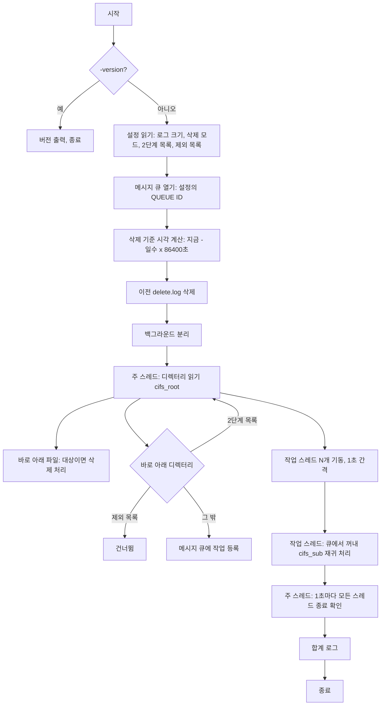
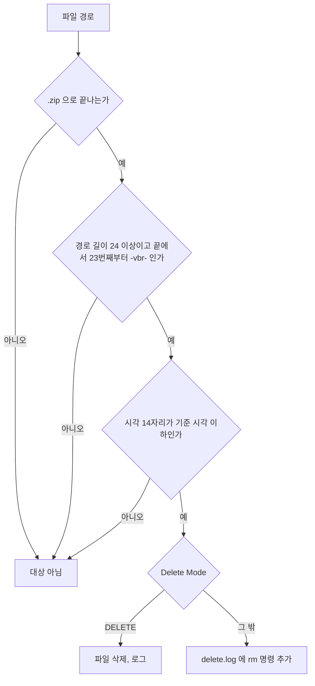

# remove 현행 분석서

기준일: 2026-11-17 / 원본: `remove/vbr_remove.c` 1.000 (721줄), `remove/bs_common.c` (1,506줄), `remove/bs_common.h` (122줄) / 읽은 범위: 전체 / 양식: T02

## 1. 개요

- 하는 일: 디렉터리 아래에서 보존 일수가 지난 이전 버전 파일(`-vbr-시각.zip`)을 찾아 지우거나, 지울 명령을 파일에 적는다.
- 실행 형태: 한 번 실행하고 끝나는 배치. 실행 직후 백그라운드로 분리된다.
- 언어·빌드: C, `cc -g -O -Wall vbr_remove.c bs_common.o -lpthread -D_REENTRANT -lm -lz` (`remove/c1`). 최신 gcc에서는 `-fcommon`이 있어야 링크된다.
- 소스 인코딩: UTF-8
- 변경 이력: 1.000 "한국장학재단 고객사 file 삭제 batch 신규 개발"
- 성립 과정: `vbr_cifs.c`를 복사해 고친 프로그램이다. 함수 이름(`cifs_root`, `cifs_sub`, `cifs_processing`)과 순회 구조가 같고, 쓰지 않는 변수(`backup_time`, 포털 관련 전역, 압축 버퍼)가 남아 있다.

## 2. 구성

| 파일 | 줄 수 | 역할 |
|---|---|---|
| `vbr_remove.c` | 721 | 삭제 본체 |
| `bs_common.c` | 1,506 | 공통 라이브러리. cifs 판과 다른 점은 `BS_Tsyslog2` 대신 `BS_Delete`, `BS_Delete_dir`, `BS_WriteShellQuoted`가 있다는 것뿐이다 |
| `bs_common.h` | 122 | cifs 판에 `DELETE_FILE`, `NO_EXIST`, `SKIP` 정의가 더해졌다 |
| `c1` | 7 | 빌드 스크립트 |

## 3. 실행과 입력·출력

| 구분 | 내용 | 원본 위치 |
|---|---|---|
| 명령행 | `vbr_remove Delete-dir days` | 122 |
| 설정 | `./node_info.cfg`의 `[File Remove (BATCH) for NCC-VBR]`. `MAX Log size`, `Delete Mode`, `2ND SEARCH DIR`, `EXCLUSION DIR`, `QUEUE ID`, `MAX Thread cnt` | 111, 131, 151, 162, 247, 267 |
| 읽는 파일 | 없음(설정 외) | - |
| 쓰는 파일 | `./server.log`, `./delete.log`(LOG 모드) | 182, 496 |
| 지우는 파일 | 대상 조건에 맞는 파일(DELETE 모드), 이전 `./delete.log` | 487, 182 |
| 프로세스 간 통신 | System V 메시지 큐. 키는 설정 `QUEUE ID`. 전용이 아니라 키로 공유되는 큐다 | 247~254 |
| 통신 | 없음 | - |
| 외부 명령 | 없음 | - |
| 종료 코드 | 정상 0, 버전 출력 1(`exit(TRUE)`), 사용법 오류·시작 실패 255 | 105, 127, 236 |

## 4. 처리 흐름

삭제 처리(파일 하나)

## 5. 기능 목록

| 번호 | 기능 | 설명 | 원본 함수(줄) |
|---|---|---|---|
| F-RM-01 | 기동 | 인자 검사, 설정 읽기, 기준 시각 계산, 데몬화, 종료 감시 | `main`(89~241) |
| F-RM-02 | 큐 준비 | 설정 `QUEUE ID`를 키로 메시지 큐를 연다 | `env_initialize`(243~257) |
| F-RM-03 | 작업자 기동 | 스레드 생성과 분리 | `thread_initialize`(259~315) |
| F-RM-04 | 최상위 순회와 작업 등록 | 바로 아래 파일 처리, 제외·2단계 판단, 작업 등록 | `cifs_root`(317~444) |
| F-RM-05 | 작업 처리 | 큐에서 디렉터리를 꺼내 하위 순회를 부름 | `cifs_processing`(502~547) |
| F-RM-06 | 하위 순회 | 한 디렉터리를 끝까지 재귀 처리 | `cifs_sub`(549~618) |
| F-RM-07 | 대상 판단과 삭제 | 이름 규칙과 기준 시각으로 판단, 모드에 따라 삭제 또는 기록 | `file_check`(446~469), `file_delete`(471~500) |
| F-RM-08 | 삭제 기준 시각 | 지금에서 일수를 초로 바꿔 뺀다 | `check_rm_date`(684~722) |
| F-RM-09 | 2단계·제외 목록 설정 | 공백 구분 목록을 배열에 저장. 최대 10개 | `setup_next_dir`(620~650), `setup_exclusion_dir`(652~682) |
| F-RM-10 | 삭제 명령 기록 | `rm -f -- '경로'`를 `delete.log`에 추가 | `BS_Delete`, `BS_WriteShellQuoted` (`bs_common.c` 520~559) |
| F-RM-11 | 설정 읽기, 서버 로그, 데몬화 | cifs와 같다 | `bs_common.c` |

대상 판단 규칙(F-RM-07)을 조건으로 적으면 다음과 같다. 네 조건을 모두 만족해야 대상이다.

1. 경로의 끝 4자가 `.zip`이다.
2. 경로 길이가 24자 이상이다.
3. 끝에서 23번째 자리부터 5자가 `-vbr-`다.
4. 끝에서 18번째 자리부터 14자가 기준 시각 문자열보다 크지 않다(문자열 비교).

파일의 수정 시각은 보지 않는다. 이름에 적힌 시각이 기준이다.

## 6. 자료 구조와 전역 상태

| 이름 | 용도 | 크기·한도 |
|---|---|---|
| `cifs_thread[51]` | 스레드별 상태와 건수(파일, 건너뜀, 디렉터리, 삭제) | 51칸 |
| `next_dir[10][512]`, `exclusion_dir[10][512]` | 2단계 목록, 제외 목록 | 10개 |
| `rm_date_time` | 삭제 기준 시각 문자열 | 14자 |
| `delete_mode` | `'0'` LOG, `'9'` DELETE | |
| `cifs_msg_key`, `cifs_queue_id` | 메시지 큐 키(기본 30001)와 식별자 | |

## 7. 동시 처리

cifs와 같다. 주 스레드 1개와 작업 스레드 최대 50개, 메시지 큐로 작업을 넘기고 전역 배열에 건수를 쌓는다. 잠금은 없다. `delete.log`는 여러 스레드가 잠금 없이 추가한다.

다른 점은 메시지 큐가 전용이 아니라는 것이다. 설정의 키로 열기 때문에 같은 키를 쓰는 다른 프로세스와 큐를 함께 쓴다. 끝날 때 큐를 지우지도 않는다.

## 8. 운영체제·환경 의존

cifs와 같다(System V 메시지 큐, `fork`, `pthread`, `/` 구분자). 시각 비교는 파일 이름만 쓰므로 파일 시각 의존은 없다. `delete.log`의 내용은 POSIX 셸 명령이다.

## 9. 오류 처리

| 상황 | 원본 동작 | 원본 위치 |
|---|---|---|
| 인자 개수 오류 | 사용법 출력, 종료 255 | 122~128 |
| 보존 일수가 숫자가 아님 | 0으로 읽고 진행(D-RM-05) | 180 |
| 설정에 `QUEUE ID` 없음 | 로그만 남기고 진행. 큐를 열지 않는다(D-RM-06) | 247~251, 171 |
| 디렉터리 열기 실패(최상위) | 로그, 종료 255 | 198~202 |
| 디렉터리 열기 실패(하위) | 로그, 건너뜀 | 559~564 |
| 파일 삭제 실패 | `file check error` 로그. 사유는 남기지 않음 | 487~491, 589~593 |
| `delete.log` 열기 실패 | 로그. 삭제 건수에는 포함 | `bs_common.c:546~550` |

## 10. 결함과 특이 동작

[04-change-register.md](04-change-register.md) 1장에 정리했다. 결함 D-RM-01~D-RM-11 (11건), 유지한 특이 동작 K-RM-01~K-RM-04 (4건).

## 11. 사용하지 않는 코드

| 대상 | 판단 근거 |
|---|---|
| `BS_Delete_dir` | 호출하는 곳이 없다. 빈 디렉터리 삭제를 계획했던 흔적으로 보인다 |
| `backup_time`, `backup_start_time`, `lt_today`, `portal_*`, `event_msg`, `BACKUP_INFO`, `EVENT_MSG` | cifs에서 복사된 뒤 쓰이지 않는다 |
| `file_check`의 `tgt_buff`, `bak_filename`, `buffer[640000]`, `zfp` 등 | 선언만 있다 |
| `NO_EXIST`, `SKIP` | 쓰는 곳이 없다 |

## 12. 확인하지 못한 것

| 항목 | 왜 확인하지 못했는가 | 누구에게 확인할 것인가 |
|---|---|---|
| 누가 어떤 주기와 보존 일수로 실행하는가 | 호출하는 쪽의 정보가 없다 | 사용자(Q-08) |
| 운영에서 LOG 모드와 DELETE 모드 중 무엇을 쓰는가 | 개발 설정에 이 섹션이 없다 | 사용자 |
| LOG 모드의 `delete.log`를 누가 언제 실행하는가 | 소스 밖의 절차다 | 사용자 |
| 운영 설정의 `QUEUE ID` 값 | 개발 설정에 이 섹션이 없다. `[VBR Manager]`에는 `QUEUE ID = 30003`이 있다 | 사용자 |
