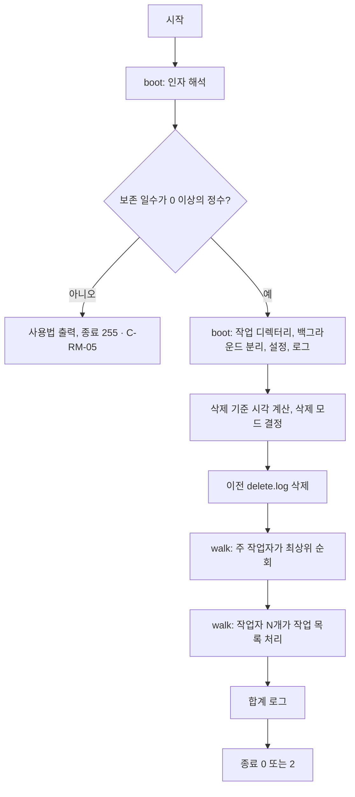

# remove 목표 설계서

기준일: 2026-11-17 / 대상: Go 1.22 이상(개발은 1.26.0), 외부 라이브러리 없음 / 양식: T03

## 1. 설계 방침

- 유지하는 것: 명령행, 설정 키, 삭제 대상 조건, LOG 모드가 기본인 것, `delete.log` 형식, 로그 형식.
- 바꾸는 것: 작업 분배 수단, 데몬화 방식, 보존 일수 검사, 오류 집계.
- 원본이 cifs를 복사해 만든 순회 구조는 다시 복사하지 않는다. cifs와 같은 순회 엔진(`walk`)을 쓰고 파일 하나에 할 일만 따로 둔다.

## 2. 구조

```
go/
├─ cmd/vbr_remove/main.go      시작점. 보존 일수를 검사하고 삭제를 실행한다
└─ internal/
   ├─ boot/, config/, logx/, daemon/, fsx/, walk/    cifs와 함께 쓰는 공통 패키지
   └─ remove/remove.go         삭제 업무 규칙
```

| 패키지 | 책임 |
|---|---|
| `cmd/vbr_remove` | 인자를 넘기고 종료 코드를 정한다 |
| `remove` | 삭제 기준 시각, 대상 판단, 삭제 또는 기록, 합계 |
| `walk` | 순회와 병렬 처리 |

`remove`가 `walk.Visitor`에서 구현하는 것은 `File`뿐이다. `EnterDir`과 `TopDir`은 하는 일이 없다.

## 3. 처리 흐름



보존 일수 검사는 백그라운드로 분리하기 전에 한다(`boot.Spec.Check`). 그래서 잘못된 일수를 주면 호출자가 바로 사용법 출력과 종료 코드 255를 받는다.

## 4. 원본 대응표

| 원본 기능 | 원본 함수 | 전환본 위치 | 처리 | 비고 |
|---|---|---|---|---|
| F-RM-01 기동 | `main` | `boot.Start`, `cmd/vbr_remove/main.go`, `remove.Run` | 구조 변경 | |
| F-RM-02 큐 준비 | `env_initialize` | 없음 | 삭제 | 메시지 큐를 쓰지 않는다. 설정 `QUEUE ID`는 읽지 않는다(C-RM-01) |
| F-RM-03 작업자 기동 | `thread_initialize` | `walk.runWorkers`, `remove.workerCount` | 구조 변경 | |
| F-RM-04 최상위 순회 | `cifs_root` | `walk.scanRoot`, `dispatchDir` | 구조 변경 | cifs와 공유 |
| F-RM-05 작업 처리 | `cifs_processing` | `walk.work` | 구조 변경 | cifs와 공유 |
| F-RM-06 하위 순회 | `cifs_sub` | `walk.walkDir` | 구조 변경 | cifs와 공유 |
| F-RM-07 대상 판단과 삭제 | `file_check`, `file_delete` | `remove.remover.File`, `remove.IsExpiredVersion` | 그대로 | 시각 자리가 숫자인지 추가 확인(C-RM-07) |
| F-RM-08 삭제 기준 시각 | `check_rm_date` | `remove.Run`의 `cutoff` 계산 | 그대로 | |
| F-RM-09 목록 설정 | `setup_next_dir`, `setup_exclusion_dir` | `remove.dirList` | 구조 변경 | 2단계가 동작한다(C-RM-02) |
| F-RM-10 삭제 명령 기록 | `BS_Delete`, `BS_WriteShellQuoted` | `remove.remover.appendDeleteLog`, `remove.shellQuote` | 그대로 | 잠금 추가 |
| F-RM-11 설정·로그·데몬화 | `bs_common.c` | `config`, `logx`, `daemon` | cifs와 같음 | |
| 사용하지 않는 코드 | `BS_Delete_dir` 등 | 없음 | 삭제 | 현행 분석서 11장 |

## 5. 운영체제·환경 의존 처리

| 원본 의존 | 전환본 처리 | Linux | Windows |
|---|---|---|---|
| System V 메시지 큐 | `walk`의 작업 목록 | 같음 | 같음 |
| `fork` 데몬화 | `daemon.Detach` | 새 세션의 자식 | 콘솔에서 분리된 자식 |
| `delete.log`의 셸 명령 | 같은 형식으로 쓴다 | 셸로 실행 가능 | 검토용 목록으로만 쓸 수 있다. Windows 셸에서는 실행되지 않는다(C-RM-14) |
| 경로 비교 | `fsx.SamePath` | 문자열(끝 구분자 무시) | 대소문자 무시 |

## 6. 동시 처리 설계

cifs와 같다. 더한 것은 `delete.log` 쓰기의 잠금이다. 한 줄을 쓰는 동안 다른 작업자가 끼어들지 않는다.

## 7. 오류 처리와 종료 코드

| 상황 | 처리 | 종료 코드 |
|---|---|---|
| 버전 출력 | 출력 후 종료 | 0 (원본은 1) |
| 인자 개수 오류, 보존 일수 오류 | 사용법 출력, 로그 | 255 |
| 디렉터리 열기 실패(최상위) | 로그 | 1(자식) |
| 일부 파일 삭제 실패, `delete.log` 쓰기 실패 | 사유와 함께 로그, 오류 건수 증가, 계속 | 2(자식) |
| 종료 신호 | 하던 파일까지 처리하고 중단 | 1(자식) |
| 정상 | | 0 |

## 8. 설정·파일

[05-interface-spec.md](05-interface-spec.md)에 있다.

## 9. Java로 다시 옮길 때의 대응

cifs와 같다([cifs/03-tobe-design.md](../cifs/03-tobe-design.md) 9장). 이 서비스에만 해당하는 것은 없다. 대상 판단은 문자열 규칙뿐이라 어느 언어에서나 같은 표로 시험할 수 있다(`remove_test.go`의 `TestIsExpiredVersion` 표).

## 10. 설계에서 미룬 것

| 항목 | 이유 | 다시 볼 시점 |
|---|---|---|
| 빈 디렉터리 삭제 | 원본에 함수(`BS_Delete_dir`)만 있고 쓰이지 않는다. 요건인지 알 수 없다 | 사용자 확인 뒤 |
| Windows용 삭제 명령 형식(`del`) | Windows 운영 계획이 정해지지 않았다 | Q-11 결정 뒤 |
| DELETE 모드에서도 지운 목록을 파일로 남기기 | 원본은 `server.log`에만 남긴다 | 운영자 요청이 있을 때 |
