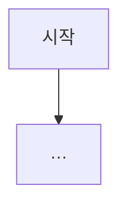

# T02 현행(As-Is) 분석서 양식

> 작성 시점: 1단계. 원본 소스를 처음부터 끝까지 읽고 쓴다.
> 모든 서술에 원본 위치(파일:줄)를 단다. 소스로 확인하지 못한 내용은 "추정"이라고 적는다.

# <서비스명> 현행 분석서

기준일: <YYYY-MM-DD> / 원본: <파일, 버전, 줄 수> / 읽은 범위: <전체 | 일부(범위와 이유)>

## 1. 개요

- 하는 일: <두세 문장>
- 실행 형태: <한 번 실행하고 끝나는 배치 | 상주 데몬>
- 언어·빌드: <컴파일러, 옵션, 링크 라이브러리>
- 변경 이력: <소스 주석의 버전 이력 요약>

## 2. 구성

| 파일 | 줄 수 | 역할 |
|---|---|---|
| <파일> | <n> | <역할> |

## 3. 실행과 입력·출력

| 구분 | 내용 | 원본 위치 |
|---|---|---|
| 명령행 | <형식, 인자의 뜻> | |
| 설정 | <읽는 섹션과 키, 기본값> | |
| 읽는 파일 | <경로, 형식> | |
| 쓰는 파일 | <경로, 형식, 교체 규칙> | |
| 통신 | <상대, 방향, 전문> | |
| 외부 명령 | <실행하는 명령> | |
| 종료 코드 | <값과 뜻> | |

## 4. 처리 흐름

전체 흐름을 그림으로 그린다(mermaid). 그 아래에 단계별 설명을 번호로 적는다.

## 5. 기능 목록

원본의 모든 함수가 어느 기능에 속하는지 적는다.

| 번호 | 기능 | 설명 | 원본 함수(줄) |
|---|---|---|---|
| F-<서비스>-01 | <이름> | <동작 규칙을 구체적으로> | <함수(줄)> |

## 6. 자료 구조와 전역 상태

| 이름 | 종류 | 용도 | 크기·한도 |
|---|---|---|---|
| <구조체·전역 변수> | | | |

## 7. 동시 처리

- 스레드·프로세스 구성: <개수, 역할>
- 주고받는 수단: <메시지 큐, 공유 메모리, 전역 변수>
- 잠금: <있음/없음, 대상>

## 8. 운영체제·환경 의존

| 항목 | 쓰는 곳 | 다른 운영체제에서의 대안 |
|---|---|---|
| <예: System V 메시지 큐> | <함수> | <대안> |

## 9. 오류 처리

| 상황 | 원본 동작 | 원본 위치 |
|---|---|---|
| <예: 대상 파일 열기 실패> | <로그 후 계속 / 종료> | |

## 10. 결함과 특이 동작

읽으면서 찾은 것을 모두 적는다. 변경·결함 대장(T04)으로 옮긴다.

| 번호 | 내용 | 영향 | 원본 위치 | 확인 수준(정적 확인/실행 확인) |
|---|---|---|---|---|
| D-<서비스>-01 | | | | |

## 11. 사용하지 않는 코드

| 대상 | 판단 근거 |
|---|---|
| <함수·변수> | <호출하는 곳 없음 등> |

## 12. 확인하지 못한 것

| 항목 | 왜 확인하지 못했는가 | 누구에게 확인할 것인가 |
|---|---|---|

## 점검표

분석을 끝내기 전에 확인한다.

- [ ] 명령행 인자와 인자 개수가 틀렸을 때의 동작
- [ ] 읽는 설정 키 전부와 키가 없을 때의 기본값
- [ ] 읽고 쓰는 파일 전부(로그, 이력, 임시 파일)와 상대 경로의 기준 디렉터리
- [ ] 통신 전문의 필드 길이와 문자 인코딩
- [ ] 실행하는 외부 명령과 그 출력에서 읽는 부분
- [ ] 스레드·프로세스 사이에 주고받는 자료와 잠금
- [ ] 고정 크기 버퍼와 개수 한도
- [ ] 반환값을 확인하지 않는 호출
- [ ] 시각을 다루는 곳(시간대, 초 단위 비교)
- [ ] 지우거나 덮어쓰는 동작의 대상 조건
- [ ] 소스 주석의 변경 이력과 실제 소스가 맞는지
- [ ] 소스 파일의 문자 인코딩
