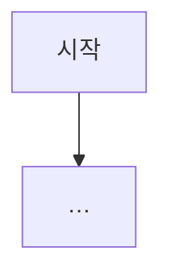

# T03 목표(To-Be) 설계서 양식

> 작성 시점: 3단계. 근거: 요건 정의서(T01), 현행 분석서(T02), 표준 구조 문서.
> 구현하면서 달라진 부분은 구현 뒤에 이 문서를 고친다.

# <서비스명> 목표 설계서

기준일: <YYYY-MM-DD> / 대상 언어·버전: <…>

## 1. 설계 방침

- 유지하는 것: <밖에서 보이는 동작>
- 바꾸는 것: <구조, 프로세스 간 통신, 오류 처리>
- 따르는 표준: <표준 구조 문서 위치>

## 2. 구조

```
<폴더와 패키지 그림>
```

| 패키지·모듈 | 책임 | 의존하는 것 |
|---|---|---|
| <이름> | <한 가지 책임> | <패키지> |

## 3. 처리 흐름



현행 흐름(T02 4장)과 달라진 단계는 표시하고 변경 번호(C-…)를 단다.

## 4. 원본 대응표

현행 기능 목록(T02 5장)의 모든 항목이 여기 있어야 한다.

| 원본 기능 | 원본 함수 | 전환본 위치 | 처리(그대로/구조 변경/대체/삭제) | 비고 |
|---|---|---|---|---|
| F-<서비스>-01 | <함수> | <패키지.함수> | | |

## 5. 운영체제·환경 의존 처리

| 원본 의존 | 전환본 처리 | 운영체제별 차이 |
|---|---|---|
| <예: fork 데몬화> | <자식 프로세스 재실행> | <Linux, Windows 각각> |

## 6. 동시 처리 설계

- 작업 단위: <무엇을 나눠 처리하는가>
- 작업자 수: <결정 방법>
- 공유 자료와 보호 방법: <…>
- 중단 처리: <신호를 받았을 때>

## 7. 오류 처리와 종료 코드

| 상황 | 처리 | 로그 | 종료 코드 |
|---|---|---|---|

## 8. 설정·파일·전문

인터페이스 명세(T05)를 가리키고, 설계에서 정한 것만 적는다.

## 9. 다른 언어로 다시 옮길 때의 대응

| 이 설계의 요소 | <다음 대상 언어>의 대응 |
|---|---|

## 10. 설계에서 미룬 것

| 항목 | 이유 | 다시 볼 시점 |
|---|---|---|
