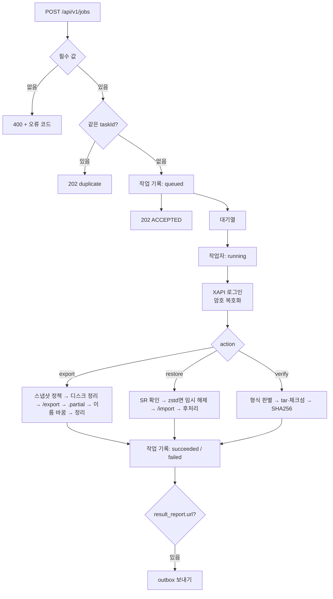

# vbr_vm 목표 설계서

기준일: 2026-11-19 / 대상: Go(같은 모듈 `go/`, 판은 DEC-VM-16·18) / 상태: **구현 반영(2026-11-19)** / 근거: [01](01-requirements.md), [02](02-baseline-reference-analysis.md), [05](05-interface-spec.md), 표준 구조 10장

## 1. 설계 방침

- 유지하는 것: 외부 시스템에 일어나는 일(01 6장). 1단계 실기에서 확인한 XAPI 호출 순서(스냅샷 → 디스크 정리 → `/export` → 스냅샷 VDI·VM 삭제, `/import` → 템플릿 후처리).
- 바꾸는 것: 요청·응답(JSON), 작업 상태 기록, 설정(YAML, 즉시 반영), 로그(stdlogger), 처리 중 취소.
- 따르는 표준: [표준 구조](../common/02-tobe-standard-structure.md) 1~8장, 10장(HTTP API 서비스). 참조 규약 ncc-xen v3.36.
- 기존 `go/internal/agent`는 고치지 않는다. 같이 쓰는 것은 공통 패키지(`xapi`, `secret`)뿐이다.

## 2. 구조

```
go/
├─ cmd/vbr_vm/main.go                기동·종료 조립
└─ internal/
   ├─ vm/                            업무: 요청 검사, 작업 실행 순서, 상태 전이
   │  ├─ request.go                  요청 구조체·필수 값 검사(CP-VM-01 일부)
   │  ├─ service.go, run.go          작업자 풀, 대기열, 취소, 종료 / 실행·진행률·결과 기록
   │  ├─ export.go                   백업(스냅샷 정책, 디스크 선택, 정리)
   │  ├─ restore.go                  복구(zstd 해제, 후처리)
   │  ├─ verify.go                   검증 호출
   │  └─ errors.go                   오류 코드(05 9장)
   ├─ vm/api/                        gin 처리기: JSON ↔ 업무 호출
   ├─ xva/                           XVA 전송·검증(CP-VM-05~09): export 스트림, import 업로드, verify, zstd
   ├─ jobstore/                      작업 기록(JSON Lines) + 결과 보고 outbox(CP-VM-04 일부)
   ├─ apiauth/                       토큰 미들웨어(CP-VM-02)
   ├─ redact/                        비밀 값 가림(CP-VM-03)
   ├─ i18n/                          문구 카탈로그 ko/en/ja + locale 즉시 반영(CP-VM-10)
   ├─ stdlogger/                     구조화 로그(CP-VM-11)
   ├─ vmconfig/                      sysconfig.yaml 구조체, viper 감시, 반영 시점 구분
   ├─ xapi/                          (1단계, 함수 추가 CP-VM-12)
   └─ secret/                        (1단계 CP-10 그대로)
test/vm/demo.ps1, demo_modules/      데모·시험(CP-VM-13)
internal/vm/vmtest                   가짜 XAPI(단위 시험), test/vm/fakexapi 가 데모 자동 모드용으로 띄운다
```

| 패키지 | 책임 | 의존 |
|---|---|---|
| `cmd/vbr_vm` | 설정 읽기, 로그·i18n 시작, 저장소 열기, 재기동 복구, 작업자 시작, HTTP 서버, 종료 신호 | 아래 전부 |
| `vm` | 상태 전이와 실행 순서. HTTP·gin을 모른다 | `xva`, `xapi`, `secret`, `jobstore`, `i18n` |
| `vm/api` | 처리기. 바인딩, 오류 코드 → HTTP 상태 | `vm`, gin |
| `xva` | 바이트 전송과 XVA 형식. 상태 전이를 모른다 | `xapi`, klauspost/zstd |
| `jobstore` | 기록 쓰기·읽기·정리, outbox. 업무를 모른다 | 표준 라이브러리 |
| `vmconfig` | 설정과 변경 알림 | viper |
| `stdlogger`, `i18n` | 로그, 문구 | viper, fsnotify, lumberjack |

의존 방향: `cmd → vm/api → vm → (xva, jobstore, xapi, secret)`. 공통 패키지는 `vm`을 import하지 않는다. 외부 라이브러리는 `vm/api`(gin), `vmconfig`·`stdlogger`·`i18n`(viper 등), `xva`(zstd)에서만 import한다(표준 구조 5장 2번 예외, DEC-VM-16). 기존 3개 서비스가 이 패키지들을 import하지 않으므로 그 실행 파일의 의존은 늘지 않는다.

## 3. 처리 흐름



export의 스냅샷 정책(기본 `auto`, 2026-11-19 사용자 결정 Q-VM-01)

| 조건 | `auto`(기본) | `always` |
|---|---|---|
| `disks` 지정 | 임시 스냅샷(디스크를 지워야 해서) | 임시 스냅샷 |
| targetUUID가 스냅샷 | 그대로 내보냄 | 그대로 내보냄 |
| Running | 임시 스냅샷 | 임시 스냅샷 |
| Halted·Suspended | 그대로 내보냄(ncc-xen) | 임시 스냅샷(기존) |

## 4. 기존 대응표

| 기존 기능 | 기존 위치 | 새 위치 | 처리 | 비고 |
|---|---|---|---|---|
| F-VM-01 전체 백업 | `agent/xen.go Backup`, `transfer.go export` | `vm/export.go`, `xva` | 구조 변경 | ncc-xen 최신 export(CP-VM-05)로 다시 복사 |
| F-VM-02 부분 백업 | `agent/xen.go partialRemove` | `vm/export.go` | 옮김 | 입력을 디스크 번호 목록으로 |
| F-VM-03 복구 | `agent/transfer.go importFile` | `vm/restore.go`, `xva` | 구조 변경 | allowed_operations 재계산, zstd 해제 추가 |
| F-VM-04 결과 조회 | `agent/tranlog.go` | `jobstore`, API-VM-02·03 | 대체 | |
| F-VM-05·06 취소 | `agent.go cancel` | `vm/runner.go`, API-VM-04·05 | 대체 | 처리 중 취소 추가 |
| F-VM-07 대기열·작업자 | `agent/registry.go` | `vm/runner.go` | 구조 변경 | 우선순위 삭제 |
| F-VM-08 재기동 복구 | `agent/registry.go Restore` | `jobstore` 재기동 처리 | 대체 | 전부 `interrupted` |
| F-VM-09 접속 허용 주소 | `agent` Allow Client | `apiauth` | 대체 | |
| F-VM-10 경로 제한 | `agent/config.go insideRoots` | `xva` 경로 규칙(CP-VM-09) | 대체 | sandbox_mode |

## 5. 운영체제·환경 의존 처리

| 의존 | 처리 | 운영체제별 차이 |
|---|---|---|
| 서비스 실행 | 앞에서 실행. Linux는 systemd, Windows는 시험용 콘솔 | 백그라운드 분리 없음(DEC-VM-24) |
| 파일 이름 바꾸기 | `.partial` → 완성본은 같은 디렉터리 안 `os.Rename` | Windows는 대상이 있으면 실패하므로 `overwrite`면 먼저 지운다 |
| 작업 기록 압축 | 임시 파일 + `os.Rename`(ncc-xen과 같음) | 같음 |
| 키링 권한 | 1단계 `secret`과 같음(Linux 600) | Windows는 검사 안 함 |
| 설정 감시 | fsnotify | 편집기가 파일을 바꿔치기해도 디렉터리를 감시하므로 잡힌다(viper 동작) |

## 6. 동시 처리 설계

- 작업 단위: 요청 하나.
- 작업자: `concurrency.max_jobs`개 고루틴. 설정이 바뀌면 작업자 수를 맞춘다(늘리면 바로 띄우고, 줄이면 남는 작업자는 지금 작업을 끝낸 뒤 멈춘다).
- 대기열: 접수 순서. 우선순위 없음. 크기 `max_queue`, 넘치면 503.
- 공유 자료: 작업 표(taskId → 상태)는 `jobstore` 안의 잠금 하나로 보호한다. 같은 taskId 중복 검사와 접수 기록을 같은 잠금 안에서 한다(ncc-xen v3.36 동시 중복 수정과 같은 이유).
- 같은 VM 동시 작업: 막지 않는다(실기 E-03, 기존과 같음).
- 취소: 작업마다 `context.Context`. 취소하면 진행 중인 HTTP 스트림을 끊고 XAPI `task.cancel`을 부른 뒤 정리 단계(임시 스냅샷 삭제, `.partial`·임시 해제 파일 삭제)를 **취소와 무관한 새 context**로 실행한다(시간 제한 2분).
- 종료 신호: 새 접수를 503으로 막고, 처리 중 작업을 취소 경로로 정리한 뒤 `interrupted`로 기록하고 끝낸다(최대 30초 기다림). 정리하지 못한 것은 작업 결과 `snapshot_left`에 남는다.

## 7. 오류 처리

| 상황 | 처리 | 로그 | 작업 상태 |
|---|---|---|---|
| 필수 값 없음 | 400, 기록하지 않음 | warn(taskId 있으면 포함) | - |
| 암호 복호화 실패 | 작업 시작 때 | error | failed `CREDENTIAL_DECRYPT_FAILED` |
| XAPI 오류 | 원문을 `detail`에 | error | failed `XAPI_*` |
| 임시 스냅샷 삭제 실패 | 결과는 그대로, `snapshot_cleanup_failed`·`snapshot_cleanup_error` | warn | 원래 결과 유지(ncc-xen과 같음) |
| 템플릿 후처리 실패 | `is_a_template_fix_error` 등 | warn | succeeded 유지(ncc-xen과 같음) |
| 작업 기록 쓰기 실패 | 접수 단계면 500(`STORE_ERROR`) — 기록 없이 202를 주지 않는다. 처리 단계면 로그만 남기고 메모리 상태는 갱신 | error | - |
| 결과 보고 실패 | outbox 재시도 → Dead Letter | warn | 작업 상태와 무관 |
## 8. 설정·파일·전문

[05](05-interface-spec.md) 8~10장. 설계에서 정한 것만 적는다.

- 요청 속 암호의 복호화 용도 문자열은 1단계와 같은 `ncc-vbr/xapi-password`다. 그래서 1단계 `vbr_secret encrypt`로 만든 값을 그대로 쓸 수 있다. 토큰은 ncc-xen처럼 용도 `sysconfig.api_auth.VBR_VM_API_TOKEN`, `sysconfig.api_auth.GATEWAY_INTERNAL_TOKEN`.
- 설정 읽기는 viper 하나로 한다. `vmconfig.Store`가 현재 설정을 원자적으로 바꿔 끼우고(`atomic.Pointer`), 바뀐 키의 종류(즉시 / 새 작업부터 / 재기동)를 보고 구독자(작업자 수, 로그, locale, 인증)에 알린다. 작업은 시작할 때 설정 사본을 받아 끝까지 쓴다.

## 9. 다른 언어로 다시 옮길 때의 대응

| 이 설계의 요소 | Java |
|---|---|
| gin 처리기 | Spring MVC 컨트롤러 |
| 작업자 풀 + context 취소 | `ExecutorService` + `Future.cancel` + 정리 블록 |
| JSON Lines 작업 기록 | 같은 파일 형식(언어 무관) |
| viper 즉시 반영 | Spring Cloud Config 또는 `WatchService` |
| 05 명세 | 그대로 |

## 10. 작업 상태 모델

| 상태 | 뜻 | 들어오는 조건 | 나가는 전이 | 기록 |
|---|---|---|---|---|
| `queued` | 접수, 대기 | 접수 | running, canceled, interrupted | 접수 때(202 전) |
| `running` | 처리 중 | 작업자가 꺼냄 | succeeded, failed, canceled, interrupted | 시작 때, 단계가 바뀔 때, 진행률(`progress_interval_sec`마다) |
| `succeeded` | 성공 | 처리 끝 | - | 끝날 때 |
| `failed` | 실패 | 오류, 시간 초과 | - | 끝날 때 |
| `canceled` | 취소 | 취소 API | - | 정리 끝난 뒤 |
| `interrupted` | 중단 | 종료 신호, 재기동 때 끝나지 않은 기록 발견 | - | 종료 때 또는 재기동 때 |

- 멱등성: 같은 taskId면 상태와 무관하게(끝난 것도) 다시 실행하지 않는다. 보관 기간이 지나 지워진 taskId는 새 작업으로 받는다.
- 재기동: 기록을 읽어 `queued`·`running`을 `interrupted`로 바꾼다. 결과 보고가 켜져 있으면 failure로 알린다(ncc-xen과 같음). 자동 재개는 하지 않는다(DEC-VM-22).
- 기록 파일(`task_store.dir`)

| 파일 | 내용 | 정리 |
|---|---|---|
| `jobs.jsonl` | 상태가 바뀔 때마다 한 줄(`taskId`, `status`, `step`, `percent`, 시각, 결과·오류). 진행률 줄은 마지막 것만 의미가 있다 | 기동 때와 1시간마다 압축: taskId마다 마지막 줄만 남기고, 끝난 지 `retention_days`가 지난 것은 뺀다. 임시 파일 + rename |
| `outbox_pending.jsonl`, `outbox_delivered.jsonl`, `outbox_deadletter.jsonl` | 결과 보고(ncc-xen 형식 그대로) | ncc-xen과 같음(대기 비면 delivered 비움, Dead Letter는 보관 기간) |

- 진행률 줄 때문에 파일이 커지지 않도록, 같은 작업의 진행률은 `progress_interval_sec`보다 자주 쓰지 않고 1% 넘게 바뀐 때만 쓴다. 2.6 GB 백업 하나(약 4분 30초)는 진행률 줄 최대 54줄이다.
- 기동 때 읽기는 줄 단위로 하고 taskId마다 마지막 상태만 메모리에 둔다(ncc-xen 2026-09-29 "전체 파싱으로 메모리 급증" 사례를 피한다).

## 11. 보안

| 대상 | 방식 | 시험용 스위치 | 운영 기본 |
|---|---|---|---|
| 호출자 인증 | `X-Internal-Token`, 비교는 상수 시간(`subtle.ConstantTimeCompare`) | `api_auth.enabled=false` | 켬 |
| 요청 속 XAPI 암호 | `ENC[v1:aes-256-gcm:…]`, 키링 `key.yaml` | `crypto.enabled=false`(평문 허용) | 켬 |
| 설정 속 토큰 | 같음 | 같음 | 켬 |
| 로그·작업 기록·조회 응답·결과 보고 | 가림(`password`, `token`, `X-Internal-Token` 등 키 이름 기준, CP-VM-03). 스위치 없음 | 없음 | 항상 |
| 기동 경고 | 스위치가 꺼져 있으면 기동 때와 설정이 바뀔 때마다 warn | - | - |

복호화한 암호는 XAPI 로그인 호출에만 쓰고 작업 구조체에 남기지 않는다(로그인 뒤 버린다).

## 12. 관측

| 대상 | 형식 | 위치 | 교체 |
|---|---|---|---|
| 동작 로그 | stdlogger custom 형식 `[{time}][{level}] {msg} {attrs}`, 작업 로그에는 `taskId`, `action`, `targetUUID` 속성 | `logging.file_name`, 표준 출력 | lumberjack(`max_size_mb` 등) |
| 작업 기록 | JSON Lines | `task_store.dir` | 10장 |
| 상태 | `/health` | - | - |

운영자는 `GET /api/v1/jobs?status=running,queued`로 지금 무엇이 어디까지 됐는지 본다.

## 13. 국제화

- `locale`: ko(기본), en, ja. 즉시 반영. 모르는 값은 ko.
- 문구를 두는 곳: `internal/i18n/catalog_ko.go`, `catalog_en.go`, `catalog_ja.go`. 키 이름은 `vm.<영역>.<번호>`.
- 문구가 없는 키: ko 문구, 그것도 없으면 키 이름.
- 번역하지 않는 것: `error.detail`(XAPI 원문), 오류 코드, 중복 taskId 문장(ncc-xen과 같은 고정 문장).
- 일본어는 네이티브 검수 전(ncc-xen과 같은 상태)이라고 운영 안내에 적는다.

## 14. 설계에서 미룬 것

| 항목 | 이유 | 다시 볼 시점 |
|---|---|---|
| 남은 임시 스냅샷 자동 정리 | 기존과 같이 범위 밖(Q-A17) | 운영에서 필요하다고 할 때 |
| HTTPS 수신 | DEC-VM-14 | middle 연동 때 |
| OVF/OVA | 범위 밖 | 요청이 있을 때 |
| XAPI 세션 재사용 | 작업마다 로그인으로 충분(01 5장 5번) | 동시 작업을 크게 늘릴 때 |
